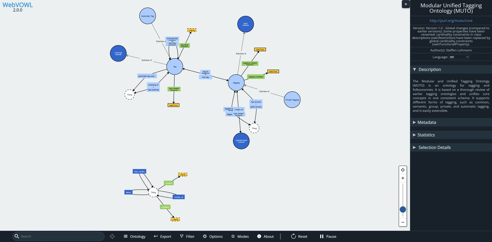

# WebVOWL

**Explore ontologies as interactive graphs.**
WebVOWL visualizes classes, properties, and relationships using the Visual Notation for OWL (VOWL).
Load an ontology, inspect its structure, and export a figure for a paper, lecture, or discussion.

**[Open WebVOWL](https://haddenindustries.com/webvowl/)** · [Work with an agent](#work-with-an-agent) · [Run locally](#run-locally) · [Get help](#help-and-contributing)



*The bundled MUTO example in the hosted application.*

## Try it

1. Open **Ontology** and choose an example, upload a file, or enter an ontology URL.
2. Search for a class or property, select it to inspect its details, and use **Filter** and zoom to explore the graph.
3. Use **Export** to save SVG for a figure or VOWL JSON for reopening the visualization.
   Turtle and LaTeX exports are also available, marked **alpha**.

> [!TIP]
> If a remote ontology cannot load because its host blocks browser requests (CORS), download the file and upload it through **Ontology**.

## Why JavaScript?

This Hadden Industries continuation moves ontology ingestion and VOWL conversion into the browser, using the JavaScript [owlapi](https://github.com/Hadden-Industries/owlapi) library.
The application can therefore run on **purely static hosting**: a university ontologist can publish it on an existing static website without asking IT to provision and maintain a dedicated Java backend.

No Java conversion service, Docker, or server-side Node.js process is required to serve the built application.
Local files are parsed in the browser; URL loading still depends on the source host's access rules.

## Work with an agent

WebVOWL exposes **16 structured tools** through [WebMCP](https://developer.chrome.com/docs/ai/webmcp), letting a compatible browser agent load, summarize, search, reveal temporary neighbourhoods, inspect, frame, arrange, and export the same graph you see.
Human controls and agent tools share the same application operations, so you can continue exploring the result yourself.

Ask your agent to:

- “Open FOAF, find Person, and explain its declared relationships.”
- “Hide datatypes, focus on the classes we discussed, and prepare an SVG for my lecture.”
- “Inspect this ontology's classes and properties, then show me the relevant part of the graph.”

This can shorten the path from an unfamiliar ontology to a useful explanation or figure by combining exploration and presentation steps in one request.
Ontology editing remains human-only.

> [!NOTE]
> WebMCP is experimental and requires a compatible browser and agent client.
> Open WebVOWL as a top-level page; embedded iframes do not register tools.
> Ordinary browsing needs no agent.
> Exports are downloaded from the page; attaching them to a conversation depends on the client.

See [WebMCP usage and limits](docs/webmcp.md) and the [recorded browser qualification](docs/evaluations/2026-09-10-webmcp-completion.md).

## Run locally

Use the runtime selections for this checkout before running setup.

| Runtime | Local requirement                                                              |
| ------- | ------------------------------------------------------------------------------ |
| Node.js | Use a version supported by npm and the locked dependencies.                    |
| npm     | Meet the minimum in [package.json](package.json).                              |
| Python  | Use a stable version at least as recent as [.python-version](.python-version). |

Run `node util/runtimeTargets.mjs` to display the current selections.
Use [`.node-version`](.node-version) to reproduce the exact Node version used by CI.
CI uses the npm and Python minimums as its exact reference versions.
The npm minimum is declared once in `devEngines.packageManager`; [runtime selection](util/runtimeTargets.mjs) derives the CI pin from it.
Local Node eligibility follows the installed npm and locked dependencies, independently of the exact CI Node reference.
See [CI runtime selection](docs/continuous-integration.md#select-the-runtimes) to reproduce the checks.

From the repository root, install the development dependencies and start the server.

```sh
npm run setup:development
npm run dev
```

Open the URL printed by the development server.
Setup installs the root npm lock with lifecycle scripts disabled, including both quality packages.
It prepares `.venv` from the [hashed Python lock](requirements.lock.txt), builds PyYAML from source, and runs `pip check`.
Setup reuses a usable environment and leaves agent configuration inactive.

### Choose a check

| Task                                     | Command                              |
| ---------------------------------------- | ------------------------------------ |
| Run the complete local check             | `npm run check`                      |
| Run the Jest suite                       | `npm test -- --runInBand`            |
| Check Python formatting, lint and setup  | `npm run check:python`               |
| Check authored Markdown                  | `npm run check:docs`                 |
| Check owned JSON                         | `npm run check:json`                 |
| Verify bundled corpus bytes and locators | `npm run check:corpus-storage`       |
| Build or preview the application         | `npm run build` or `npm run preview` |

The complete check and full Jest suite require the [sibling ontology corpus](#test-corpus).
The complete check validates source and corpus storage, runs the tests, then builds the application and verifies generated JSON and bundled paths.
`npm run format:check` checks formatting without writing.
`npm run lint` runs application and Python lint, then checks Markdown and JSON.
`npm run build` runs application formatting and lint checks before Vite writes to `deploy/`.
`npm run build:bundle` invokes Vite directly.

Use the [CI and quality check guide](docs/continuous-integration.md) to inspect scope, preview formatting, or run the same post-build JSON check as CI.
For opt-in dependency views and affected Jest feedback, see [Dependency graphs and affected Jest tests](docs/dependency-graph-and-tests.md).

### JSON quality and producer ownership

Use `npm run check:json` for a human-readable report, or `npm run --silent inspect:json` to stream version-5 NDJSON.
Both commands check the complete owned scope, including bundled JSON.
The final `execution-terminal` reports the repository result.

Use `npm run format:json` to repair eligible JSON presentation.
Normalize specific writable files with `npm run normalize:json -- -- path/to/source.json`.
Both scripts write eligible files.
Repair protected outputs through their owning source or producer.

The [JSON policy](.json-quality.json) records write protection, narrow NFC exemptions, and expected diagnostics for conformance fixtures.
Keep general JSON checks separate from corpus storage and VOWL domain validation.
For comparisons of controller state, view signatures, or archived byte views, see [Graph data comparisons](docs/rendering-performance-follow-up-results.md#compare-graph-data).

### Select and verify the OwlAPI dependency

Application and VOWL consumers use the `owlapi` import name.
Set `dependencies.owlapi` in the root [package.json](package.json) to `npm:PACKAGE_NAME@EXACT_VERSION` for a registry package, or `git+https://github.com/Hadden-Industries/owlapi.git#FULL_40_CHARACTER_COMMIT` for a Git source.
The root override and private VOWL workspace inherit that selection.

Regenerate the root lock, then run `npm ci --ignore-scripts` and the consumer checks.
See [OwlAPI dependency selection](docs/owlapi-git-adoption.md) for payload verification and lock maintenance.

### Update the Python lock

The [development requirements](requirements-dev.txt) set minimum versions.
Setup and CI install exact versions from the [hashed lock](requirements.lock.txt).
Run the resolver from the repository's `.venv`.

```sh
node util/runRepositoryPython.mjs -m piptools compile --allow-unsafe --generate-hashes --no-strip-extras --output-file=requirements.lock.txt requirements-dev.txt
```

The resolver preserves compatible selections.
To upgrade a specific package, add `--upgrade-package NAME`, review the lock diff, rerun `npm run setup:development`, and run `npm run check:python`.
After an approved change to [.python-version](.python-version), regenerate Ruff's target with `node util/pythonTarget.mjs --write`.

### Test corpus

The corpus tests read `../universal-ontology/dist` beside this checkout.
CI uses [Universal Ontology at commit `b3984ff`](https://github.com/Hadden-Industries/universal-ontology/tree/b3984ffbfe9b38cca7bd4570aeb3f5bc0fa6f20e) and copies its `src/external`, `src/iso`, `src/iso-iec`, and `src/universal` directories into that repository's `dist/` directory.
Prepare the same static corpus for local full-suite checks, preserving its licence and per-ontology notices.
An absent corpus is a missing test prerequisite.

### Agent tooling

The independent `util/set_up_mcp_servers.py` utility remains available.
External skills use the independently deployed `tools/repository-skills.pyz`, remote declarations and acquisition metadata in `skills-lock.json`, and agent targets and invocation policies in `repository-skills.json`.
Run `npm run plan:skill-reconciliation`, review its exact diff, then use `npm run apply:skill-reconciliation-plan -- PLAN_ID` to publish that saved candidate without reacquisition.

The CLI resolves `skills@latest` once per plan and supports optional per-skill branch, tag or commit refs; floating refs do not become mandatory pins.
Unrelated installed skills and native lock entries survive; removing a declaration never prunes an installation.
Use `node util/runRepositoryPython.mjs tools/repository-skills.pyz recover PLAN_ID` to recover an interrupted publication.
Generated local configuration and retained historical evidence remain ignored by Git.

## Help and contributing

[Report a bug or request a feature](https://github.com/Hadden-Industries/webvowl/issues), including reproduction steps, browser details, and a shareable example ontology.
Include relevant test/build results with changes.
For browser or export changes, also record the scenario, expected result, observed behavior, and any verification limits.

<details>
<summary>Project history and legacy links</summary>

This project continues [VisualDataWeb/WebVOWL](https://github.com/VisualDataWeb/WebVOWL).
Its early history was imported from SVN after version 0.4.0; historical Git cleanup can make early commits look unusual.
The legacy `visualdataweb.org` domain is no longer associated with the project.
[TIB hosts a separate WebVOWL service](https://service.tib.eu/webvowl/).

</details>

## License

Copyright © 2014–2026 Vincent Link, Steffen Lohmann, Eduard Marbach, Stefan Negru, Vitalis Wiens, Maksym Shostak.

Licensed under **GNU AGPL version 3 only** (`AGPL-3.0-only`), except as stated below.
See [LICENSE](LICENSE).

The Canonical VOWL schemas and conformance data in `packages/vowl` are licensed under the [BSD 3-Clause License](LICENSES/BSD-3-Clause.txt).
[REUSE.toml](REUSE.toml) lists the files covered; the package's code remains AGPL-3.0-only.
Canonical VOWL specification documents that state a CC BY 4.0 licence are licensed under [CC BY 4.0](LICENSES/CC-BY-4.0.txt); the dated records in `docs/specs/` remain AGPL-3.0-only.
Those schemas, data and documents are copyright © 2026 Maksym Shostak.
