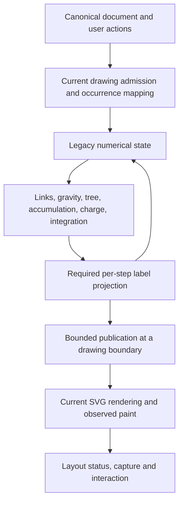

# Legacy force simulation performance: HISEW implementation plan

## 1. Status, authority and source

| Field                  | Value                                                                                                                                                                                                                                         |
| ---------------------- | --------------------------------------------------------------------------------------------------------------------------------------------------------------------------------------------------------------------------------------------- |
| Status                 | Packed main-thread force implemented; approximation and worker/Wasm gates evaluated; browser functional/lifetime diagnostics complete; foreground performance, manual acceptance and native admission limits remain open in sections 1.9–1.12 |
| Prepared               | 26 October 2026                                                                                                                                                                                                                               |
| Decision owner         | Repository owner, Maksym Shostak                                                                                                                                                                                                              |
| Integration owner      | Current Codex task under the repository owner's implementation authorization; coordinates numerical state, label projection, scheduling and renderer publication                                                                              |
| Source document        | `C:\Users\maksy\Downloads\Optimising legacyForceSimulation.js for High-Performance WebVOWL Layouts.md`                                                                                                                                        |
| Source identity        | 52,885 bytes; SHA-256 `b5851a9dfa68e1092556a5afc0e5426f4a8d2008a9aef8ca7a91fc13efb700ee`                                                                                                                                                      |
| Inspected baseline     | `61ae133033e482814f47415a4e5d396e35e57244`, plus the current working-tree contents                                                                                                                                                            |
| Procedure              | HISEW `hadden-industries-plan-software-change`, installed `0.1.0-dev.29`                                                                                                                                                                      |
| Identifier scope       | All `REQ-###`, `AC-###`, `QA-###`, `DEC-###` and `SLICE-###` identifiers are local to this document; qualify cross-document references by filename                                                                                            |
| Evidence produced here | Original source synthesis and repository inspection, followed by the implementation, measurement, test and external-review record in section 1.4                                                                                              |

The user initially authorized creation of a detailed plan in `docs/plans/`, preserving all relevant source detail, and subsequently authorized its implementation as recorded in section 1.3.
This document retains the report's technical findings, equations, alternatives, workload definitions, architecture, measurement protocol, roadmap and limitations.
Its code examples are translated into contracts and implementation constraints rather than copied as complete proposed implementations.
Section 13 maps the source's sections and examples to their dispositions.
Source line numbers and opaque citation tokens are replaced by current module references and identifiable primary sources.

Existing modifications to `packages/vowl/src/lexicalJson.js`, `packages/vowl/src/snapshot.js` and `packages/vowl/test/admission.test.js`, and untracked `docs/canonical-vowl/` and the lexical-failure-position plan, were present before this task.
They are outside this document's editing scope.
The initial planning step changed only this document; section 1.4 records the subsequent implementation.
No remote state is changed by this task.

### 1.1 HISEW applicability and prerequisite boundary

At the initial planning checkpoint, inspection reported personal applicability active, workflow state `unrouted`, and no current execution.
Configured profiles are `focused` → `npm run lint`, `affected` → `npm run test`, and `full` → `npm run check`, each with a reported 600-second command timeout.
The obligation assessment says `risk-route-not-selected`; available profiles are not selected verification obligations.
These observations supersede older documents' descriptions of a retained execution, without rewriting their history.
No execution was started, adopted, closed or verified during that planning step; the subsequent execution is recorded in section 1.4.

The supplied source was a proposal, not an accepted design or an accepted risk route.
This plan originally supplied a **draft** dossier and proposed route so its missing decisions were reviewable; section 1.3 records the subsequent acceptance.
Before dependent implementation, the owner must accept the scope, numerical compatibility policy, quality/performance thresholds and applicable risk route, and assign integration and acceptance owners.
Worker, approximation and Wasm slices have additional gates below.
Missing prerequisites block those implementations; they do not prevent preserving the requested proposal.

No code-review, security, commit or independent-verifier operation was selected to write this draft; provider availability and consent are not assessed here.
Before selecting one, inspect and resolve that actual operation using current tools and existing scoped authority; do not infer a review from provider discovery.
Pending feedback continuations are not part of this task.

### 1.2 Related controlling records

- [Performance implementation plan](2026-10-21-performance-implementation-plan.md) and [JavaScript performance audit plan](2026-10-26-javascript-performance-improvements-implementation-plan.md): overlapping performance work, including conditional quadtree allocation investigation.
- [Initial-layout improvement plan](2026-10-23-initial-layout-improvement-plan.md) and [active-graph performance follow-up](2026-10-24-active-graph-performance-follow-up.md): initialization, first-paint behavior, unchanged numerical steps, batched drawing, interaction and current measurements.
- [PERF-DEC-011 worker experiment decision](2026-10-23-worker-experiment-decision.md): approval of a narrow checkpoint-admission refactor, not general worker pooling or a physics worker.
- [Quiescent benchmark environment ADR](../adr/0003-quiescent-benchmark-environment.md), [rendered graph projection ADR](../adr/0010-rendered-graph-is-a-projection-not-the-store.md) and [pending manual validation](2026-10-23-ui-manual-validation.md).

The initial-layout plan's AC-104 owner disposition accepts a measured cadence limitation for its documented candidate.
It does not create a general 70.8-ms allowance, prove a 50-ms pass, authorize this plan's physics changes or waive new acceptance.
Keep its remaining movement, maximum-frame, settlement and manual-validation conditions visible when the owner selects this plan's final gates.
Do not duplicate a delivered slice merely because the supplied report describes an older implementation.

### 1.3 Implementation authorization and working record — 26 October 2026

The owner subsequently authorized implementing this plan on the existing local `main`, initially matching remote `main` at `61ae133033e482814f47415a4e5d396e35e57244`, with signed local commits and **no pushes**.
This authorization accepts the proposed R2 route and staged, measurement-led implementation; it supersedes the draft-only authority statements above for this task.
The current Codex task owns integration and preserves unrelated working-tree changes.
The plan is committed at the first checkpoint.

Use preservation checks for equivalent numerical changes and characterization/performance evidence for experiments.
Default force parameters and exact per-step state remain unchanged; approximation candidates are measured separately and are not silently selected for production.
Conditional packed-state, worker and Wasm work remains subject to the plan's demonstrated-benefit and compatibility gates.
Routine implementation choices and configuration changes required by this accepted plan are pre-approved by the owner.

Keep one execution and this concise working record; reuse scoped native test/review results and defer disposable-directory cleanup.
Consolidate source changes before ordinary review.
External review is reserved for the final implementation candidate: Claude Opus 5.5 at Max, up to 30 minutes per run; if unavailable, `agy` Flash 3.8 at High with the same timeout.
Resolve external findings and use narrow repair reviews before the single final full test run.
No duplicate helper-witnessed checks or evidence packages are required; signing and truthful result verification remain required.

### 1.4 Selected implementation and evidence

The first checkpoint is signed commit `51fb50a12a66a0a3cdac594ea516e38b97237625`.
The single R2 execution is `9149fb1d-09e6-48dd-a30c-5626ef32e7ed`.
Raw local measurements are retained in `C:\Users\maksy\.hi\w\e\operator\a5829ca38c224663b20c75d8aaa6073d`; this section is the working decision record, not a second evidence bundle.

The selected production change replaces recursive generic quadtree visits and one closure per movable node with an iterative charge traversal.
Three charge-pass-local stacks retain cells and their exact horizontal endpoints; reverse child pushes preserve quadrant order 0, 1, 2, 3.
The midpoint expression, squared-distance division, charge/cutoff guards, cached current/previous coordinates and property-backed label writeback remain unchanged.
The tree exposes its original horizontal bounds; insertion, topology rebuilding, accumulation, jitter, cooling, links, gravity, integration and per-step projection remain unchanged.
The stacks die with the charge pass, so they neither retain a previous drawing nor share mutable traversal state between simulations.

This is a measured refinement of SLICE-002's initial shared-visitor proposal.
The baseline CPU profile attributed approximately 65.9% of samples to recursive `visit`, 6.0% to GC, 5.9% to `step`, 5.5% to accumulation and 6.9% to tree construction/insertion combined.
These are diagnostic whole-process self samples, including startup, not clean phase timings.
The shared-visitor pilot passed compatibility checks but produced inconsistent timings, including slower 5,000-point cases, and was superseded.
The iterative pilot completed all six workloads with identical final state and lower median cooling times; its three runs per fixture are diagnostic evidence only.
`baseline-force.cpuprofile`, `baseline-profile.json`, `visitor-diagnostic.json` and `iterative-diagnostic.json` retain these experiments.

| Slice | Disposition for this increment                                                                                                                                                                                                                                                  |
| ----- | ------------------------------------------------------------------------------------------------------------------------------------------------------------------------------------------------------------------------------------------------------------------------------- |
| 001   | Added six seeded force-point fixtures using real class and property-backed label objects, plus complete-cooling A/A and A/B measurement. Existing production browser measurement is reused for integration.                                                                     |
| 002   | Selected iterative traversal after the visitor-only pilot failed to establish a consistent benefit. Independent D3 oracle and exact numerical compatibility are retained.                                                                                                       |
| 003   | Retain the current two-step/32-ms renderer budget and one-step interaction policy. Kernel timing alone cannot qualify a changed foreground budget; an individual large-graph step can already exceed the report's 5–8-ms targets.                                               |
| 004   | Retain theta 0.8 and infinite cutoff. The harness supports separately identified parameter experiments and detects changed trajectories, but no approximate mode or quality tolerance is selected. No Pareto-quality or visual-equivalence claim is made for those experiments. |
| 005   | No pooling/flat-tree storage selected. The profile prioritizes traversal; its GC share does not justify adding a persistent pool and retained-reference lifecycle in this increment. Fresh-tree semantics remain intact.                                                        |
| 006   | No packed representation selected. Property-backed labels and per-step projection already have exact observable ownership; a conversion layer lacks demonstrated end-to-end benefit after the smaller traversal change.                                                         |
| 007   | No physics worker selected without the packed-state/projection seam and foreground evidence required by its dependencies. Existing canonical-model workers remain separate.                                                                                                     |
| 008   | No Wasm/toolchain selected: the prerequisite packed/worker experiments have not justified that escalation.                                                                                                                                                                      |
| 009   | Focused numerical/integration checks, a production browser functional pass, external source review, full Jest and production build completed. Repository-wide and timing acceptance limits are recorded below; release, deployment and field acceptance are not claimed.        |

Conditional slices remain documented in full below for a later evidence-backed selection; a no-change disposition does not claim that their experiments or acceptance tests ran.
For selecting this exact-state kernel optimization, the task's engineering target is at least 10% lower median cooling time on large fixtures, no small-fixture regression above 5%, and an A/A noise band below 5% on the same accepted environment.
Twenty independent complete cooling cycles per version/fixture are required for timing qualification; per-tick samples within a cycle are descriptive, not independent layout replications.
Foreground user-facing speedup is a separate outcome and cannot be inferred from this kernel target.

The initial clean pilot was rejected at 28.2% host CPU busy; an A/A attempt was stopped at 17.6% after two pairs, and its retry stopped at 16.1% after seven pairs.
Some of this task's metadata work overlapped those attempts, so these readings cannot be attributed solely to other host activity.
Those incomplete files (`visitor-pilot.json`, `iterative-aa.json`, `iterative-aa-retry.json`) remain retained.
After all tests and builds finished, one isolated A/A retry ran without other task commands.
It completed 20 pairs for both medium fixtures and 14 large-fixture pairs, then stopped at 11.7% CPU busy against the unchanged 10% limit; `final-aa-isolated.json` retains the incomplete run and exact error.
Clean timing acceptance is open; diagnostic measurements do not override the quiescent-environment policy.

The completed diagnostic A/A and A/B matrices each contain 20 counterbalanced pairs per fixture after three warmup pairs.
Every A/A and A/B pair retained exact final state; A/A median differences ranged from -1.18% to +1.78%, with individual contention spikes.
The A/B medians below describe this host run only; they **do not satisfy clean timing or foreground acceptance**.
Raw samples are in `final-aa-diagnostic.json` and `final-ab-diagnostic.json`.
The later review repairs affect report I/O, import admission and comments only, so these measurements remain applicable to the unchanged numerical algorithm without another timing campaign.

| Fixture               | Baseline cooling median (ms) | Candidate cooling median (ms) | Diagnostic change |
| --------------------- | ---------------------------: | ----------------------------: | ----------------: |
| `wvowl-medium-sparse` |                       267.54 |                        212.37 |           -20.62% |
| `wvowl-medium-hub`    |                       292.40 |                        233.69 |           -20.08% |
| `wvowl-large`         |                      1368.43 |                       1103.75 |           -19.34% |
| `wvowl-large-hub`     |                      1551.51 |                       1213.51 |           -21.79% |
| `wvowl-xlarge`        |                      4196.12 |                       3394.43 |           -19.11% |
| `wvowl-xlarge-dense`  |                      4148.53 |                       3217.32 |           -22.45% |

The final broad external assignment used the authorized fallback, AGY Gemini 3.8 Flash High with a 1,800-second answer window, after Claude Opus 5.5 Max reported its five-hour quota exhausted.
AGY returned substantive source coverage and five findings; no execution of tests by the reviewer is claimed.
The native attempt `bf75f74d-8bc7-5fe5-a869-61113dd443d9` remains failed for control qualification because the reviewer did not reproduce `Cwd` in the exact denied command probe; its source assessment and original diagnostics are retained.
This is a review-control admission failure, not a product test failure.
The narrow follow-up checked the repairs and dispositions below and requested that probe-argument correction; it did not repeat the broad assessment.

The narrow follow-up `b22593f0-d1f7-5f32-93e6-6c6cd5f79eb1` returned no findings and explicitly closed all five repair/disposition questions.
Its native control qualification still failed on the same `Cwd` exact-match condition despite the explicit correction instruction; the retained raw native input omitted `Cwd`, and the command was denied.
Both failed native records remain intact.
The retained substantive static reviews establish source-review feedback and its resolution, not qualified native control assurance or independent test execution.
No further broad review or bookkeeping-only replay is selected under the owner's process instructions.
Full product verification ran after this substantive review closure.

| External finding                        | Disposition                                                                                                                                                                                                                               |
| --------------------------------------- | ----------------------------------------------------------------------------------------------------------------------------------------------------------------------------------------------------------------------------------------- |
| Redundant leaf midpoint/child checks    | No correctness defect. The proposed leaf fast path and claimed leaf fraction lack a measured benefit for this candidate; defer this additional optimization instead of changing the already measured kernel.                              |
| Clean timing unqualified                | Accepted limitation, explicitly open above. No diagnostic figure is promoted to clean timing, release or foreground evidence.                                                                                                             |
| Mixed-sign zero-sum subtree pruning     | Preserve inherited D3 semantics; document the numerical limitation at the pruning guard. Opposing charges can cancel the aggregate and prune their subtree. Existing differential cases remain authoritative.                             |
| Existing output masks a benchmark error | Reserve an exclusive output descriptor before measuring; reject collisions before any cycle, and emit the original report to stderr if later report writing fails. A regression test checks no cycle runs and the existing bytes survive. |
| Single-occurrence import replacement    | Explicitly require exactly one occurrence of each supported historical import before adapting it. Unsupported historical import shapes now fail at the declared import-contract boundary instead of partially rewriting a module.         |

Focused proof includes unchanged exact-state oracle tests, new full-cooling zero/mixed-charge and finite-cutoff cases, coincident labels, interleaved simulation ownership and graph replacement.
The benchmark tests require an explicit historical comparator and detect a theta-1.2 negative control while an A/A comparison remains exact.
Renderer/viewport, label, adapter and settlement checks passed.
The production Chromium functional pass on `W4-connected` completed loading, count/filter changes, selection, search and ten edits without runtime exceptions; it is functional-only evidence, not foreground performance acceptance.
The production build passed with its existing large-chunk advisory.
Exact-scope ESLint and Prettier checks passed after correcting braces and replacing a bitwise quadrant check with equivalent comparisons.

The single HISEW full-profile attempt `e8f92a36-f3c9-4573-beb1-8f7cefe2a7c3` retained its failed result: `npm run check` passed application and Python lint, then stopped because the pre-existing, unrelated `packages/vowl/conformance/supplemental/lexical-position-v1/README.md` requires Markdown formatting.
That file was preserved.
The unrun components were then executed individually without repeating the successful lint stages:

- Application and Python formatting checks passed; all ten Python files were already formatted.
- Setup tests passed (28 tests, two skips), including repository-skill verification; all three Markdown integration tests passed.
- Corpus-storage probes passed (four tests), and storage verification covered 7,227 artifacts in 64 bundles with no loose copies.
- Repository JSON checking failed its quality contract.
  JSON integration passed six of seven tests; the complete-repository contract assertion failed at `util/jsonIntegration.probes.mjs:67`.
- Full Jest passed all **198 suites and 10,296 tests** in 203.163 seconds.
- The subsequent production build passed with the existing large-chunk advisory.
- The final generated-output JSON check retained all diagnostics in `final-generated-json.ndjson` and failed its overall contract across 7,110 observed members.
  Its five failing source terminals are all in the unrelated `packages/vowl/conformance/supplemental/lexical-position-v1/vectors/` work: `snapshot-member-name-lone-surrogate/source.json`, `snapshot-member-name-noncharacter-after-unknown-member/source.json`, `snapshot-unicode-after-mistyped-member/source.json`, `snapshot-unicode-after-unknown-member/source.json` and `snapshot-unicode-before-later-mistyped-member/source.json`.
  These inputs and their ownership remain unchanged.

The failed aggregate and JSON results are not passes, and this task does not claim complete HISEW qualification.
Original tool records and the native full-profile run remain the evidence; no duplicate receipts are manufactured.

Reproduce the independent force checks and the six-workload comparison with:

```powershell
npm test -- --runInBand src/webvowl/js/runtime/legacyForceSimulation.test.js util/legacyForceBenchmarkFixtures.test.js util/benchmark-legacy-force.test.js
node util/benchmark-legacy-force.mjs --baseline-ref 51fb50a --runs 20 --warmups 3 --aa --output <new-aa-result.json>
node util/benchmark-legacy-force.mjs --baseline-ref 51fb50a --runs 20 --warmups 3 --output <new-ab-result.json>
```

Run comparisons serially on an idle host.
The harness checks host load before timing and before every measured pair, counterbalances order, asserts 298 moving steps plus the terminating call, retains raw tick/cycle samples and refuses to overwrite an existing result.
`--fixture` selects one or more named workloads; `--theta` and `--charge-distance` change only the experimental candidate.
`--diagnostic` explicitly marks non-acceptance runs and omits the quiescence gate; it must never be used to label a rejected clean run as passing.

### 1.5 Continued conditional experiments and pooling candidate

The owner subsequently requested continuation through the conditional investigations.
The same execution resumed; the first implementation is signed commit `ada450ecab22ac07ee2f68614129ca6ec0a92e3f`.
This continuation supersedes the first increment's SLICE-005/006 investigation status, without retrospectively claiming that those experiments ran before that commit.
The owner separately directed that the lexical-position quality repair be left to its owner; no lexical files or `.json-quality.json` were changed here.

Warm, startup-excluded profiles of three complete cooling cycles attributed approximately 69.6–70.2% of self samples to iterative repulsion, 6.4–7.8% to GC, 7.7–8.1% to accumulation and 9.3–9.5% to construction/insertion.
The 2,000- and 5,000-point profiles are `optimized-wvowl-large.cpuprofile` and `optimized-wvowl-xlarge.cpuprofile`, with matching `-profile.json` summaries in the existing evidence directory.
Profiling overhead is included; these are attribution diagnostics, not clean wall-time acceptance.
The separate PerformanceObserver collection returned no GC entries despite GC CPU samples, so it supplies no GC-event-count or pause-duration claim.

The selected additional **local production candidate** pools quadtree cells within each simulation while rebuilding topology and bounds on every charge pass.
Reused cells reset point/child references, insertion coordinates, charge/center fields, bounds and visitor closure; retired tail cells release their references, and capacity shrinks when it exceeds twice current use.
Stop, natural end and graph replacement release retained cells.
A stop called by the supplied jitter function defers release until the active charge phase finishes: the original failing regression threw while reading a cleared point, and the repaired test preserves the independent D3 step exactly.
Caller-owned fresh trees and other simulations retain separate storage.
Six tree tests cover topology, changed coordinates, no warm allocation, large/small/large capacity, retained-reference release, independent owners, empty/invalid and near-coincident input; the force suite now has twenty tests.
All 26 focused tests and exact-scope ESLint/Prettier passed before final review.

The pooling prototype matched all 299 calls of every six-fixture cooling trajectory.
The integrated three-pair, counterbalanced pilot retained exact final states and produced the following medians against the first committed iterative implementation (`integrated-pool-pilot.json`):

| Fixture               | Iterative baseline (ms) | Pooled candidate (ms) | Diagnostic change |
| --------------------- | ----------------------: | --------------------: | ----------------: |
| `wvowl-medium-sparse` |                  197.89 |                167.06 |           -15.58% |
| `wvowl-medium-hub`    |                  223.90 |                197.78 |           -11.67% |
| `wvowl-large`         |                 1152.41 |               1001.81 |           -13.07% |
| `wvowl-large-hub`     |                 1471.47 |               1098.59 |           -25.34% |
| `wvowl-xlarge`        |                 3265.12 |               2909.74 |           -10.88% |
| `wvowl-xlarge-dense`  |                 3384.22 |               2643.30 |           -21.89% |

These figures do not qualify the engineering target.
This pilot preceded the jitter-stop release guard; it is evidence for the pooling design, not a throughput qualification of the final repaired source.
The subsequent isolated 20-pair qualification attempt, `pool-qualified.json`, was rejected before any measured fixture at 13.3% host CPU busy against the unchanged 10% limit.
No other benchmark, test, build or bulk scan from this task ran during that attempt.
Clean timing remains an external environment prerequisite; the failed run is retained rather than rewritten or waived.

A separate complete Float64 numerical prototype includes indexed links/coefficients, a fresh indexed tree, the original accumulation/traversal/jitter order, integration, fixed targets and numerical solitary-label projection.
Its projection descriptors include circular/rectangular borders, eligible-label membership, invalid-coordinate handling and edit-mode intersections.
Every step matched an object-model comparator using the actual `createMath` and rectangular-border functions across all six workloads, including inverse pins, partial/null fixed targets, position edits, geometry edits and projection enablement changes.
Initialization and coefficient accessors still execute once through the current `start()` implementation; this is not an independent replacement initialization proof.
The experiment retains the D3 licence and source provenance in `packed-kernel.mjs`; `experiment-packed.mjs` and `packed-pilot.json` retain the executable experiment and raw results.
The correctness-only follow-up `experiment-packed-boundaries.mjs` / `packed-boundaries.json` also matched all six complete trajectories with effective circle and rectangle geometry edits, invalid borders and recovery; it supplies no additional timing samples.

| Fixture               | Object model with projection (ms) | Packed numeric owner (ms) | Packed with per-step model synchronization (ms) |
| --------------------- | --------------------------------: | ------------------------: | ----------------------------------------------: |
| `wvowl-medium-sparse` |                            213.13 |                    149.80 |                                          178.66 |
| `wvowl-medium-hub`    |                            257.81 |                    176.21 |                                          200.83 |
| `wvowl-large`         |                           1155.88 |                    792.48 |                                          905.34 |
| `wvowl-large-hub`     |                           1356.46 |                    891.25 |                                         1056.39 |
| `wvowl-xlarge`        |                           3701.54 |                   2234.26 |                                         2611.39 |
| `wvowl-xlarge-dense`  |                           3922.73 |                   2259.33 |                                         2777.26 |

These three-pair diagnostic medians include packed conversion, capacity growth and final model export; the synchronized variant also imports and publishes coordinates/pin state each step.
Common fixture construction and original initialization are excluded.
Packed state remains promising: synchronization reduces its gain but did not erase it in this pilot.
The prototype is **not** imported by the application and does not establish a qualified live renderer/capture cutover.
In particular, current `readArrangement`, `readOccurrenceGeometry`, `applyArrangement`, synchronous `captureRenderedDrawing`, canonical generation admission and `projectLayoutStep` consume or mutate current model geometry; frozen experimental descriptors do not migrate these owners.
SLICE-006 therefore remains partially investigated, not completed or disproved, and its clean end-to-end and ownership gates remain open.

The indexed-tree-only alternative retained the object model and also matched all six complete trajectories, but three-pair medians were 2.5–3.2 times the pooled-object-tree comparator across the six sizes/shapes (`flat-pilot.json`, `experiment-flat.mjs`, `flat-charge.mjs`).
The scaling evidence supports rejecting this specific candidate; it is not a claim that all flat-tree designs are slower.
The 5,000-point tail overlapped browser setup/idle preflights, so those samples are additionally contaminated; the earlier 500/2,000-point cases already showed the same large disadvantage before that overlap.
No flat-tree code is selected for production.

The original headed-browser attempt failed visibility admission while Windows was available; after the owner confirmed the desktop was unlocked and visible, the unchanged harness admitted a visible page.
The iterative build's one `W4-connected` diagnostic run observed settlement at 8,512.1 ms and frame p95 62.6 ms.
The pooled build's corresponding run settled at 8,185.2 ms with frame p95 58.2 ms and maximum interval 83.3 ms, retaining the initial nodes and observing movement with no foreground loss.
The pooled run's idle guard rejected the overlapping flat-tree experiment before measuring; it admitted the actual operation after that experiment finished.
Both runs remain single-run foreground diagnostics, not matched-cohort acceptance or a 50-ms pass.
Their traces/CPU profiles cover initial loading through first frames, while the frame observations extend through relaxation; they do not profile the entire cooling interval.
Evidence is retained under `optimized-foreground-active-window` and `pool-foreground-trace`.

The reuse assessment retains the current legacy kernel because [modern D3 force simulation](https://d3js.org/d3-force/simulation) uses a different velocity/state and initialization contract.
The current canonical worker client is a bounded document-operation owner, not a continuous physics owner; its generation and failure ideas are reusable, but moving physics into it would couple unrelated lifetimes.
[Native transferable buffers](https://developer.mozilla.org/en-US/docs/Web/API/Web_Workers_API/Transferable_objects) supply transport and detachment, not the missing projection, command-watermark or current-state capture contract.
No new dependency or compiler is selected.
SLICE-007 cannot enter production implementation until SLICE-006's complete ownership/capture path and clean outcome are qualified; the visible p95 result keeps responsiveness work relevant but does not waive that dependency.
SLICE-008 likewise lacks its qualified packed-worker baseline and remaining-kernel attribution, so no Wasm toolchain, port or build change is launched.
These are explicit **open prerequisite gates**, not claims that worker/Wasm experiments passed, were completed, or were shown unnecessary.

Final consolidated source review used the requested Claude Opus 5.5 Max / 1,800-second allowance; attempt `0013eabe-4933-501e-b114-ce9184300b97` stopped on the provider's session quota before substantive review.
The authorized fallback, AGY Flash 3.8 High with the same answer window, completed substantive static review in attempt `c284fa79-3a96-59da-96e3-1b47f95474b4` and returned no actionable findings.
Its native qualification remains failed: the exact prescribed known-file read was not observed, and the report's coverage labels did not satisfy mechanical coverage admission.
The retained review is source feedback with those limitations, not qualified native assurance or independently executed tests; no bookkeeping-only replay was performed.
The independent review clone and native project `a87344ea-a4cb-4499-9a5f-3b9531cc2ea2` remain task-owned retained evidence, with cleanup deferred.

After substantive review completed, all **199 Jest suites / 10,303 tests passed** in 178.517 seconds.
The pooled production build also passed the `W4-connected` functional browser pass: load, count/filter changes, four slider changes, selection, search and ten edits (`pool-browser-functional`).
The successful production build is reused because review introduced no runtime changes; its existing large-chunk advisory remains.
The new native full verification run `ac387351-559b-4248-a41a-d846c0357a6a` passed application and Python lint, then stopped at `packages/vowl/conformance/supplemental/lexical-position-v1/README.md` formatting.
It did not reach later commands, so the separately executed Jest pass does not turn that native run into a pass.
The previously retained JSON fixture failures also remain outside this task's authorized repair scope.
No full HISEW handoff, clean timing acceptance, release, deployment, worker/Wasm completion or push is claimed.

### 1.6 Integrated Float64 candidate and current ownership

The next coherent candidate replaces the production object's numerical hot loop with one private Float64 kernel and indexed fresh quadtree.
The adapter retains start/accessor timing, cooling, events, timers and current model ownership: it imports edits before every step and publishes x/y/px/py before projection and observers.
Known `Label` coordinate owners are resolved directly, while fixed state still reads the label's current inverse-property semantics.
Coordinate aliases and node identity are distinct: duplicate nodes and two labels backed by the same property retain their original effects.
Changed link endpoints, weights and charge indices are imported; stop, end, start and node/link replacement release private packed state.
Explicit random callbacks synchronize the model around every call, including callbacks identical to the global `Math.random` function.
The default production random algorithm, theta, cutoff and renderer scheduling remain unchanged.

`legacyForceProjection.js` extracts the existing DOM-independent intersection/centering calculation; visible-label eligibility, canonical positionable exclusions, invalid-label handling and edit-mode intersections remain in the renderer.
This is a complete main-thread physics path with current synchronous capture, not a shipped worker protocol.
The independent D3 oracle is unchanged; 25 force tests, 52 real-renderer tests and three numerical projection tests passed.
Added cases cover shared coordinate owners, duplicate identity, live endpoint/index/weight edits and state-observing random callbacks.
Exact-scope lint/format and the production bundle passed before final review.

The clean A/A attempt stopped before fixtures at 12.1% CPU busy against the 10% guard.
The owner then explicitly instructed, **“Capture results ignoring the idle guard.”**
Subsequent measurements retain diagnostic/uncontrolled-load labels; this is no clean-host or release acceptance claim.
The retained 20-pair A/A run had median changes between -4.66% and +3.35% across the six fixtures.
The final A/B run used 20 interleaved pairs and three warmups per fixture, compared with pooled commit `0f6aa8bc25ff1a89424b690c01a4da825ddb50d6`.
It includes packed conversion, coefficient copies, capacity growth, per-step model synchronization, real-label projection and teardown; common fixture construction/initialization and SVG drawing are excluded.
Both variants use the same current numerical projection helper, so this isolates physics plus synchronization rather than every renderer change.

| Fixture               | Pooled median (ms) | Packed median (ms) |  Change |
| --------------------- | -----------------: | -----------------: | ------: |
| `wvowl-medium-sparse` |             170.57 |             161.49 |  -5.32% |
| `wvowl-medium-hub`    |             187.06 |             183.30 |  -2.01% |
| `wvowl-large`         |             964.12 |             871.73 |  -9.58% |
| `wvowl-large-hub`     |            1049.47 |             967.67 |  -7.80% |
| `wvowl-xlarge`        |            3037.75 |            2580.26 | -15.06% |
| `wvowl-xlarge-dense`  |            3143.59 |            2540.03 | -19.20% |

Every pair matched the complete final state exactly, with 298 moving steps and the final termination call.
The preselected 5,000-point cases exceed the 10% engineering target; the 2,000-point cases do not both reach it, and no small-fixture regression was observed.
`packed-final-ab-20.json`, `packed-current-aa-20.json` and their executable harnesses remain in the existing evidence group.
The integrated A/B producer is `benchmark-packed-final.mjs`, which installs `step.geometry` projection on both variants; the repository's `util/benchmark-legacy-force.mjs` remains a separately identified kernel benchmark.
Rejected callback-heavy and alias-safe but slower prototypes, their original failures, and the intermediate V5 source/timings are retained rather than overwritten as passes.
The corrected final callback case and alias semantics supersede those intermediate candidates.

The final forced-GC lifecycle probe observed collection of all three retired kernels and position buffers across 2,000 → 3 → 2,000 nodes and stop; its deliberately retained positive control stayed alive.
`packed-final-lifetime.json` is Node ownership evidence, not browser heap acceptance.
A real foreground `W4-connected` profile now spans the complete cooling interval.
Source-position attribution identifies packed physics as 1,621 ms, 19.9% of sampled time and 65.6% of attributed JavaScript; 58.7% remains unattributed `(program)` time and is not labelled SVG by inference.
Its instrumented frame p95 was 62.5 ms; the separate uninstrumented run, at 27.7% observed host CPU busy, had frame p95 79.3 ms and settled within 12 seconds.
These unmatched diagnostics establish neither a browser speedup nor the 50-ms target.
Evidence is `packed-complete-cooling`, `packed-cooling-attribution.json` and `packed-uninstrumented-cooling`.

### 1.7 Seeded worker experiment

The owner explicitly authorized **“Authorize seeded randomness for the worker experiment.”** after the current native random stream was identified as lacking transferable checkpoint state.
That decision permits the experiment's private reproducible stream and possible changed jitter/final positions; the production default remains unchanged.
The prototype, build transformations and browser evidence live under `worker-experiment` in the existing task evidence group, outside application source and configuration.
It reuses the production packed kernel and numerical projection helper, with current circular/rectangular geometry and visible/solitary membership supplied by the renderer.
No new dependency, compiler, hosting setting or installation is selected.

The experimental ownership contract makes a published complete checkpoint authoritative; worker computation after it is speculative until admitted.
Each checkpoint includes x/y/px/py, alpha and random state; main-owned coefficients, pins, targets, topology and projection inputs are retained for restart.
One command is outstanding at a time, one paint callback is pending, and two transferable buffers hold bounded batches of intermediate checkpoints.
Generation/run identity, sequence and command watermark guard publication; changed current model state rejects the pending result and restarts from the edited checkpoint.
Intermediate step observers still receive every accepted step, then drawing publishes once per batch.
Stop/replacement cancels pending paint and terminates the owned worker; failure resumes the same seeded main-thread kernel from the latest committed checkpoint.
This avoids treating an obsolete visible snapshot as authority over a newer edit.

The protocol comparison matched state and random position at every moving step for 500-point sparse/hub, 2,000-point and 5,000-point fixtures, including pin, position and geometry edits.
All 298 moving steps matched in each case; Node transfer checks observed detachment and rejected stale generations and duplicate recycling.
Real Chrome lifecycle checks retained current pins and synchronous arrangement reads, stable paused geometry, seeded failure recovery, rapid successive edits, and rejection of retired occurrence references after replacement.
All 14 workers retired and 52 real browser transfers detached their senders; the only recorded failure was the deliberately injected recovery probe.
An initial lifecycle-harness failure omitted its cohort metadata; that original result is retained, and the corrected harness passed without changing the worker implementation.
The native scoped security assessment completed with no supported security vulnerabilities in the five canonical protocol/adapter files and bounded supporting context.
Its sealed report is `C:\Users\maksy\.codex\state\plugins\codex-security\scans\worker-experiment\unversioned_20261026T233619Z_854mc_3l\report.md`, scan `0268001a-873f-4c7b-a97a-04e4cbd21186`.
This is source assessment, not browser hosting, CSP or runtime acceptance; same-origin worker code is not a separate security principal.
The native usage counters report 6,402,750 total tokens (6,374,295 input, including 6,247,424 cached; 28,455 output, including 7,843 reasoning) across four threads; they include earlier thread history and are not incremental scan-only usage.
The frozen original experiment remains intact.

Two ordinary correctness observations were repaired in the retained successor `worker-experiment-v3`: snapshot/constructor/initial-send failures now recover without leaving an owned worker alive, and arbitrary custom step listeners use the main-thread path rather than consuming precomputed intermediate steps after callbacks mutate force inputs.
The focused callback test exposed D3's whitespace-separated event-name case; that original failure is retained, and the corrected name parser passes it.
Nine focused startup/callback cases pass, including registration before startup and during a running worker, and the successor passes the same real-browser lifecycle checks with all 14 workers retired.
These repairs are outside the original sealed security snapshot and receive narrow correctness review within the final consolidated source review.
No worker production selection or Wasm qualification is claimed.

### 1.8 Conditional escalation decision and final candidate

The worker experiment ran real Chrome builds, rather than ending at a dependency deferral.
Initial single-run diagnostics compared seeded main-thread and worker profiles: main two-step/32-ms settlement was 8,488 ms with 66.6-ms frame p95; worker two-step/32-ms was 7,791 ms with 62.6-ms p95; worker eight-step/6-ms was 8,215 ms with 58.4-ms p95.
A seeded main-thread eight-step/6-ms control did not settle by 12,033 ms, despite 58.4-ms frame p95.
These unmatched pilots suggested further measurement, not an adopted scheduling change.

The corrected worker candidate was then compared with the unchanged renderer scheduling in three alternating large-graph pairs and two alternating small-graph pairs.
Both variants use the same private seeded stream and packed numerical kernel; the main-thread control uses two steps/32 ms, and the worker candidate permits eight steps/6 ms.
The large fixture is 2,000 connected class glyphs, approximately 3,999 force points; the small control is explicitly 250 classes/499 force points, not the original W4 workload.
All measured runs retained foreground visibility/focus and the owner's busy-host waiver.
Two hidden-page admission failures were retained and excluded before a successful foreground retry; no visibility-state override or hidden timing was used.
Computer Use ended when its browser-URL policy check could not establish the URL; no further desktop input was attempted, and subsequent harness runs independently satisfied foreground admission.

| Fixture / pair | Main settlement (ms) | Worker settlement (ms) | Main frame p95 (ms) | Worker frame p95 (ms) |
| -------------- | -------------------: | ---------------------: | ------------------: | --------------------: |
| Large / 1      |              8,376.4 |               10,091.6 |                62.5 |                  62.5 |
| Large / 2      |              9,100.1 |                9,560.6 |                62.6 |                  66.6 |
| Large / 3      |              9,475.8 |   >12,026.8; unsettled |                66.8 |                  91.7 |
| Small / 1      |              1,163.9 |                  465.1 |                12.4 |                   8.4 |
| Small / 2      |              1,154.8 |                  435.8 |                 8.4 |                   8.4 |

The repeated large-graph results do not reproduce the pilot benefit: worker settlement is worse in each pair and the third misses the 12-second target.
Small-graph gains are confounded by the larger step batch; they do not isolate worker execution as their cause or qualify a large-graph adoption.
The ten successful measurement runs are exploratory evidence, not the plan's 20-cycle acceptance campaign; one has an unsettled outcome, and uncontrolled host load limits causal claims.
`worker-experiment-v3/browser-comparison.json` points to every result, including actual CPU admission observations, worker counts and transfer diagnostics.
The worker owns at most two result buffers, 2,047,488 bytes combined for this large fixture; this does not bound the complete heap, quadtree or duration of an individual step.

Select the packed main-thread implementation with unchanged default randomness, theta, cutoff and renderer scheduling.
Keep the seeded worker as a retained experiment: the demonstrated-benefit gate is not met, and pointer-drag/SVG-export acceptance, a 20-cycle lifecycle campaign and hosting/clean timing qualification are not claimed.
SLICE-008's Wasm gate is also not met: there is no selected qualified JavaScript worker and no demonstrated remaining kernel-bound foreground bottleneck after transfer/publication costs.
The worker's measured numerical computation was approximately 1.69–1.73 seconds per large run, while observed settlement was approximately 9.56–12.03 seconds; overlapping work and unattributed main-thread time prevent treating that ratio as precise critical-path attribution.
No Wasm compiler, dependency, hosting change, SIMD/thread mode or production random-stream change is justified by these results.
This disposes the conditional paths on evidence while preserving their contracts and reopening criteria below; it does not label unimplemented worker/Wasm product paths complete.

The final consolidated external review covers the eight production/document paths and bounded experimental context, followed by narrow repairs if needed and then the required full repository check.
Existing unrelated lexical-position changes remain with their owner.
No push, deployment, release or manual-device acceptance is authorized or claimed.

### 1.9 Final packed-source review and verification

Claude Opus 5.5 Max attempt `9c032cec-4d9f-5474-833b-4cca6c382c70` stopped on the provider's five-hour quota before reading source.
The authorized AGY Flash 3.8 High fallback retained the 1,800-second answer allowance.
Its first attempt, `eee517b9-9e35-5aed-83ac-486ca83ea071`, completed but early native callback envelopes exceeded the unchanged 64-KiB guard limit; only 12 of 41 distinct inputs were read.
Its claimed complete coverage is rejected, and its original failed capture and five proposed findings remain retained.
Existing owned guard files were preserved when profile preparation refused to replace them; the correction used an independent owned clone and ten lossless input bundles, without weakening controls.

The corrected source-coverage attempt, `75737b24-41f6-59fc-ad61-bc32d02de38c`, read all ten bundles and returned no findings after assessing the complete eight-file patch, surrounding numerical source, bounded worker context and actual integrated timing harness.
It explicitly agreed with all five evidence-based dispositions:

- Production `force.on` delegates to D3's existing whitespace-aware dispatcher; a focused registration/removal probe also passed.
  The repaired worker eligibility parser is a separate experimental wrapper.
- Sequential coordinate-alias integration preserves the baseline and independent oracle.
  Aggregating fixed flags by owner would change inherited physics.
- Solitary-label projection already updates x/y without resetting px/py; the extraction preserves that behavior.
- The reported integrated 20-pair timings come from the harness that projects labels on every step, rather than the separate kernel utility.
- Sections 1.6–1.8 explicitly limit worker results to nonshipping diagnostic evidence and record the unmet worker/Wasm adoption gates.

The corrected attempt still failed native control qualification: the prescribed command-denial probe omitted the exact `Cwd` field.
Its source feedback and resolved findings are retained independently of that failure; no qualified native assurance or reviewer-executed tests are claimed.
No further review replay is selected solely to repair that bookkeeping outcome under the owner's explicit process instructions.
After this substantive review closure, native full run `c47184a6-f222-4d02-a5f5-65f0c55a15b0` completed `npm run check` with exit zero, `passed: true` and no verification problems.
All 200 Jest suites and 10,405 tests passed in 208.78 seconds; application/Python lint and formatting, Markdown, setup, corpus storage, all seven JSON integration tests, the production bundle and generated-output JSON checks passed.
The lexical-position owner’s current changes cleared the earlier unrelated JSON/documentation blockers; those files remain outside this task’s commit.
The next native progress read nevertheless rejected reuse with `process-environment-changed`, before any further source edit.
That admission failure does not change the product result; its exact environmental cause is not established here, and the owner’s explicit no-duplicate-check instruction rules out a receipt-only rerun.
This final documentation-only outcome update receives scoped Markdown validation; the completed implementation checks are reused without claiming complete HISEW/native review qualification.

### 1.10 Approximation experiments — 27 October 2026

The owner requested the remaining approximation experiments, followed by foreground performance and browser acceptance.
The requested HISEW guard-reuse amendment was posted to [issue #157](https://github.com/Hadden-Industries/software-engineering-workflow/issues/157#issuecomment-6431135250), preserving the original refusals, callback-envelope failure, successful source-coverage recovery and remaining native qualification failure.
No guard files or unrelated lexical work were replaced.

SLICE-004 now has an independent theta/cutoff quality sweep over the six real class/property-label fixtures plus an eight-component disconnected control.
Each fixture has three explicitly fixed class targets and three input seeds: 24,301, 7 and 42.
The 147 cases compare theta 0.8/0.9/1.0/1.2 with infinite cutoff, and theta 0.8 with cutoff 300/600/1,200, changing one parameter at a time.
Every case completed 298 moving steps and the terminating call, retained finite current/previous positions and preserved its fixed targets exactly.
Initial-state/link/pin hashes, complete final coordinates, random-draw counts and per-step timing summaries are retained under `approximation/independent-sweep/` in the section 1.3 evidence directory.
These are newly declared pinned cohorts, not replacements for the earlier exact-state timing populations.

Quality is computed after timing: raw and rigidly aligned RMS/p95/maximum displacement, normalized by baseline RMS radius without fitting scale; rotation-only and reflection-permitted fits; exact class-circle/property-rectangle overlaps; relative force-link length error; sampled crossings; and nearest-neighbor preservation.
Reflection is permitted only for structural comparison, never for pin or saved-view acceptance.
Crossings use the same retained, deterministic sample of at most 50,000 unique link pairs for each comparison, excluding adjacent, touching and collinear pairs.
They estimate straight force-link intersections, not curved SVG paths.
Neighborhood preservation uses the exact ten nearest class neighbors at up to 256 evenly spaced class anchors.
Edge-error target distance is 150; the nonzero denominator uses the documented epsilon of 1e-9, and a zero-radius displacement is explicitly undefined.
Positive and negative controls check rotation/reflection invariance, rejection of scale fitting, crossing adjacency, actual glyph intersections, neighborhood changes, fixed targets and deterministic replay.

The following quality ranges summarize 21 fixture/seed cases per candidate; complete per-case values and outliers remain in `approximation/summary.json`.
Overlap ratios compare each candidate with its own matched baseline; values above one mean more overlaps.

| Candidate    | Worst normalized RMS | Lowest mean neighbor preservation | Median overlap ratio | Maximum overlap ratio |
| ------------ | -------------------: | --------------------------------: | -------------------: | --------------------: |
| theta 0.9    |               0.4274 |                            40.90% |               0.9965 |                1.0390 |
| theta 1.0    |               0.5178 |                            43.24% |               1.0000 |                1.0573 |
| theta 1.2    |               0.3742 |                            44.69% |               1.0051 |                1.0526 |
| cutoff 300   |               0.8597 |                             4.73% |               4.3494 |               10.3256 |
| cutoff 600   |               0.8220 |                             9.45% |               2.0267 |                5.3208 |
| cutoff 1,200 |               0.7283 |                            15.66% |               1.4008 |                3.0358 |

The independent cutoff sweep showed only about 0.5–1.8% lower mean cooling time while substantially changing neighborhoods and increasing overlaps/crossings.
Lower target-edge error alone does not make those layouts better: stronger clustering can reduce that error while making labels overlap.
No cutoff combination was advanced.
Theta 0.9 and 1.2 were selected for 20 counterbalanced complete-cycle repetitions on every fixture, after three warmups per variant.
Timing includes packed conversion/import/export, real per-step label projection, timer teardown and per-step clock overhead; common fixture/start initialization and quality calculations are outside that interval.
The owner's existing idle-guard waiver applies, so these remain diagnostic timings under uncontrolled host load.

| Fixture              | theta 0.9 median cooling change | theta 1.2 median cooling change |
| -------------------- | ------------------------------: | ------------------------------: |
| Medium sparse        |                         -10.77% |                         -30.04% |
| Medium hub           |                          -8.89% |                         -29.41% |
| Large                |                         -11.69% |                         -32.38% |
| Large hub            |                         -11.25% |                         -32.48% |
| Extra large          |                         -12.01% |                         -33.65% |
| Extra large dense    |                         -10.35% |                         -29.58% |
| Disconnected control |                          -8.30% |                         -27.41% |

The accompanying 20-pair A/A medians differed by +1.24% on medium sparse and +0.86% on extra large; individual contention outliers remain retained.
Each parameter setting replayed its own final state exactly throughout these repetitions.
Raw rounds, order and host observations are in `approximation/repeated-timing.json`.
Theta 1.0 remains a three-seed exploratory point, not a separately repeated timing qualification.

**Decision:** retain production theta 0.8 and infinite cutoff.
The measured speed/quality curve supports an explicit no-change disposition: larger theta is faster, but no changed-layout tolerance has been accepted and structural drift is material.
Quality changes are not monotonic in theta, so a smaller increase cannot be assumed safe without its own evidence.
No approximate production mode, precision change or new escape bound is selected.
The source-level curve and semantic controls are complete; clean-host qualification, an accepted tolerance matrix and visual/interaction acceptance would still be required before adopting an approximation.

### 1.11 Foreground disposition and matched browser diagnostics

Two new headed Chrome attempts failed visibility admission without producing an accepted timing sample.
The dedicated page remained `hidden` despite ordinary CDP and owned-window activation, while Windows reported AC power and a 240-Hz display.
The owner then explicitly answered **“Continue with diagnostics; foreground unavailable.”**
Foreground frame, real input-to-paint and 50-ms budget acceptance therefore remain open; headless observations cannot close them.
The failures are retained in `foreground/large-1-baseline/` and `foreground/large-1-baseline-retry1/`, with the owner's disposition in `foreground/headless-decision.md`.

The authorized headless comparison completed 20 independent loads per variant/workload, in ABBA blocks of ten, with three unreported warmups per block.
The force/renderer baseline is pooled commit `0f6aa8bc25ff1a89424b690c01a4da825ddb50d6`; the candidate is packed commit `1523de1d6b60ced26577530729c180348d02d477`.
Chrome 156.0.8078.48 ran the actual minified production-mode application at an emulated 1,440 × 900 CSS-pixel viewport, with unchanged two-step/32-ms force scheduling, theta 0.8 and infinite cutoff.
A test-page-only LCG stream, seed 24,301, resets before each load; production random-source code is unchanged.
The same fixture bytes, dependency lock and build settings apply to both variants.
These headless measurements retain the owner's host-idle waiver and are neither clean-host qualification nor foreground acceptance.

The build audit found a provenance limitation: Vite's separate worker pipeline did not receive the first script's committed lexical/snapshot overlays.
The main force/renderer inputs are pinned, and all nine parsing-worker closure assets are byte-identical across the two frozen builds, so this remains a matched comparison of the force increment against common worker bytes.
It is not whole-commit browser qualification; the original manifests' `dirtyWorkspaceExcluded` description applies only to their main bundle.
`foreground/provenance-limit.md` records that correction without rewriting frozen manifests or runs.
Subsequent functional/lifetime builds install and verify committed-source overlays in both main and worker pipelines.
No unrelated source or repository configuration was edited.

| Workload / variant               | Rendered class nodes | Median source-to-first-frame (ms) | Median settlement (ms) | Median of per-run frame p95 (ms) |
| -------------------------------- | -------------------: | --------------------------------: | ---------------------: | -------------------------------: |
| W4-connected / pooled            |                2,000 |                          1,257.90 |               8,723.10 |                            66.60 |
| W4-connected / packed            |                2,000 |                          1,244.20 |               8,857.55 |                            62.70 |
| W4-disconnected / pooled         |                2,000 |                            597.25 |               2,132.55 |                            18.85 |
| W4-disconnected / packed         |                2,000 |                            598.80 |               2,177.85 |                            16.80 |
| Connected small control / pooled |                  250 |                            219.95 |                 981.45 |                             8.40 |
| Connected small control / packed |                  250 |                            246.80 |               1,202.40 |                            12.50 |

The connected cases contain 3,999 and 499 force points respectively, including property labels; the disconnected W4 population is kept separate.
All 120 measured loads observed movement, retained their initial nodes, began with no class glyph wholly outside the viewport and settled within 12 seconds.
Per-run frame distributions remain separate statistical units; frame samples were not pooled into fictitious independent loads.
Raw intervals, first-image boundaries, viewport state, CPU observations and runs are in `foreground/headless-*/result.json`; `foreground/headless-summary.json` retains their descriptive aggregates, maximum intervals and 16.7-ms reference exceedances.
The host's physical 240-Hz display does not turn headless frames into observed physical presentation.

The connected packed cohort's median settlement was 1.54% longer despite a 5.86% lower median per-run frame p95; there is no demonstrated end-to-end settlement speedup.
The small packed cohort was 22.51% slower in median settlement and 12.21% slower to its first frame, so **the small-input no-regression gate is not passed by these results**.
Its two candidate blocks differed materially: median settlement 1,263.7 and 1,037.4 ms, versus baseline blocks 964.55 and 1,016.55 ms; the slower candidate block observed CPU busy as high as 51.84%.
That temporal/load confounding limits attribution, but does not erase the unfavorable samples or justify declaring a pass.
The existing exact-state numerical evidence remains valid; a controlled foreground comparison is still required for user-facing performance acceptance.

### 1.12 Browser behavior, export and lifetime acceptance

The committed packed candidate was rebuilt with both main and worker source overlays verified, excluding the unrelated lexical changes from those builds.
`browser/manifest-committed.json` identifies the uninstrumented candidate; `browser/manifest-lifetime.json` identifies a separate diagnostic build with weak ownership taps only.
Production force parameters, random-source behavior, scheduling and arithmetic remain unchanged.

Actual Chrome 156.0.8078.48 and Edge 156.0.4314.42 engine checks passed in headless mode.
Chrome covered FOAF and W4-connected; Edge covered FOAF.
The ordinary browser sequence covered load, count/filter changes, native keyboard count adjustment, selection, search and ten edits.
Force-specific checks covered two fixed targets through running steps, five rapid position updates, synchronous current arrangement reads, stable Pause and moving Resume, two native mouse drags, native pan/wheel zoom, active graph replacement with stale-reference rejection, and natural completion with a stable final model/drawing.
The native mouse driver uses explicit pressed/moved/released button state and targets the actual node glyph.
A separate focused Chrome probe enabled touch before application construction, moved two simultaneous native touch gestures while layout ran, verified both model locks and verified that both locks were released at touch end.
That is browser-engine input evidence, not a physical touch-device test.

Export checks compared every current class/property-label SVG transform with the page-local exported SVG, and checked the accepted pinned coordinates in the canonical VOWL export.
The large case matched **3,999 transforms** and produced a 14,049,416-byte SVG; Edge's FOAF case matched **125 transforms**.
Captures were explicitly paused and reported the existing `stable-frames` export outcome; this does not relabel them as natural initial-layout settlement.
Screenshots were inspected and retained with the original result files.
Local Event Timing, Long Animation Frame and long-task observers were available; the large functional probe retained 276 event entries, 50 long-animation-frame entries and 205 long tasks without dropping entries.
Those observations include diagnostic load/export work and headless input, and do not establish field INP or foreground input-to-paint performance.

Two harness failures remain retained with their original failed status.
The first native drag attempt lacked explicit held-button state and used the group's bounds; the corrected native input sequence passed without a product repair.
The next attempt reached its final natural-end question after the preceding assertions passed, but FOAF had loaded with saved paused intent.
A narrow follow-up explicitly resumed that document and observed natural end in 650.1 ms with a stable final drawing; the successful earlier questions were reused.
The large graph's resumed natural-end check completed in 9,151.4 ms.
Evidence is in `browser/chrome-foaf*`, `browser/chrome-large`, `browser/edge-foaf`, and `browser/chrome-two-touch`.

The separate Chrome lifetime probe completed **20** load/edit/capture/retirement cycles.
Each cycle ran full/small/full layouts, reducing the visible class population from 2,000 to 50 and back before capture and collection.
Weak references observed actual packed kernels, state/input buffers and every allocated tree capacity; canonical projection, inspection and read-model ownership used the existing browser probe.
The deliberately retained packed positive control kept one kernel and 21 buffers alive; releasing it made all of them collectible.
Every cycle collected all retired packed objects and canonical owners and observed zero remaining capture workers.
After final controller disposal, **all 4,646 tracked kernel/buffer objects were absent**, all tracked canonical owners were absent and no workers remained.
Forced-GC heap used approximately 74.36 MB after the first cycle, 76.18 MB after cycle 20 and 9.01 MB after disposal; these diagnostic totals include the accumulating observer registry and are not an allocation-rate or whole-browser-memory certification.
The owned browser exited normally.
`browser/chrome-packed-lifetime/result.json` retains the positive controls, every cycle and final disposal observations.

No runtime source changed in this continuation.
The consolidated ordinary review of the experiment/acceptance work corrected the worker-build provenance and test-driver/setup issues described above; their original evidence is preserved.
The prior external packed-source review and the successful 200-suite/10,405-test full product run remain applicable to the unchanged runtime, with their existing native admission limits from section 1.9.
Only the plan's documentation delta needs scoped formatting/validation; no full-suite or external campaign is repeated to manufacture new receipts.
The owner-deferred foreground comparison, the unfavorable/confounded small-input diagnostic result, actual Firefox/Safari/mobile/assistive-technology acceptance and native evidence-admission qualification remain open.
No release, deployment, push or disposable-directory cleanup is performed.

## 2. Source findings reconciled with current code

### 2.1 Central hypothesis and cost model

The source correctly identifies an existing Barnes–Hut approximation, not an all-pairs implementation awaiting one.
The useful hypothesis is that tree construction/allocation, repeated charge traversal, numerical object access and main-thread publication are the main opportunities.
This is static cost analysis, not measured attribution for the inspected baseline.

For cell width `s`, distance `d` and opening parameter `theta`, the conceptual acceptance test is `s / d < theta`, or `s² / d² < theta²` for valid positive distances.
Larger theta accepts more aggregates and generally trades force accuracy for less traversal.
Typical distributions permit approximately `O(N log N)` work instead of direct all-pairs `O(N²)` work; neither spatial distribution nor approximation settings guarantee that bound in every case.
The algorithmic source is [Barnes and Hut, Nature 324, 446–449 (1986), DOI 10.1038/324446a0](https://doi.org/10.1038/324446a0).

Here `N` means actual force points, including applicable property labels, and `E` means actual force links, including link parts.
Semantic ontology entities, visible class glyphs and force points are different counts.

| Source priority         | Work                              | Typical cost                                       | Source hypothesis and current disposition                                                                                                      |
| ----------------------- | --------------------------------- | -------------------------------------------------- | ---------------------------------------------------------------------------------------------------------------------------------------------- |
| Critical                | Quadtree build and accumulation   | `O(N log N)` build plus tree accumulation          | Recursive objects, child arrays and temporary coordinate arrays still allocate; profile allocation and CPU separately                          |
| Critical                | Per-movable-node charge traversal | Typically `O(N log N)` overall                     | Still present; distribution, coincident points and opening decisions matter                                                                    |
| High                    | Per-node visitor closure          | `O(N)` closures plus traversal                     | Still one callback allocated by each `repulse` call; a pass-scoped visitor is a candidate                                                      |
| High                    | Link relaxation                   | `O(E)` with a square root per nonzero displacement | Current loop is already indexed; dense 10,000–20,000-link graphs still merit attribution                                                       |
| Medium                  | Integration and position export   | Source describes two `O(N)` passes                 | Current force has one integration loop and no standalone export pass; investigate actual boundary work rather than inventing a pass to merge   |
| Medium                  | Event dispatch and rendering      | Application-dependent                              | May dominate end-to-end cost; drawing is already batched while numerical projection remains per step                                           |
| Low                     | Gravity                           | `O(N)`                                             | Already an indexed loop; do not spend disproportionate effort here                                                                             |
| Low during steady state | Initial positions                 | Start/restart only                                 | Source describes allocation-heavy initialization; current fallback uses lazy neighbor lists, while canonical fresh placement has its own owner |

The source's approximately 300 advances per cooling cycle multiply small costs.
With `alpha = 0.1`, decay `0.99` and stop threshold `0.005`, `log(0.005 / 0.1) / log(0.99) = 298.072852...`.
The current code checks termination before doing forces, so there are **298 moving numerical steps and a 299th terminating call**, absent reheating.
The report's “about 299 physics iterations” is an approximate cooling description, not an exact count of force integrations.
Removing one 5,000-point traversal would avoid roughly 1.5 million visits over a cycle, if such a redundant traversal actually exists.

Use `T_layout = sum(T_tree + T_accumulate + T_charge + T_links + T_gravity + T_integrate + T_projection)` across moving steps, plus publication/rendering and scheduling costs.
A hypothetical improvement from 20 ms to 10 ms per tick could help fit a 16.7-ms display interval; those numbers are illustrations, not observations.
Faster cooling throughput, first usable drawing, physical settlement and responsive interaction remain separate outcomes.

### 2.2 Material differences from the supplied report

| Source statement or example                                            | Current owning evidence                                                                                                                                                                     | Required treatment                                                                                                      |
| ---------------------------------------------------------------------- | ------------------------------------------------------------------------------------------------------------------------------------------------------------------------------------------- | ----------------------------------------------------------------------------------------------------------------------- |
| Tree → gravity → links → charge → integrate → export                   | [Force `step`](../../src/webvowl/js/runtime/legacyForceSimulation.js) performs **links → gravity → tree build → accumulation → repulsion → integration → `step` projection**, after cooling | Preserve the current order exactly in compatibility slices; copying the report's ordering would change trajectories     |
| `createLegacyForceQuadtree` supplies accumulated values                | [Quadtree](../../src/webvowl/js/runtime/legacyForceQuadtree.js) exports `createLegacyQuadtree`; force separately calls `d3_layout_forceAccumulate`                                          | Preserve both owners and their call order; aggregation is not supplied by tree creation alone                           |
| Callback hot loops need conversion                                     | Links, gravity and integration are already indexed                                                                                                                                          | Count as already delivered; optimize only demonstrated residual overhead                                                |
| Uncached object fields dominate every charge update                    | `repulse` already caches current x/y and accumulates previous x/y locally through a synchronous visit                                                                                       | Retain this improvement and its arithmetic order; measure only the residual visitor allocation and traversal            |
| Merge `updatePositions` and `exportPositions`; write `__internal__x/y` | Those helpers and export fields do not occur in the current force module                                                                                                                    | Preserve the pass-reduction objective, not obsolete helper names or undocumented fields                                 |
| Render/export on every physics step                                    | `advanceFrame`, `publishTick` and renderer `projectLayoutStep` already split physics projection from drawing                                                                                | Extend the existing scheduler seam instead of adding a second timer or generic `renderEveryPhysicsTick` switch          |
| Per-step notifications may become optional                             | [Renderer internals](../../src/webvowl/js/runtime/renderedGraphInternals.js) use `step` to recenter solitary labels before the next step                                                    | Suppressing that event is not equivalent; preserve model effects at every numerical step                                |
| 5–8-ms budget, illustrative 6 ms and eight steps                       | Factory defaults are one step/8 ms; the renderer selects two steps/32 ms, and one step while a drag is active                                                                               | These are distinct current policies and proposed experimental values; no silent reset to the report's examples          |
| D3 dependency `^7.8.4`                                                 | [Package manifest](../../package.json) declares `^7.9.0`                                                                                                                                    | Report current declaration; resolve exact installed/locked versions for later evidence, without changing dependencies   |
| Modern D3 and legacy APIs appear similar                               | Modern D3 documents `vx/vy` and velocity decay; current code preserves `px/py` integration                                                                                                  | A whole `d3-force` replacement is a separate behavior-changing experiment, not an equivalent refactor                   |
| Exact coordinates are too brittle for all regression tests             | [Current force tests](../../src/webvowl/js/runtime/legacyForceSimulation.test.js) compare every step against an immutable official D3 3.5.17 distribution                                   | Keep exact oracles for compatibility changes; use agreed quality tolerances only for explicitly selected approximations |
| Simple typed-array copy preserves node semantics                       | [Label accessors](../../src/webvowl/js/elements/links/Label.js) delegate state to properties; `fixed` also considers inverse-property state                                                 | Packed state must model those ownership/alias relationships, pin targets and current projection rules                   |

The current tree is built only when `charge` is truthy.
Accumulation may jitter a point attached to an internal node using the injected random stream.
The tree ignores NaN coordinates, retains near-coincident points using the `0.01` Manhattan-distance test, visits children in quadrant order, and exposes a synchronous pruning visitor.
Zero total charge, mixed signed charges, empty inputs, zero-length edges and coincident points need explicit characterization; do not “repair” them while removing allocation without a separate decision.

## 3. Purpose, scope and proposed risk route

The beneficiary is a person exploring or editing 500–5,000-force-point ontologies who needs a readable layout and responsive controls without losing VOWL meaning, positions, pins, edits or saved views.
The purpose is measurable user-visible improvement with bounded memory and reliable cancellation, not a higher ticks-per-second number alone.
At every gate reassess total CPU, rendering, interaction, lifetime and maintenance costs together.

Included work is measurement, remaining compatible hot-path cleanup, scheduler tuning, optional approximation experiments, tree storage experiments, complete numeric-state experiments and conditional physics-worker/Wasm adoption.
The report's order is retained as an escalation path, with already implemented work acknowledged.

Non-goals are a default force-law change, altered cooling, approximate spring lengths, silent theta/cutoff changes, a general renderer rewrite, removed labels/edges, weaker ontology admission, a new telemetry service, initialization-policy redesign, or automatic adoption of every advanced option.
Multi-worker Barnes–Hut, stale-tree reuse and SharedArrayBuffer deployment are deferred alternatives.
No implementation, configuration change, commit, push, merge or deployment is authorized by this document.

### Risk class:

Proposed **R2** for the combined implementation: material performance behavior, event contracts, asynchronous ownership and worker cancellation can affect layout correctness and availability.
This is an inference from the proposed scope, not an accepted route.
An isolated equivalent allocation change may qualify for a narrower route when its actual scope is selected; do not downgrade the combined change because the planning artifact is Markdown.

### Decision owner:

Maksym Shostak accepts scope, quality trade-offs, configuration and release decisions; integration and independent verification owners remain unassigned.

### Reasoning:

Source-preserving micro-optimizations can still change rounding, pruning, getter effects or random-call order.
Packed and worker state can lose edits, use stale graph indices, publish detached buffers or report completion before paint.
The observed per-step label projection makes timing changes numerically consequential.

### Potential blast radius:

Active drawing, drag/pin/release, Pause/Resume, ontology replacement, count/filter changes, editor operations, layout capture/export, first paint, and worker/runtime memory.
The canonical document and its admission contract must remain authoritative.

### Reversibility:

Compatible local changes can be withdrawn as targeted source edits before release.
A released candidate can be replaced by a qualified compatible build only after package, worker and document compatibility are checked.
Worker recovery requires a complete current checkpoint and an ownership fence; an x/y-only snapshot cannot promise exact continuation.

### Principal unknowns:

Current phase shares, target CPUs and browsers, corpus coverage, acceptable layout drift, actual small-graph overhead, representability of property-backed labels and projection, resource limits, and whether worker/Wasm benefits exceed their lifecycle costs.

### Required artifacts:

Accepted dossier and risk route, named decisions below, immutable baseline/candidate identities, fixture manifests, raw timing and quality evidence, current regression results, applicable independent review, and release/recovery/cleanup disposition.
Reuse existing evidence formats and owning plans.

### Required specialist lenses:

Numerical equivalence and geometry, browser performance and interaction, concurrency/lifetime for workers, and native security assessment if a worker/message/memory boundary or Wasm loading changes.
These are proposed obligations to select with the route, not permission to launch agents or scans now.

### Required verification:

Focused invariant checks during each slice, affected integration checks, and the route-selected final profiles plus actual foreground-browser acceptance.
Exact-state oracle evidence and quality/performance evidence answer different questions.

### Required human approvals:

Accept the baseline, scope and thresholds; select behavior-changing experiments; approve each exact configuration change under [AGENTS.md](../../AGENTS.md); authorize any required shim exception and publication separately.
This planning task needs no configuration change.

### Maximum sensible autonomy:

Complete this draft and its document validation.
After implementation is authorized, carry out accepted slices within their limits and stop only the affected branch on a material contract, approval or evidence gap.

### Next lifecycle step:

Owner accepts or revises the draft dossier and route, then the implementation owner rechecks applicability/current state and begins SLICE-001 under the accepted execution.
Do not automatically start the unrelated pending workflow continuations.

## 4. Draft requirements, acceptance and quality scenarios

### 4.1 Requirements

| ID      | Proposed requirement                                                                                                                                     |
| ------- | -------------------------------------------------------------------------------------------------------------------------------------------------------- |
| REQ-001 | Preserve the current legacy numerical contract, state ownership, random order and per-step projection in the compatibility track                         |
| REQ-002 | Measure actual tree, accumulation, charge, links, linear passes, projection, rendering and memory costs before selecting an optimization                 |
| REQ-003 | Reduce demonstrated visitor/tree allocation and redundant work without removing observable required effects                                              |
| REQ-004 | Bound scheduling and render publication while preserving drag, cancellation, first paint, final moving state and exactly-once natural completion         |
| REQ-005 | Treat theta, finite cutoff, precision, stale-tree and whole-solver changes as explicit quality/performance decisions                                     |
| REQ-006 | Represent the complete selected hot numerical state in indexed arrays if evidence justifies it, retaining stable occurrence and property ownership       |
| REQ-007 | A physics worker owns its state, accepts bounded versioned commands and publishes bounded transferable snapshots without stale publication or lost edits |
| REQ-008 | Preserve canonical document, saved-view, pin, selection, accessible interaction, SVG/export and rendering-admission behavior                             |
| REQ-009 | Reuse native capabilities and existing owners; select new dependencies/toolchains only after current fit, version and licence assessment                 |
| REQ-010 | Admit Wasm only if optimized packed JavaScript remains kernel-bound and a coarse kernel improves the selected end-to-end outcome                         |
| REQ-011 | Retain reproducible, private-by-default evidence, separate profiling from clean timing, and make no unsupported speedup claim                            |
| REQ-012 | Deliver independently reviewable increments with qualified recovery, cleanup and accountable release observation                                         |

### 4.2 Acceptance criteria

| ID     | Falsifiable acceptance condition                                                                                                                                                                                 |
| ------ | ---------------------------------------------------------------------------------------------------------------------------------------------------------------------------------------------------------------- |
| AC-001 | Compatible candidates preserve each recorded x/y/px/py, weight, index, fixed state, alpha, random sequence and termination result against the retained oracle and current adapter-specific expectations          |
| AC-002 | All six source fixtures and selected real workloads have reproducible seeds, exact force inputs, hashes, environment/parameter identities and separated baseline/candidate results                               |
| AC-003 | Each retained optimization demonstrates the pre-agreed material improvement in its targeted phase and user outcome beyond A/A noise, with no unaccepted small-workload, tail-latency or memory regression        |
| AC-004 | Every moving step retains required label projection; manual `tick()` remains one numerical step and publication; drag policy, stop/restart ownership, final moving publication and natural end remain correct    |
| AC-005 | Every approximation mode meets owner-selected displacement, crossings, edge-error, overlaps and neighborhood tolerances on all selected workload classes; no default changes without its recorded decision       |
| AC-006 | Packed state preserves fixed targets, inverse-property ownership, computed coefficients, graph-generation mapping and capture semantics; conversion/export costs are included in performance results             |
| AC-007 | Delayed, reordered, malformed or stale worker traffic cannot mutate another graph generation; snapshots and commands have bounded ownership, monotonic sequencing and complete disposal evidence                 |
| AC-008 | End-to-end UI results include foreground frame distributions, missed display intervals, input latency, long tasks, first usable drawing and settlement; headless/kernel results alone cannot pass this criterion |
| AC-009 | Reload, partial/saved positions, filter/count changes, concurrent edits, drag/pin/release, pause/resume, export, graph replacement and dispose preserve their current externally observable contracts            |
| AC-010 | New reuse selections have recorded current exact identities, supported validators and actual terms/notices decisions; unknown clearance or browser/deployment support blocks adoption                            |
| AC-011 | Wasm beats the qualified JavaScript comparator on the selected outcome including startup, memory, communication and recovery, while passing the same applicable correctness/quality gates                        |
| AC-012 | Applicable final verification/review is current for the delivered candidate; cleanup and release observation are assigned; recovery has been demonstrated rather than asserted                                   |

AC-003, AC-005, AC-008 and AC-011 require owner-selected quantitative thresholds before candidate selection.
The source supplies illustrative 60-Hz/16.7-ms ambitions and qualitative gains, not approved numerical speedup or quality tolerances.
Carry forward applicable existing acceptance criteria explicitly; do not inherit an old exception by analogy.

### 4.3 Quality scenarios

| ID     | Stimulus, environment and observable response                                                                                                                                                                            |
| ------ | ------------------------------------------------------------------------------------------------------------------------------------------------------------------------------------------------------------------------ |
| QA-001 | Identical fresh, missing-position, coincident-point and real-label inputs execute a full cooling cycle; compatible state matches at every step and natural end occurs once                                               |
| QA-002 | Empty/single-point, self-loop, parallel-edge, zero-distance, zero-weight, zero/mixed-charge and degenerate-extent inputs follow characterized semantics without a new hang, unbounded tree growth or invalid publication |
| QA-003 | Run 500, 2,000 and 5,000 points with sparse, hub and dense links; report phase medians/tails, allocation/GC and quality against identical initial state                                                                  |
| QA-004 | Drag one or multiple pointers, pin/inverse-pin, release and reheat during active layout; required fixed targets and projection win over older state and responsive rendering remains measurable                          |
| QA-005 | Stop or restart from a step listener, pause while a frame is queued, reach natural end, and replace the drawing; no obsolete owner advances or publishes                                                                 |
| QA-006 | Packed state receives model edits, count/filter changes, property labels, supplied positions and saved views; occurrence mapping and authoritative ownership remain correct                                              |
| QA-007 | Worker startup fails, messages arrive late, a buffer is detached, pool capacity is exhausted or the graph is replaced mid-command; bounded denial/recovery preserves current user work                                   |
| QA-008 | Compare theta/cutoff/Float32 candidates on clustered, disconnected and hub-heavy graphs; quality regressions are reported alongside throughput, including outliers                                                       |
| QA-009 | Repeated load/edit/capture/dispose cycles return retired workers, buffers and owners to the agreed baseline; retained positive controls prove leak detection can fail                                                    |
| QA-010 | Foreground browser interactions and first-paint/settlement run on the agreed matrix; DOM/style/paint and physics are distinguished, with no accessibility or VOWL-notation shortcut                                      |
| QA-011 | Candidate and baseline run under the same quiescent environment and immutable inputs with A/A calibration and counterbalanced order; profiler overhead and invalid runs are disclosed                                    |
| QA-012 | A selected Wasm build loads or fails under actual production policy; numeric, memory-growth/view, cancellation and recovery behavior conform to the accepted boundary                                                    |

### 4.4 Consequential decisions

| ID      | Proposal and status                                                                                                              | Decision owner / evidence needed                                                                               |
| ------- | -------------------------------------------------------------------------------------------------------------------------------- | -------------------------------------------------------------------------------------------------------------- |
| DEC-001 | Preserve current legacy integrator and order for the default track; proposed                                                     | Owner accepts contract; existing exact-state oracle is the starting proof                                      |
| DEC-002 | Separate exact compatibility and intentional approximation tracks; proposed                                                      | Owner selects quality tolerances and whether any approximation ships                                           |
| DEC-003 | Reuse the existing step/tick scheduler distinction; proposed                                                                     | Integration owner maps all listeners and first-paint ownership                                                 |
| DEC-004 | Retain theta 0.8 and infinite cutoff pending experiments; proposed                                                               | Owner chooses Pareto trade-off after the 0.8/0.9/1.0/1.2 sweep                                                 |
| DEC-005 | Try per-pass visitor and pooled tree before a more expensive representation change where attribution supports them; conditional  | Benchmark and numerical owners demonstrate residual allocation cost and equivalence                            |
| DEC-006 | Use complete Float64 numerical state first; conditional                                                                          | Prove property-backed label/projection representation and current consumer conformance                         |
| DEC-007 | Use a dedicated physics worker and two or three transferable snapshot buffers if justified; conditional                          | Owner accepts lifecycle, resource, browser and recovery contract; no existing worker-pooling approval inferred |
| DEC-008 | Defer SharedArrayBuffer, multi-worker execution and unchanged stale-tree reuse; retained alternatives                            | Reopen only on measured need and accepted synchronization/deployment design                                    |
| DEC-009 | Evaluate a whole numerical Wasm kernel only after optimized packed JS/worker measurement; conditional                            | New software/toolchain selection, terms, build and recovery decisions                                          |
| DEC-010 | Define current browser/hardware/corpus, statistical method and material-improvement/quality thresholds before selection; pending | Owner and performance observer approve benchmark contract                                                      |
| DEC-011 | No new compatibility bridge selected; existing boundary adapters retain legitimate responsibilities                              | Any proposed shim needs its own prior scoped NSH-01 approval; this document grants none                        |
| DEC-012 | Qualify one selected production mode and preserve historical comparator evidence; proposed                                       | Release owner approves rollout, recovery and removal of experimental paths                                     |

## 5. Optimization choices and numerical constraints

### 5.1 Source option ranking retained

All gains below are source expectations to test, not measured outcomes or approval to implement.

| Technique                                   | Behavior effect                                                          | Expected benefit                                                      | Effort / appropriate use                                  |
| ------------------------------------------- | ------------------------------------------------------------------------ | --------------------------------------------------------------------- | --------------------------------------------------------- |
| Indexed loops and hoisted lengths/constants | None if exact operations and effects are preserved                       | Small                                                                 | Low; largely present already                              |
| One charge visitor per pass                 | None if traversal/state semantics are preserved                          | Small to moderate, especially allocation/GC                           | Low; remaining candidate                                  |
| Combine integration and export              | None only if the boundary has no observable ordering effect              | Small                                                                 | Low; source's separate export pass is absent here         |
| Export/draw only at render boundaries       | Changes intermediate publications; model projection must remain          | Moderate main-thread benefit                                          | Low to medium; batching already exists                    |
| Increase theta                              | Intentional approximation                                                | Moderate to potentially large, graph-dependent                        | Very low coding effort; significant quality-decision work |
| Finite charge distance                      | Changes equilibrium and disconnected-component behavior                  | Moderate for some broad layouts                                       | Low; explicit experimental mode only                      |
| Pooled or flat tree                         | Equivalent in principle; traversal/rounding can drift                    | Moderate to large                                                     | Medium to high; investigate for 2,000–5,000 points        |
| Complete typed-array state                  | Float64 can preserve arithmetic; mapping and effects are consequential   | Moderate to large potential                                           | High; worker/Wasm foundation                              |
| Multiple numerical steps per paint          | Intermediate animation changes; external mutation can affect final state | Faster apparent convergence                                           | Medium; preserve every numerical projection               |
| Dedicated worker                            | No inherent force change, but asynchronous controls need a contract      | Large potential UI/FPS gain; raw throughput may be unchanged or worse | Medium to high; primarily 2,000–5,000 points              |
| Modern `d3-force` substitution              | Changes integration and force contracts                                  | Potentially good                                                      | Medium; separate experiment with quality acceptance       |
| Wasm kernel                                 | Equivalent in principle; precision/order/toolchain need proof            | Potentially large if kernel-bound                                     | High; last stage                                          |
| Multiple physics workers                    | Equivalent in principle; synchronization is complex                      | Potentially large                                                     | Very high; normally unjustified at 5,000 points           |

For about 500 points, the source expects compatible cleanup and batching to be sufficient; worker/Wasm overhead needs contrary evidence.
At about 2,000, focus attribution on traversal/allocation and interaction contention.
At about 5,000, the strategic candidate is worker-owned Float64 state, a flat Barnes–Hut tree and frame-limited snapshots.
These are research priorities, not hard automatic size thresholds.

### 5.2 Compatible hot-path work

Retain current indexed loops, squared distances, cached lengths where valid, synchronous traversal and cached per-node current/previous coordinates.
Do not reorder gravity, links, tree construction, accumulation or force application to match the older report.
Do not build a tree when the current charge-disabled branch would skip it.

The current link correction is conceptually:

```text
dx = target.x - source.x; dy = target.y - source.y
length = sqrt(dx² + dy²)
scale = alpha * strength[i] * (length - distance[i]) / length
targetShare = source.weight / (source.weight + target.weight), or 0.5 at zero total
target -= displacement * scale * targetShare
source += displacement * scale * (1 - targetShare)
```

Preserve exact evaluation and mutation order from the current function, including the zero-length guard and the zero-total-weight split.
Do not substitute a Manhattan norm, approximate reciprocal square root or reordered multiplication/division in the compatibility track.
The source considers the likely savings too small to justify changing spring behavior before charge and scheduling are measured.

Gravity retains `k = alpha * gravity`, center `size / 2` and its zero-strength fast path.
Integration retains position-Verlet previous/current ownership, friction and fixed-node handling.
Finite `fx/fy` values currently update `px/py` for fixed nodes before current coordinates are assigned.
The report's fixed-node example simply assigns x/y from px/py and therefore omits a current canonical contract.

For the visitor candidate, allocate one callback per charge pass and change its pass-local current-node state before each synchronous `visit`.
Keep per-node previous-coordinate arithmetic local and write it back at the same boundary as now.
Never use shared mutable visitor state across simulations, overlapping invocations or workers.
Establish any reentrancy assumptions with actual consumers; a global reusable closure would broaden ownership unnecessarily.

Copy the **current** two force branches and pruning returns into the new structure.
The report's example changes a leaf interaction to point-specific coordinates, while the current implementation uses `quad.cx/cy` and the same `dn` in its point-charge branch.
It also moves zero-charge and positive-distance guards and rewrites the acceptance expression.
Those changes can alter cancellation, zero/NaN and rounding behavior.
They are not part of the allocation optimization.
Do not replace `(dw * dw) / theta2 < dn` with an algebraic rearrangement merely because it is mathematically similar.

Pass fusion is permitted only after mapping all current readers/writers and property accessors.
There is no existing `__internal__x/y` export contract to adopt.
If a packed mode later needs one visible-frame export, define it at the renderer boundary; do not reintroduce per-tick object synchronization that defeats its purpose.
Initialize/restart allocation work is lower priority unless repeated graph replacement measurements make it material.
Preserve supplied and retained positions and the current fresh-placement owner.

### 5.3 Barnes–Hut experiments

Sweep theta `0.8` baseline, `0.9` mild, `1.0` moderate and `1.2` aggressive with identical inputs and seed.
The source's suggested 0.9–1.0 compromise is a hypothesis, not a known optimum.
Record force visits, accepted aggregates and tree cost only in attribution runs, then compare clean end-to-end timing and all quality measures.

Keep infinite charge distance as the baseline.
Choose finite candidates relative to measured graph scale and record actual world-unit values; the source provides no universal cutoff values.
A cutoff can change spacing and interaction of disconnected or weakly connected components.
The present centroid-distance test does not guarantee that every remote cell is cheaply pruned or that distance-to-aggregate exactly represents all member distances.
Any new spatial-cutoff pruning must prove its own semantics and benefit.

Do not rebuild every second/fourth tick as an initial shortcut.
Unchanged reuse makes both quadrant topology and aggregate centers/charges stale.
Prefer fresh object tree → pooled nodes → flat numeric tree, rebuilding each moving step.
Only then consider topology reuse with a separate error/rebuild contract and acceptance decision.

### 5.4 Currentness, reuse, naming and rights

The compatible work reuses the existing legacy numerical owner, modern D3 timer/dispatch, renderer projection, current force tests and browser platform APIs.
This is internal optimization, not a reason to survey unrelated layout libraries or add another general scheduler.

The maintained [D3 simulation](https://d3js.org/d3-force/simulation), [many-body force](https://d3js.org/d3-force/many-body) and [quadtree](https://d3js.org/d3-quadtree) are comparison candidates and reference contracts.
Modern D3 exposes velocities and decay, while its quadtree represents coincident points differently from this legacy tree.
Native composition must be evaluated before custom new numerical capabilities, but similar API names do not establish compatibility.
The residual custom requirement is exact legacy numerical, projection and model-ownership behavior where modern native contracts cannot supply it.

Before selecting packed/worker/Wasm functionality, complete a scoped REU-01 assessment of existing repository modules, platform facilities and credible maintained alternatives.
Record requirements, supported extension fit, rejected alternatives, exact version/channel identity, consumer validation and real licence/terms status.
This plan's reference checks are not a completed deep selection or legal clearance for a new package/compiler.
At selection and first deployment, verify latest stable or latest applicable LTS via the owning registry/release policy, then freeze exact identities.
No upgrade is implied by this draft.

The current package declares `AGPL-3.0-only`; the legacy files retain D3 v3.5.17 copyright, redistribution conditions and disclaimer.
Preserve those notices and source provenance.
Do not copy modern D3 or third-party Wasm code based only on public readability or a package badge.

Under NAM-01, retained names must still describe their responsibilities after any refactor.
Keep numerical step, projected step, drawn tick, snapshot sequence, graph generation and alpha distinct.
Use units for time/distance when the type does not establish them.
Do not add the report's helper names or `__forceIndex` field merely to imitate its sketches; private indexed mappings may express the actual ownership more accurately.

## 6. Architecture, state and ownership design hypotheses

Paths proposed below are predictions, not approved file changes.
Prefer small seams within current owners over a second competing implementation.

### 6.1 Existing and target boundaries



The packed/worker candidate moves C, D and the **numerical effects of E** into one coherent owner.
The main thread retains canonical actions, SVG/DOM and paint observation.
It cannot simply move D to a worker while E runs once per snapshot on the UI thread: that would feed different label positions into subsequent force steps.

| Boundary / likely files                                       | Current authority and latest consumers                                                             | Proposed strategy, failure boundary and drift control                                                                                                   |
| ------------------------------------------------------------- | -------------------------------------------------------------------------------------------------- | ------------------------------------------------------------------------------------------------------------------------------------------------------- |
| `legacyForceSimulation.js`, `legacyForceQuadtree.js`          | Numerical order, coefficients, alpha, random stream and traversal; renderer and tests consume them | One production rule owner; internal storage/visitor changes keep exact current contract                                                                 |
| `renderedGraphInternals.js`, `Label.js` and property elements | Per-step projection, fixed/pin aliases, current geometry and pointer state                         | Factor only the DOM-independent numeric projection needed by both selected contexts; preserve rendered-label membership and invalid-coordinate handling |
| `d3RenderedGraphAdapter.js`, `graphLayoutSettler.js`          | Drawing generations, first paint, stop/settlement, capture and publication consumers               | Worker transport must fit current admission/currentness; do not redefine success as queued work or received coordinates                                 |
| Existing canonical worker client/operations                   | Canonical model admission and operation lifecycle, not continuous physics                          | Inspect reusable lifecycle concepts without coupling long-lived physics to unrelated parser/model worker ownership                                      |
| Candidate `legacyForceState.js` / physics protocol module     | New private numeric layout and graph-generation mapping if selected                                | Derive transport views from one current schema; reject unsupported protocol identities rather than adding version bridges                               |
| Candidate `legacyForceWorker.js`                              | Dedicated physics lifetime if selected                                                             | Bounded owned worker and buffers; failure cannot publish into the canonical document or a newer drawing                                                 |
| Force fixture/oracle and benchmark utilities                  | Historical numerical evidence versus new experiment inputs                                         | Keep oracle independent; share neutral inputs/statistics only, never production-computed expected answers                                               |

This applies DRY-01 by meaning, consumers and deployment/failure boundaries, not by matching loop text.
For JavaScript and a later Wasm kernel, one accepted numerical specification may have separate implementations because their deployment/language boundaries differ.
The integration owner must record that deliberate duplication and prevent drift with the same independent oracle and cross-backend conformance corpus.
Historical baseline code is immutable evidence, not a supported second public API.

### 6.2 Scheduling and publication

Reuse the current D3 timer and `advanceFrame` unless evidence identifies a limitation that requires a different clock.
Switching to `requestAnimationFrame` by itself is not the optimization.
The relevant mechanism is bounded numerical work with one drawing publication for a batch, while every step still applies required projection.

Benchmark the source's 5–8-ms envelope, including 6 ms, and its illustrative maximum of eight steps against the current renderer's two-step/32-ms policy.
Retain factory one-step behavior and the existing one-step-during-drag predicate until a selected decision changes them.
A time budget is checked **between** numerical steps; it cannot preempt one expensive tick.
Report both total frame cost and the largest individual step rather than claiming the budget is a hard deadline.

Preserve stop/restart ownership if listeners stop or replace the timer, the final moving state before natural end, Pause without false end, Resume reheating to 0.1, and existing first-paint gating.
Background/foreground transitions and a delayed paint require cancellation/currentness checks, not a catch-up loop with unbounded ticks.
Do not alter step/tick event payloads or dispatch counts silently.

### 6.3 Complete packed state

Replacing only the charge array with `Float64Array` is not the source's proposed optimization.
The candidate moves the whole numerical hot state to indexed storage and minimizes object crossings.

| State                          | Initial representation                                                   | Contract                                                                                                                       |
| ------------------------------ | ------------------------------------------------------------------------ | ------------------------------------------------------------------------------------------------------------------------------ |
| Current and previous positions | Float64 x, y, px, py                                                     | Double precision first; preserve position-Verlet and exact arithmetic order                                                    |
| Node coefficients              | Float64 weight and charge                                                | Compute from the same start/restart/accessor semantics, including alpha's role in accumulation                                 |
| Fixed/pin state                | Uint8 fixed plus an explicit representation of fx/fy validity and values | A Boolean copy alone cannot represent inverse-property pin ownership or later target changes                                   |
| Link endpoints                 | Uint32 source and target indices                                         | Dense current-generation indices bound to stable occurrence identity; validate range and capacities                            |
| Link coefficients              | Float64 distance and strength                                            | Preserve current accessor timing, link order, zero length and weight partition                                                 |
| Random/cooling state           | Explicit PRNG state or reproducible stream, alpha and current parameters | Complete replay/resumption must retain these values                                                                            |
| Projection inputs              | Numeric geometry and membership required by solitary-label projection    | Represent current visible projection set, glyph intersection rules, edit-mode outputs and invalid-label handling               |
| External mapping               | Private occurrence/property-to-index ownership                           | Rebuild or update coherently on graph topology/membership change; never reuse an index across generations without its identity |

The source's basic node arrays use 49 bytes per point and its link arrays 24 bytes per link before metadata, fixed targets, alignment, projection and capacity slack.
Those are arithmetic lower bounds, not total heap forecasts.
An interleaved Float64 x/y snapshot uses `16 * N` bytes: 80,000 bytes for 5,000 points; two/three snapshot buffers use 160,000/240,000 bytes before other state.
Account for the worker's private arrays and all simultaneously owned buffers as well.

Export to current WebVOWL objects at the agreed drawing/capture boundary.
Readback required by drag, pins, exports or synchronous APIs must have an explicit current-state contract.
Do not make a stale visible snapshot the authority for a later model edit.
If exact property/projection semantics cannot be represented, stop this slice and choose a narrower optimization or obtain an explicit changed-behavior decision.

Float32 is a separate precision experiment after Float64 evidence exists.
Measure cache/bandwidth benefits and quality drift independently; do not combine precision, force parameters and scheduling changes in the same attribution comparison.

### 6.4 Pooled and flat tree

Pooling should reset all node state, including child references, point references, extent data, aggregate charge, point charge and centers, and release references at graph retirement.
Retain a fresh spatial build every numerical step.
Measure live capacity, peak capacity, allocation after warmup and retained memory after small/large/small graph transitions.
A permanently oversized pool is not a successful memory optimization merely because it avoids GC.

The source proposes four Int32 child arrays, Float64 center-x/center-y/aggregate-charge arrays and an Int32 point-index array.
A complete current representation must also account for point charge, leaf/internal distinction, insertion coordinates and bounds, traversal state, near-coincident internal points and capacity growth.
Specify sentinel values, index limits, growth/overflow behavior and reset ownership before implementation.
Preserve child traversal and accumulation order and random jitter calls.
Flattening can reduce ephemeral objects, improve locality, ease worker transfer and support later Wasm linear memory; each benefit remains to be measured.

### 6.5 Dedicated physics worker

The source's architecture is static topology and initial numeric state sent once, several physics steps per update, transferable position snapshots, main-thread rendering, and explicit drag/fix/reheat commands.
Static topology is sent once **per graph generation**; edits that change topology create a defined update/reinitialization boundary.
Never clone `{ nodes, links }` on every tick or send graph objects with methods, DOM owners or closures.

Use two or three transferable snapshot buffers as the initial experiment.
Transfer ownership of `ArrayBuffer`, not a typed-array view; the sending context loses access after transfer.
This is the browser's documented [transferable-object contract](https://developer.mozilla.org/en-US/docs/Web/API/Web_Workers_API/Transferable_objects).
Keep solver arrays privately owned and fill separate output buffers so publishing does not detach the state being integrated.

| Message / transition                    | Required contract                                                                                                                                                           |
| --------------------------------------- | --------------------------------------------------------------------------------------------------------------------------------------------------------------------------- |
| Initialize / ready                      | Current protocol and graph generation, node/link counts, dense mapping, complete initial state and coefficients; ready only after validation and ownership are established  |
| Run / pause / resume / stop             | Explicit current generation and command sequence; preserve paused choice, reheat rules and stop versus natural-end meaning                                                  |
| Drag / fix / release / parameter change | Stable occurrence mapping resolved to current index, finite coordinates and target flags; ordered application at a documented step boundary, with stale-snapshot protection |
| Positions                               | Generation, snapshot sequence, numerical-step count, alpha, command watermark, exact buffer layout and length; renderer accepts only current, sufficiently recent state     |
| Recycle                                 | Return an owned buffer exactly once; reject wrong-generation, duplicate, wrong-sized or detached-invalid inputs without corrupting the pool                                 |
| Natural end                             | Final moving state reaches the publication contract before completion; layout/paint observer still owns user-visible completion                                             |
| Replace / dispose / failure             | Invalidate generation first, cancel scheduled paint, stop/terminate the worker as appropriate and dispose owned references; late messages cannot affect the new drawing     |

The protocol fields above are design requirements to resolve, not an approved wire schema or configuration file.
Use the current owning validators where applicable; explicitly validate the new typed message boundary where no native consumer schema exists.
Bound counts, byte lengths, index ranges, finite values, queue size and outstanding buffers before allocation/effects.

Coalesce incoming positions behind **one pending paint callback**, rendering the newest admissible snapshot.
Recycle skipped buffers and the rendered buffer exactly once after their last reader finishes.
The source's illustrative `latestPositions` plus one callback per message is not sufficient: callbacks can capture different buffers while reading a shared newest value, risking redundant renders or detached-buffer use.
Do not transplant that example unchanged.
When no buffer is free, skip/coalesce snapshot production under a bounded policy instead of allocating without limit or building an unbounded message backlog.

Apply UI commands at defined numerical boundaries.
Record command acknowledgments/watermarks so a pre-drag snapshot cannot overwrite a newer pin or movement.
Yield between bounded worker batches so stop and interaction messages can be processed.
A single worker running an uninterrupted 299-call loop would delay commands even though it frees the main thread.

Evaluate main-thread frame intervals, input latency and long tasks, total CPU, worker CPU, startup, communication and memory.
The worker may improve responsiveness with equal or greater total CPU time; report that trade-off honestly.
It cannot remove SVG/style/paint cost on its own.

SharedArrayBuffer remains deferred: it adds concurrent-read/write synchronization and cross-origin-isolation deployment requirements beyond transferable ownership.
See the platform's [SharedArrayBuffer security requirements](https://developer.mozilla.org/en-US/docs/Web/JavaScript/Reference/Global_Objects/SharedArrayBuffer#security_requirements).
No response headers, CSP, hosting or isolation settings are changed or approved here.

### 6.6 Wasm escalation

The source's progression is legacy object JS → complete packed Float64/Uint32 JS → flat tree → worker → fresh profile → a Wasm kernel if still justified.
A worker may be evaluated earlier using a proven numeric representation, but it must not become a reason to skip ownership/quality proof.

Port tree build, accumulation, repulsion, link force, gravity/integration and necessary numerical projection as a coarse operation over linear memory.
Avoid one JavaScript-to-Wasm call per point with repeated object conversion.
Preserve parameter, random, ordering and lifecycle semantics and include memory copy/growth/view-recreation and initialization costs in results.
The [WebAssembly JavaScript interface](https://www.w3.org/TR/wasm-js-api-2/) describes the memory boundary; its retrieved edition is a Candidate Recommendation Draft, not proof of deployment support or a toolchain selection.

SIMD may help regular gravity/integration loops more than branch-heavy Barnes–Hut traversal.
The source therefore does not use SIMD as the justification for the rewrite.
If optimized JavaScript is no longer the bottleneck, close the Wasm experiment without shipping it.

## 7. Vertical implementation slices

Each slice includes its code, focused proof, affected integration, measurements and disposition.
Do not implement all numerical layers first and defer integration/tests to a later batch.
The integration owner records the selected subset; conditional slices can close with a justified no-change decision.
SLICE-009 is the shared release/outcome gate for **each** selected production increment, not a reason to defer all qualification until Wasm.

### SLICE-001 — Reproducible current-layout baseline

**Outcome:** a reviewer can reproduce one complete legacy cooling and visible-layout path and identify the actual bottleneck.
Create the six source fixture definitions, current-force input capture and experiment identities; run a small diagnostic first, then the approved matrix.
Reuse the existing numerical oracle and production measurement machinery.
Add a narrowly named legacy-force harness only where an existing harness does not cover the contract.
Pin current event/projection, fixed-state and degenerate-input semantics before optimization.

Likely files are the force tests, renderer editing/seam tests, relevant production-performance utilities, and a predicted `util/benchmark-legacy-force.mjs` if needed.
The existing `util/benchmark-rendering-force-layout.mjs` benchmarks **modern D3 and Label variants**; it is not a legacy-solver baseline and must not be relabeled as one.
`vowlBenchmarkFixtures.mjs` currently generates ontology declarations, not all six requested force topologies.
Reuse its appropriate input conventions without pretending its present outputs cover these shapes.

**Proof:** identical seeds/inputs reproduce complete state; A/A controls expose noise; phase and UI attribution are separately retained; the benchmark's negative controls detect a changed trajectory and stale publication.
**Dependencies:** accepted DEC-001/002/010, representative-input access and oracle ownership.
**Exit/recovery:** freeze evidence and a benchmark decision; instrumentation is disabled for clean timing and ordinary production behavior.

### SLICE-002 — Remove residual charge-pass allocation

**Outcome:** the unchanged layout completes with fewer visitor allocations and a measured benefit where that cost matters.
Change the per-node visitor to a charge-pass-local visitor while retaining cached current/previous coordinates, pruning and writeback order.
Only include additional constant/lookup/pass cleanup when the baseline shows remaining redundant work.
Do not manufacture the report's obsolete export pass or rewrite already indexed loops.

Likely files are `legacyForceSimulation.js`, its existing tests and the benchmark harness.
**Proof:** exact state at every step against the independent oracle, real property-backed labels, fixed targets, coincident points and full reheating phases; allocation/GC attribution plus clean timings on small and large fixtures.
**Dependencies:** SLICE-001 and DEC-005.
**Exit/recovery:** independently releasable after SLICE-009; withdraw only this scoped optimization if it fails benefit or compatibility.

### SLICE-003 — Tune the existing drawing budget

**Outcome:** visible progress and interaction improve without changing numerical/projection sequences or lifecycle ownership.
Compare current budgets with the report's 5–8-ms/6-ms/eight-step candidates and the drag-specific one-step policy.
Keep existing timer ownership and step/tick separation; use the actual paint boundary for first/final rendering and status.
Any newly discovered residual per-step export work must be classified as numerical, observable or drawing-only before moving it.

Likely files are the force scheduler, `renderedGraphInternals.js`, the adapter/settler tests and browser measurement controls.
**Proof:** clock-driven cap/termination tests, actual labels and SVG comparison, stop/restart from a listener, multiple drags, Pause/Resume, initial prepared image and final observed paint; foreground input/frame evidence.
**Dependencies:** SLICE-001 and DEC-003; compare both with and without SLICE-002 for attribution.
**Exit/recovery:** adopt only the selected budget, or retain current policy; do not leave permanent competing scheduler switches without an owner and purpose.

### SLICE-004 — Decide approximation policy from a quality curve

**Outcome:** the owner receives a reproducible speed/quality Pareto comparison rather than an assumed faster default.
Sweep theta and finite cutoff independently, then only selected combinations.
Include disconnected/hub/dense shapes and quality outliers; retain the unmodified theta-0.8/infinite-cutoff comparator.
Modern D3 replacement can appear only as a separately identified, separately authorized experiment.

Likely scope is the experiment harness, result analysis and decision record; production parameters need not change.
**Proof:** all section 8 metrics, same initial state/seed/force order, clean timing, aligned and raw displacement, visual/interaction assessment and the agreed tolerance matrix.
**Dependencies:** SLICE-001 and accepted DEC-002/004/010.
**Exit/recovery:** either select an explicit mode/default with a release decision, or close with no production change.
No quality winner is inferred from ticks/sec alone.

### SLICE-005 — Reduce fresh-tree allocation

**Outcome:** the current solver builds a fresh equivalent tree with less allocation and bounded retained capacity.
First test pooling if attribution warrants it; progress to an indexed/flat tree only if the incremental benefit justifies the complexity.
Keep topology rebuilding, point ownership, accumulation order, centers/charges, jitter, insertion and traversal semantics.
Treat a different traversal or accumulation order as a changed numerical decision, not an invisible storage detail.

Likely files are `legacyForceQuadtree.js`, accumulation in the simulation, focused quadtree cases and the existing end-to-end oracle suite.
**Proof:** structural and exact-trajectory tests plus pathological distributions, zero/mixed charges, retained-reference and large/small lifetime controls; tree/GC attribution and clean full-layout timings.
**Dependencies:** SLICE-001/002, DEC-005 and the existing JavaScript-performance plan's overlapping quadtree decision reconciled by one owner.
**Exit/recovery:** ship pooling or flattening only if it wins the agreed outcome; dispose retired pools and retain baseline evidence.

### SLICE-006 — Complete packed physics with current model semantics

**Outcome:** one full layout, interaction and capture path runs through Float64 indexed state without losing property-backed labels, pins or per-step projection.
Complete the state layout in section 6.3, prove the DOM-independent projection seam, map all current consumers, and account for conversion/export cost.
Start on the main thread to separate representation effects from worker transport.
Reuse a qualified tree representation from SLICE-005 or explicitly measure the cost/benefit of the interim tree.

Likely new files are the private state/kernel/projection seams; changes to the renderer and label consumers must be integrated together.
**Proof:** differential per-step state including projection, edit/pin/inverse-pin and partial positions, generation changes, current capture/export and end-to-end timing/memory.
Float32 requires a separate selected experiment and AC-005 proof.
**Dependencies:** SLICE-001/002, DEC-006, completed reuse assessment and resolved representation/projection ownership.
**Exit/recovery:** reject the packed candidate if synchronization outweighs benefit or exact ownership cannot be established; do not ship a stale-state compatibility wrapper.

### SLICE-007 — Worker-owned physics and bounded snapshots

**Outcome:** an interactive 2,000–5,000-point drawing continues while the numerical owner runs off the main thread, with responsive commands and bounded resources.
Implement the current-generation protocol, complete initialization, bounded batches, two/three-buffer transport, one pending paint callback, command watermarks and disposal/recovery boundaries.
Keep DOM rendering on the main thread and numerical label effects with the solver.

Likely files are the private physics worker/client, current adapter and renderer lifecycle, and protocol/lifetime/browser tests.
**Proof:** real browser worker transfer/detachment, out-of-order/stale/malformed traffic, pool exhaustion, rapid edits and graph replacement, multiple drags, pause/resume, natural end, worker failure and repeated disposal; clean foreground input/frame evidence and total CPU/memory.
**Dependencies:** SLICE-006, DEC-007, accepted protocol/resource/recovery design, applicable native security assessment, and any separately approved build/hosting changes.
**Exit/recovery:** release only with verified current-state handoff or honest failure containment; old x/y snapshots are not sufficient recovery evidence.

### SLICE-008 — Conditional whole-kernel Wasm experiment

**Outcome:** determine whether a measured remaining kernel bottleneck merits Wasm after packed JavaScript and worker isolation.
Select a supported maintained toolchain or reusable kernel through current version/terms research, then port one coarse numerical operation with the existing projection and lifecycle contract.
Keep JS/Wasm crossing, initialization, memory growth and view ownership visible in measurements.

Likely files and toolchain artifacts remain undecided until selection; do not invent a package or build pipeline now.
**Proof:** same independent numerical/quality corpus, checked memory bounds and recreated views after growth, supported-browser loading/failure, full-cost measurements against optimized JS and working recovery.
**Dependencies:** SLICE-005/006/007, DEC-009, new toolchain/rights decisions and exact configuration approval where required.
**Exit/recovery:** adopt only with AC-011 and SLICE-009; otherwise retain the JS implementation and remove owned experimental runtime artifacts.

### SLICE-009 — Qualify, release and observe each selected increment

**Outcome:** the delivered candidate is demonstrably useful, compatible with its selected contract, recoverable and free of retired task resources.
Freeze the selected source/build/worker/toolchain identities, complete required profiles and reviews, run applicable foreground/manual acceptance and record unresolved limits without calling them passes.
Exercise rollout/abort/recovery and update implementation status separately from this draft's proposals.

**Proof:** current verification/review evidence, same-input product benchmark, user-action regression coverage, actual paint/settlement, repeat-cycle lifetime results and a demonstrated recovery route.
**Dependencies:** all slices selected for that increment, accepted thresholds and named release/production observers.
**Exit/recovery:** owner decides release; observer applies agreed abort signals, preserves user work/evidence and records cleanup disposition.
Commit, publication and deployment require their own authorization.

### 7.1 Ordering, integration and possible parallel work

```text
001 → 002 → 005 → 006 → 007 → 008 (only if justified)
001 → 003 (existing scheduling experiment)
001 → 004 (separate approximation decision)
each selected production increment → 009
```

SLICE-003/004 do not require adoption of packed state, workers or Wasm.
Fixture design, source/reference review and protocol threat/recovery design can be semantically independent once their contracts are frozen.
Numerical code, projection and renderer-state changes share invariants and need one integration owner; they are not independent parallel write tasks.
Serialize actual performance measurements to preserve the quiescent-environment contract.
This ordering identifies possible work separation, not authorization to spawn agents.

### 7.2 Required traceability

| Slice     | REQ / AC / QA / DEC links                                                              | Proof                                                                         | Release / cleanup implication                                       |
| --------- | -------------------------------------------------------------------------------------- | ----------------------------------------------------------------------------- | ------------------------------------------------------------------- |
| SLICE-001 | REQ-001/002/011; AC-001/002; QA-001/002/003/011; DEC-001/002/010                       | Independent oracle, six fixtures, reproducible A/A and phase/UI baseline      | No product change; disable attribution hooks for clean timing       |
| SLICE-002 | REQ-001/003; AC-001/003; QA-001/002/003; DEC-001/005                                   | Exact state, allocation attribution and same-input benefit                    | Small compatible release or targeted withdrawal                     |
| SLICE-003 | REQ-004/008; AC-004/008/009; QA-004/005/010; DEC-003/010                               | Cap, lifecycle, projection, paint and foreground interaction evidence         | Retain one qualified policy; remove unused experiments              |
| SLICE-004 | REQ-005/011; AC-002/003/005; QA-003/008/011; DEC-002/004                               | Speed/quality curve and owner-selected tolerances                             | No silent default change; no-change disposition is valid            |
| SLICE-005 | REQ-001/003/009; AC-001/003/012; QA-001/002/003/009; DEC-005                           | Tree conformance, exact full trajectory and capacity/GC controls              | Retire pools safely; no stale tree shortcut                         |
| SLICE-006 | REQ-006/008/009; AC-001/006/009/010; QA-004/006/009; DEC-006/011                       | Complete mapping, numeric projection, capture and conversion-inclusive timing | Coherent cutover; no unsupported duplicate public contract          |
| SLICE-007 | REQ-004/007/008/012; AC-004/007/008/009/012; QA-004/005/007/009/010; DEC-007/008       | Real transport, adversarial lifecycle, bounded buffers and UI outcome         | Qualified worker failure handling; terminate/release retired owners |
| SLICE-008 | REQ-009/010; AC-001/005/010/011; QA-003/008/012; DEC-009/011                           | Cross-backend conformance, supported runtime and full-cost advantage          | Remove rejected toolchain/runtime artifacts; preserve provenance    |
| SLICE-009 | REQ-008/011/012; AC-003/008/009/010/012; QA-009/010/011/012 as applicable; DEC-010/012 | Final applicable profiles, reviews, foreground acceptance and recovery drill  | Explicit release/abort, observation and cleanup ownership           |

## 8. Benchmark and layout-quality protocol

### 8.1 Source workload matrix

These names and approximate sizes are proposed **fixture definitions**, not measured production ontology counts.
Resolve exact generated counts in the fixture manifest.

| Fixture               | Force points | Force links  | Topology / purpose                           |
| --------------------- | ------------ | ------------ | -------------------------------------------- |
| `wvowl-medium-sparse` | 500          | About 750    | Sparse ontology-like everyday baseline       |
| `wvowl-medium-hub`    | 500          | About 1,000  | Several high-degree classes; tree/hub stress |
| `wvowl-large`         | 2,000        | About 3,000  | Clustered sparse transition workload         |
| `wvowl-large-hub`     | 2,000        | About 4,000  | Power-law/hub-heavy link and charge stress   |
| `wvowl-xlarge`        | 5,000        | About 7,500  | Clustered sparse primary scalability case    |
| `wvowl-xlarge-dense`  | 5,000        | About 15,000 | Unusually edge-heavy link-force stress       |

Use a fixed PRNG seed, including the source's illustrative `0x5eed` where appropriate, and identical baseline/candidate initial coordinates, links, coefficients and random stream.
Keep the existing oracle's own seed/fixture identity unchanged.
Include real property-backed labels and actual link-part construction; a plain-object-only suite cannot establish production equivalence.
Add small degeneracy/ownership guards from QA-001/002 and selected real WebVOWL documents.
Preserve exact post-parser **force/render inputs**, selected filters/counts, positions and hashes rather than reporting only original ontology sizes.

Use current W4-connected/disconnected as stress controls and W5/W6 as applicable real-workload comparisons without renaming them into the new six fixtures.
Different populations, load modes and graph generations remain separate cohorts.
Private source ontologies stay in approved local storage; public or external-review evidence contains permitted hashes/aggregate structure/results, not copied private content.

### 8.2 Three measurement layers

1. **Kernel attribution:** manually advance the real legacy numerical path without SVG rendering and measure tree build, accumulation, gravity, links, charge, integration and required projection separately.
   Use `performance.mark/measure` or `performance.now` in diagnostic runs; distinguish allocation/GC from self-time and inclusive time.
2. **Complete cooling:** run the same threshold from the same state without rendering, counting moving steps and the terminating call separately.
   Report elapsed cycle time and `completed moving steps / elapsed seconds`; reheating creates a new declared segment.
3. **Actual WebVOWL:** load/admit, produce the prepared image, run layout, interact and capture settlement through current application controls.
   Measure JavaScript, style/layout, paint/compositor, worker communication and input-to-paint, including required rendering/projection work.

Do not leave fine-grained timing enabled in the clean throughput runs: repeated timing calls perturb short phases.
Use profiling to explain results and uninstrumented runs to estimate absolute timing.
Node kernel measurements cannot substitute for a foreground browser's SVG and interaction evidence.

### 8.3 Metrics and definitions

| Category     | Required measures                                                                        | Interpretation                                                                                       |
| ------------ | ---------------------------------------------------------------------------------------- | ---------------------------------------------------------------------------------------------------- |
| Physics      | Median, p95 and p99 tick time; ticks/sec; complete cooling time                          | Separate typical throughput from tails/GC and distinguish kernel termination from visible settlement |
| User outcome | First usable drawing, total settlement, input-to-paint during drag/pan/count/edit        | Use actual current admission/paint/settlement events; no premature success                           |
| Rendering    | FPS, frame-interval distribution, missed 16.7-ms intervals                               | 16.7 ms is a 60-Hz reference; record actual display refresh and foreground state                     |
| Main thread  | Long-task count/duration and input latency                                               | Worker success is assessed here as well as on total CPU                                              |
| Worker       | Startup, CPU, batch duration, command latency, snapshot age and transport cost           | Detect shifted cost and delayed commands rather than treating off-thread work as free                |
| Memory       | Peak JS heap, bytes/tick where supported, private numeric/tree capacity and live buffers | Record unavailable profiler measures as unavailable, not zero                                        |
| GC/lifetime  | GC count/pause duration, retired owners/workers/buffers after cycles/disposal            | Test visitor/tree-allocation and cleanup hypotheses                                                  |
| Quality      | Edge crossings, target-edge-length error and node/glyph overlaps                         | Compute outside timing; retain VOWL geometry and label meaning                                       |
| Similarity   | Aligned RMS, normalized RMS, maximum and p95 displacement; neighborhood preservation     | Stable occurrence mapping and agreed geometry rules are required                                     |

For quality comparisons, align candidate and baseline coordinates with a rigid Procrustes-style transformation before displacement measurement, then normalize by the baseline RMS radius about its centroid.
The source permits translation, rotation and reflection for structural comparison.
Report raw displacement too: reflection or rotation is not an acceptable explanation for a moved pin, changed saved view, different viewport or lost orientation contract.
Do not fit scale away; normalize only the reported error.
Define whether reflection is permitted for each quality mode before measurement.

```text
D_RMS = sqrt(sum_i ||aligned(candidate_i) - baseline_i||² / N)
R_baseline = sqrt(sum_i ||baseline_i - centroid_baseline||² / N)
D_norm = D_RMS / R_baseline

E_edge = sum_e abs(||position_source - position_target|| - target_distance_e)
                 / max(target_distance_e, epsilon)
         divided by E
```

Specify epsilon, empty-graph/zero-radius handling, force-link versus rendered-edge measurement, glyph/label overlap geometry, crossing adjacency rules and the neighborhood metric before comparison.
Report degenerate measures as defined/undefined with their reason instead of dividing by zero or hiding them in an average.
For 15,000 links, crossings are potentially expensive; use a spatially indexed method or a deterministic documented sample after timing.
Retain sample identity and distinguish an estimate from an exact crossing count.

Exact snapshots remain mandatory for the compatible track's deterministic oracle.
For deliberately approximate modes, add semantic finite-coordinate, fixed-target, cooling, edge-error and displacement assertions with accepted tolerances.
The source's “no unexpected escape” assertion requires a defined bound: this force layout has no universal hard viewport confinement, and its current documents acknowledge later moving nodes can leave initial bounds.
Do not invent containment as a new solver invariant or waive the separately owned first-image requirement.

### 8.4 Experimental discipline

Freeze source/build and dependency identities, all numerical parameters, node/link order, initial state, graph mode and random seed.
Record CPU, RAM, OS, browser/version, device/display conditions and power/foreground state.
Select the actual supported browser matrix; the current package's policy is `baseline widely available`, not an approved list of test devices.

Perform several unreported warmups, validate A/A noise and use counterbalanced A/B or ABBA ordering.
The related initial-layout plan specifies at least 20 accepted samples per version/fixture for numerical comparisons; reuse that applicable protocol or obtain an explicit revised sampling decision.
Keep independent runs as the unit for frame statistics, with per-run p95 and distributions across runs.
Do not pool a few intervals or unrelated workloads to manufacture stable percentiles.
Record excluded runs and reasons; retain both raw and accepted datasets.

Use the existing quiescent-environment control and preserve its scope.
Do not inherit a prior CPU exception or disable a control because a test is slow.
Keep profiled, headless and headed measurements distinct.
A headless runner can repeat deterministic controls and persist results; foreground headed runs remain necessary for UI/FPS acceptance.
Compare small graphs as well as 5,000-point cases so an advanced backend does not hide startup regressions.

The source's minimum row schema is retained below; add identity and lifecycle fields rather than dropping its measures:

```text
implementation, browser/version, hardware, graph_id, nodes, edges,
theta, charge_distance, run, ticks, settle_ms, tick_median_ms,
tick_p95_ms, fps_median, frame_p95_ms, heap_peak_mb, gc_pause_ms,
edge_crossings, edge_error, node_displacement_norm

additional: source/build/lock hashes, seed, initial_state_hash, graph_generation,
force_points, rendered_nodes, force_links, rendered_edges, moving_steps,
termination_calls, tick_p99_ms, projection_ms, first_usable_paint_ms,
input_latency_ms, long_task_count/duration, overlap_count,
displacement_p95/max, neighborhood_preservation, profiler_enabled,
worker_startup_ms, snapshot_age_ms, live_buffer_bytes, environment_validity
```

Define `settle_ms` precisely for each layer; do not reuse the same column label for kernel alpha threshold and application-observed settlement without a layer discriminator.
Report medians and tails, uncertainty/noise and full-cost trade-offs.
Choose candidates only when they materially improve the preselected 5,000-point outcome or UI responsiveness while meeting all applicable quality, small-input and lifetime tolerances.
No precise speedup factor or absolute FPS is known from the supplied report.

## 9. Verification tools, oracle ownership and execution

### 9.1 Existing proof and genuine mock boundaries

The current force test loads an untouched official D3 3.5.17 fixture in an isolated realm and hashes it as `0c0b24005903a9d71beb93837fc1fc618b81780f14601c729030227c16b3ef51`.
It uses identical independent random streams and covers fresh, coincident, missing-position and real-label cases, full cooling, resume, changed distances, fixed/drag/release behavior, frame/time caps, stop inside a step and final publication.
A canonical-size fixture contains 668 classes and 775 labels with link parts and pin ownership.
Preserve that oracle and extend missing coverage instead of deriving expected coordinates from the optimized kernel.

The numerical reviewer owns oracle integrity and acceptable numerical changes.
The renderer/integration reviewer owns projection, SVG, model/capture and event expectations.
The product owner accepts quality thresholds; the performance observer owns environment validity and statistical interpretation.
An independent verifier checks the frozen selected candidate under the accepted R2 obligations.
Names remain to be assigned before execution.

Clock/timer scheduling and controlled worker transport failure are legitimate test seams.
Use mocks to force stop/restart, delay, duplication and stale generation cases, but prove real transfer/detachment, worker loading and rendering in actual browsers.
Do not mock the force/tree, projection equations or canonical validation in a test claiming their correctness.
Shared fixture construction is acceptable; shared production-derived expected decisions are not.

### 9.2 Focused and final checks

Current commands below are planned execution routes, not checks run while writing this document:

```powershell
npm test -- --runInBand src/webvowl/js/runtime/legacyForceSimulation.test.js
npm test -- --runInBand src/webvowl/js/runtime/renderedGraphEditing.test.js src/webvowl/js/runtime/renderedGraphSeamConformance.test.js src/app/js/controller/graphLayoutSettler.test.js src/app/js/controller/renderedGraphRuntimeContracts.test.js
npm run check
```

Inspect the `check:affected` utility's supported selection interface before using it; command discovery is not a passing affected-test run.
The first command is the focused numerical feedback route; choose the second command's genuinely impacted suites and add the selected candidate's meaningful protocol/representation tests.
Final verification follows the accepted HISEW profile selection, preserving the currently configured commands and repository CI floors.
Do not replace the profile's `lint`, `test` or `check` contract with a narrower ad hoc claim.
Run broad final checks once the candidate is stable; repeat only for changed inputs or unresolved evidence gaps.

### 9.3 Profiling and browser harness

Use [Chrome DevTools Performance](https://developer.chrome.com/docs/devtools/performance) and its [memory tools](https://developer.chrome.com/docs/devtools/memory-problems) to inspect the 5,000-point baseline through natural end or a fixed declared step count.
Flame chart, Bottom-Up and Call Tree attribution must distinguish tree construction/accumulation, charge, link square roots and SVG/DOM work.
Inspect worker and main-thread contexts separately for worker candidates.
Look for fewer minor GCs, fewer closure/object allocations, lower relevant self-time and unchanged selected quality, not only a shorter aggregate bar.

The expected stack categories are current `step` → links → gravity → quadtree/accumulation → repeated charge visits → integration → projection, with batch publication/rendering measured separately.
This replaces the source's older stack order and obsolete standalone export phase.
Inclusive nested durations must not be summed as independent CPU attribution.

Reuse existing production controls in `util/measure-production-performance.mjs`, `productionPerformance.mjs`, `productionLifetime.mjs` and relevant qualification utilities where their contracts fit.
Expose a deterministic test-only control equivalent to the source's `forceBenchmark({ fixture, theta, iterations })` proposal: load fixed inputs, seed initialization, advance a declared number of real legacy ticks, and return timings, counts, parameters and positions.
Use current `force.tick()` semantics; `tickOnce()` in the report is a proposed helper, not an existing API.
Do not ship a privileged global benchmark hook as part of ordinary user flow.

Node CPU profiling (`--cpu-prof`) and statistical profiling (`--prof`) can inspect the same browser-independent numerical kernel using a selected harness path.
The source's `benchmark-force.mjs` is illustrative and does not exist as an approved command here.
Follow [Node's official profiling documentation](https://nodejs.org/learn/getting-started/profiling), record the runtime, and keep profiler artifacts separate from clean throughput samples.
Browser evidence remains required even when Node shows a large kernel improvement.

## 10. Compatibility, security, configuration and recovery

### 10.1 Data and schema boundaries

The selected design should not change canonical ontology serialization, saved-view meaning or stable occurrence identity.
No persistent-data migration/backfill is currently planned.
Private packed arrays and worker messages are runtime representations, not a new public document schema.
If saved data, public APIs or cross-version worker protocols change, stop that branch for a new accepted migration/reconciliation design.

Restart/replacement must rebuild or coherently reconcile numeric indices and coefficients from the current admitted graph.
Preserve supplied/partial positions, pins, filters, camera, distance settings, current edits and paused/running choice.
Interruption/resumption must account for px/py, alpha, random state, projection inputs and acknowledged commands as well as x/y.
Otherwise exact continuation is unproven and must not be advertised.

### 10.2 Trust and privacy

Worker messages remain a validation boundary even when sent from the same application.
Check protocol identity, graph generation, lengths, bounds, numeric validity and command ownership before effects.
Constrain resource use and reject incompatible states; do not weaken canonical model admission or add a caller-controlled “already validated” flag.
A worker is a scheduling boundary, not proof of confidentiality or a separate security principal for same-origin application code.

Use the applicable native security provider only when the accepted scope triggers assessment and its current capability/consent is resolved.
Expected questions include malformed messages, stale writes, unbounded queues/capacities, imported worker/Wasm assets, memory limits and production loading policy.
No security scan was performed for this draft.

Collect local benchmark evidence without a new telemetry destination.
Do not log private ontology text, labels, graph contents or user input into external services.
Any field telemetry proposal needs a separate purpose, minimization, retention, access and approval decision.

### 10.3 Exact configuration approval

This plan requires **no configuration edit**.
Potential future surfaces include `package.json`/`package-lock.json` for an actually selected dependency/toolchain, Vite configuration for a demonstrated worker/Wasm bundling need, test/CI definitions for an agreed gate, and hosting/CSP/isolation settings for a separately selected deployment feature.
Native module-worker support may avoid some changes; verify first.

Before any create/modify/rename/delete of configuration, the implementer must identify the actual file and setting, explain behavior and pipeline impact and propose the smallest exact change for the user's explicit approval.
Approving this plan or a code slice is not that approval.
Do not invent a flag file, test config, environment variable contract or header change simply because the source's sketches contain options.

### 10.4 Rollout, abort and restoration

Use independent experimental controls in the harness to isolate regressions.
The report's conceptual baseline is theta 0.8, infinite cutoff, object state, no worker and no batched rendering; its illustrative optimized combination is theta 0.9, infinite cutoff, packed state, worker, batching, a 6-ms budget and eight-step cap.
Those are **source comparison profiles**, not current production configuration: current WebVOWL already batches two steps/32 ms.
Preserve them as experiment definitions, substituting the actual current baseline for acceptance and never enabling all changes together as the first comparison.

Rollout proceeds through deterministic equivalence, small-workload regression, large-workload benefit, real UI/lifetime acceptance and a selected release candidate.
Appoint a production observer and observation window before release.
Monitor layout failures, actual settlement, frame/input tails, worker startup/error counts, stale-result rejections, command/snapshot age, memory growth and current export/pin behavior using approved local or existing observability.

Abort on invalid positions, lost edit/pin state, stale generation publication, detached-buffer use, missed final paint/end ordering, unbounded memory/queues, exceeded accepted quality/performance limits or unavailable required runtime assets.
Pause the affected numerical owner, invalidate its publication generation and preserve the canonical document/current user work.
Do not report a failed/aborted layout as settled.

Before deployment, prove either a complete current-state transfer to the qualified implementation or a recoverable reload/reinitialization path that preserves the accepted user-state contract.
For a runtime-only optimization, withdrawing the candidate build may be possible, but old assets, worker compatibility and caches must be checked.
Where continuity cannot be proven, contain the failed operation and use an accountable forward fix instead of silent partial restoration.
Retain the failing candidate/input identities and logs for diagnosis.

### 10.5 Resource cleanup

The implementation owner inventories benchmark result groups, traces, fixture copies, built worker/Wasm assets, temporary review repositories and toolchain outputs before they accumulate.
Retain immutable baseline/candidate identities, accepted measurements, review and recovery evidence under the existing evidence-retention policy.
Dispose only task-owned superseded artifacts after checking their consumers and retention decision; do not sweep unrelated files or restore another task's edits.

At runtime, release tree point references, generation maps, snapshots, message handlers, scheduled callbacks and worker ownership on replacement/disposal.
Remove unsupported experimental production paths after selection; historical comparisons remain evidence.
No Git commit or push is part of cleanup without separate authorization.

## 11. Principal unknowns and cheapest discriminating work

| Unknown                                                                            | Cheapest useful evidence                                                                         | Owner / decision                                           |
| ---------------------------------------------------------------------------------- | ------------------------------------------------------------------------------------------------ | ---------------------------------------------------------- |
| Is the current large-layout bottleneck tree allocation, charge, projection or SVG? | One representative phase profile plus one clean full-layout/foreground control                   | Performance observer selects the first optimization        |
| Does visitor allocation still matter after cached coordinate work?                 | SLICE-002 isolated A/A and A/B allocation/throughput control                                     | Numerical and performance owners retain or reject          |
| Which time/step budget improves interaction without slowing useful progress?       | Small budget sweep with actual label projection and drag, measuring single-step overrun          | Integration/product owners select policy                   |
| Can current label/projection semantics be represented numerically?                 | Tiny real-label/inverse-pin/solitary-label prototype and exact full-step trace                   | Numerical/renderer owners gate packed state and worker     |
| Is a finite cutoff or larger theta acceptable?                                     | Same-input sweep on sparse, disconnected and hub fixtures with quality outliers                  | Product owner sets tolerances and adoption                 |
| Does pooling reduce total cost or merely retain more memory?                       | Large/small/large lifecycle, allocation profile and clean cycle timing                           | Performance/lifetime owners choose pooling or flat storage |
| Does the worker improve real UI after transport and SVG cost?                      | One end-to-end large-graph worker experiment plus 500-point overhead control                     | Product/release owners accept benefit and scope            |
| Can worker failure preserve current user state?                                    | Failure during drag/edit, complete checkpoint/command watermark and recovery drill               | Integration owner blocks release until proven              |
| Are browser, hosting and asset policies sufficient?                                | Existing build output and actual target-browser load/failure probe                               | Owner approves any exact necessary configuration change    |
| Is Wasm still useful?                                                              | Reprofile the qualified packed JS worker; estimate remaining kernel share before selecting tools | Owner opens or closes SLICE-008                            |
| Are thresholds and reviewers accepted?                                             | Review this draft's AC/DEC tables and appoint owners                                             | Repository owner; no fabricated acceptance                 |

## 12. Replanning and completion conditions

Rebaseline when relevant force, projection, renderer, initializer or consumer code changes while work is in progress.
Also replan if the representative workload exceeds the declared range, actual force-point/link counts differ materially, SVG dominates after force changes, the required projection cannot move safely, an exact oracle fails, or a timing win depends on changing quality.

Changes to cooling, force order, precision, default theta/cutoff, event semantics, saved data, external API, resource policy, worker topology, privacy or browser support require their accountable decision before dependent implementation.
Likewise reopen selection when a native maintained option satisfies the residual requirement, a selected component's release/terms/support changes, or a previous no-shim/benchmark exception is outside its actual scope.

The plan is ready for implementation only when the accepted subset has a protected baseline, selected route, assigned owners, measurable thresholds, compatible oracle, resolved representation/migration/recovery design and any required exact approvals.
A slice is complete only when its observable outcome and evidence pass; a draft, implemented code, passing tests, administrative execution closure and verified production activation are distinct statuses.
The planning task's completion consists of this source-preserving, repository-grounded draft and document validation, not delivery of the optimizations.

## 13. Source-detail preservation map

| Source section / example                                        | Preserved detail and disposition in this plan                                                                                                                                                  |
| --------------------------------------------------------------- | ---------------------------------------------------------------------------------------------------------------------------------------------------------------------------------------------- |
| Executive summary and six-step recommendation                   | Sections 2, 5 and 7 retain existing Barnes–Hut, overhead first, tuning, batching, worker, packed state and Wasm escalation; work already present is identified                                 |
| Current simulation, pipeline and hotspot ranking                | Sections 2.1–2.2 retain all priority/cost categories and allocation hypotheses, replacing stale ordering/names with actual owners                                                              |
| Barnes–Hut criterion and complexity caveat                      | Section 2.1 retains both opening-test forms, speed/accuracy trade-off, typical complexity and pathological-distribution warning                                                                |
| Cooling arithmetic and layout-time equation                     | Section 2.1 retains approximate 300-call reasoning, 1.5-million-visit illustration and timing example, clarifying 298 moving steps versus 299 calls                                            |
| Optimization alternatives table                                 | Section 5.1 retains behavior, qualitative gain, effort and target-size guidance for every listed option                                                                                        |
| Combined positions/export, gravity and links examples           | Sections 2.2 and 5.2 retain the intended pass/lookup reductions, equations, fixed-state and zero-weight constraints without copying obsolete helpers                                           |
| One-visitor `updateCharge` example                              | Section 5.2 retains synchronous mutable-current-node structure and exact-equation/pruning warning; current centroid, guard and writeback differences are explicit                              |
| Theta sweep and finite distance                                 | Sections 5.3, 7 and 8 retain 0.8/0.9/1.0/1.2, the 0.9–1.0 hypothesis, equilibrium/quality trade-offs and default-preservation decision                                                         |
| Stale-tree warning and pooling progression                      | Sections 5.3 and 6.4 retain topology/aggregate staleness, rebuild-each-step, pooling then flat arrays and conditional reuse                                                                    |
| Physics/render architecture and scheduler examples              | Sections 2.2 and 6.2 retain separate cadences, 16.7-ms context, 5–8/6-ms budget, cap, stop/resume/end and event caveats; current projection and scheduling supersede example semantics         |
| Complete packed state, link kernel and export examples          | Sections 5.2 and 6.3 retain all source numeric arrays, Float64-first, indexed endpoints, arithmetic and boundary export, adding current property/pin/projection requirements                   |
| Flat-tree arrays and four benefits                              | Section 6.4 retains child/center/charge/point arrays, locality/allocation/worker/Wasm benefits and missing current-contract fields                                                             |
| Worker sequence, init/positions/recycle/drag and pool examples  | Section 6.5 retains topology-once, pooled transfer, newest-state rendering, command path and UI-oriented success, with explicit buffer/currentness corrections                                 |
| SharedArrayBuffer alternative                                   | Sections 5.1 and 6.5 retain synchronization/deployment costs and preference for two/three transferable buffers at this scale                                                                   |
| Wasm functions, coarse `tick`, rejected per-node calls and SIMD | Section 6.6 retains full-kernel linear memory, staged progression, boundary-crossing warning and regular-loop versus branch-heavy SIMD trade-off                                               |
| Six-fixture table and real-corpus capture                       | Section 8.1 preserves exact names, sizes, topology purposes, deterministic seed and actual post-parser force/render inputs                                                                     |
| Three benchmark layers and instrumentation examples             | Section 8.2 preserves phase timing, whole-cycle throughput and real UI, with instrumentation overhead separated                                                                                |
| Metric table, alignment and equations                           | Section 8.3 preserves all physics/rendering/memory/GC/quality measures, RMS/normalized/edge-error equations and crossing-work placement                                                        |
| Experimental protocol and result fields                         | Section 8.4 preserves identical inputs/parameters, warmup, repetitions, medians/tails, clean timing and the complete source result schema                                                      |
| DevTools, Memory, Node and deterministic browser harness        | Section 9 preserves tooling, stack interpretation, expected GC/self-time changes, worker-context profiling, CPU/statistical profiler flags, controlled harness and headed/headless distinction |
| Semantic assertions versus exact coordinates                    | Sections 2.2, 8.3 and 9 distinguish selected approximation tolerances from the current independent exact compatibility oracle                                                                  |
| Roadmap, comparison profiles and size-specific recommendations  | Sections 5.1, 7 and 10.4 retain all phases, source settings, A/B isolation and 500/2,000/5,000 guidance while distinguishing current production settings                                       |
| Conclusions, source basis and limitations                       | Sections 1–3, 11–12 and 14 retain no measured speedup, unspecified target environment/corpus, listener/aggregate-contract uncertainty and conditional strategic end state                      |

## 14. Primary references and evidence limits

Primary references checked on 26 October 2026 support the mechanism descriptions; they do not benchmark this repository or approve this design.
The local source document and inspected repository remain the basis for the detailed requirements and current-code reconciliation.

- Barnes and Hut's [original algorithm paper](https://doi.org/10.1038/324446a0) establishes the hierarchical approximation reference; publisher metadata/abstract were available, not a new reproduction of the paper's experiments.
- D3's [simulation](https://d3js.org/d3-force/simulation), [many-body](https://d3js.org/d3-force/many-body) and [quadtree](https://d3js.org/d3-quadtree) documents describe maintained comparison contracts; the report additionally identifies `d3/d3-force/src/manyBody.js` as a source to inspect when evaluating adoption.
- MDN's [transferable objects](https://developer.mozilla.org/en-US/docs/Web/API/Web_Workers_API/Transferable_objects) and [SharedArrayBuffer](https://developer.mozilla.org/en-US/docs/Web/JavaScript/Reference/Global_Objects/SharedArrayBuffer) document ownership transfer and shared-memory requirements.
- Chrome's [Performance panel](https://developer.chrome.com/docs/devtools/performance) and [memory diagnostics](https://developer.chrome.com/docs/devtools/memory-problems), and [Node profiling](https://nodejs.org/learn/getting-started/profiling), supply the profiling-tool references.
- The [WebAssembly core specification's module/memory model](https://webassembly.github.io/spec/core/syntax/modules.html#memories) and [JavaScript interface](https://www.w3.org/TR/wasm-js-api-2/) supply the numeric-memory boundary reference; exact production feature/toolchain support remains a selection-time check.

No benchmark numbers, speedup factors, browser qualification, software licence clearance, accepted approximation tolerance, security assessment or release approval are inferred from those references.
