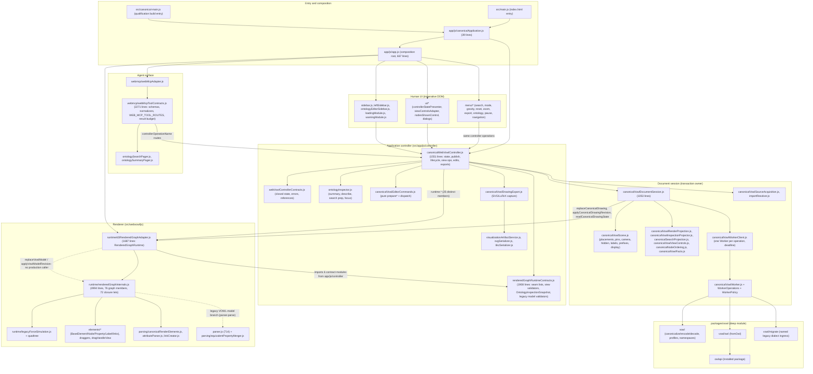
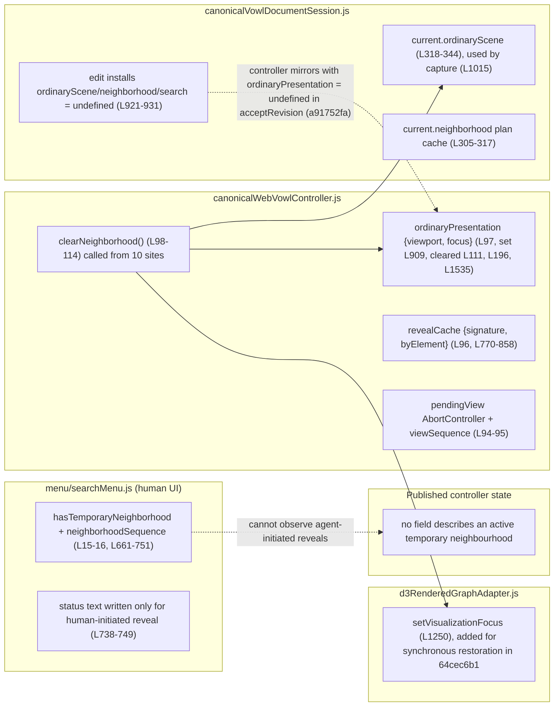
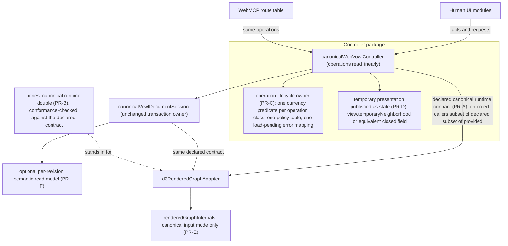

# WebVOWL architecture assessment: smallest changes that reduce change cost and regression risk

Run: `run-20261020T015803-dadc8b24`, started 2026-10-20 01:58 (+03:00).
Mode: planning and review only.
Author: Claude (Opus 5.5) in one serial session, with no subagents, per the owner's standing rule.
Status: review record. Its recommendations are proposals awaiting the owner decisions in section 15; none has been accepted or implemented.
Citations: source citations are relative links, and line numbers refer to HEAD `62961414`; later commits may move them.
When the citations were converted to links, some ranges were tightened to the exact start and end of the cited construct, and one start line that pointed at a blank line was corrected.
Location: written outside the repository as the task required, as a report, an evidence log and three Mermaid files.
On 2026-10-20 the owner moved them into the repository, then had the diagrams embedded and the evidence log appended (section 17), giving this single file.
Parallel reviews from the same date: [performance](20261020-performance-review.md) and [UI design](20261020-ui-design-review.md).
This assessment was written without reading them, as the task instructed, and is not reconciled with them.

## 0. Reading guide, scope, and evidence classes

### 0.1 Repository state inspected

| Item                | Value                                                                                                                                                         |
| ------------------- | ------------------------------------------------------------------------------------------------------------------------------------------------------------- |
| Checkout            | `C:\Users\maksy\GitHub\webvowl` (no linked worktrees)                                                                                                         |
| Remote              | `origin` = `Hadden-Industries/webvowl`; `upstream` = `VisualDataWeb/WebVOWL`                                                                                  |
| Branch / HEAD       | `main` at `62961414530e141f8f79ec369afee2d68b9036a6` ("Merge pull request #81: Align JSON Quality consumer tooling", 2026-10-19)                              |
| Pre-existing change | ` M AGENTS.md` (+10/−5; replaces the commit-authorization text with a disposable-repository exception). User-owned; not read as a task input and not touched. |
| Authoritative input | Current working-tree contents. No production source file differs from HEAD.                                                                                   |

### 0.2 Operating boundaries honoured

- Only read-only operations were run: file reads, `grep`/`awk`/`sed -n` over the working tree, and `git log`/`git show`/`git diff`/`git status`.
- Nothing was built, tested, benchmarked, generated, installed or formatted.
  `npm run graph:dependencies` and dependency-cruiser were deliberately not run, because the graph command writes a bundle and counts as a generator.
- No branch, worktree, commit, publication, configuration change or HISEW/workflow mutation happened.
- The assessment's only writes were this report and its diagrams, under `C:\Users\maksy\Documents\Claude-planning-reviews\2026-10-20\task-03\run-20261020T015803-dadc8b24\`, plus one scratch file (`cochange.txt`, the raw `git log --name-only` output) in the session's temporary scratchpad.
  The owner has since moved the report into the repository (see Location above).
- Performance prioritisation and UI design belong to other threads.
  Section 13 states only the seams those threads would use.

### 0.3 Evidence classes

Each claim carries one tag:

- **\[M]** Measured, by the repository's own retained qualification records. This assessment re-measured nothing.
- **\[S]** Static observation: read directly from source, tests, configuration or Git at the stated commit.
- **\[I]** Inference: reasoned from \[S] evidence but not executed. Each one names the test that would confirm or refute it.
- **\[P]** Proposal.

No \[P] item claims a performance benefit.
Where a change might have a performance side effect, it is named as a question for the performance thread.

### 0.4 Contents of this document

Sections 1 to 16 are the assessment.
Section 17 is the evidence log: the commands run and the key outputs they returned.

The diagrams are embedded as non-executable Mermaid blocks:

- the current module and dependency map, in section 3;
- who holds the temporary neighbourhood, in section 6 under rank 3;
- the proposed seams, in section 10.

---

## 1. Executive summary

**Verdict: keep the macro-architecture, and deepen three seams inside it.**
The evidence does not justify a broad redesign: no new framework, no new state library, no TypeScript migration, no renderer replacement.

The layering is sound and was requalified in production on 2026-10-04 \[M: cutover review, 9,315 tests across 145 suites; live three-engine browser matrix]:

1. canonical `vowl` package;
2. per-operation worker;
3. transactional document session;
4. controller;
5. renderer adapter;
6. renderer internals.

The human UI and WebMCP sit side by side over the controller.
ADR 0010's ownership rule and ADR 0012's action parity hold structurally: WebMCP reaches the controller only through its `WEB_MCP_TOOL_ROUTES` table, plus `getState()` reads \[S].

The cost of future change concentrates in three places:

1. **Operation lifecycle ownership inside [`canonicalWebVowlController.js`](../../src/app/js/controller/canonicalWebVowlController.js) (rank 1).**
   Supersession, cancellation, rollback, export abortion and neighbourhood retirement are re-implemented inside each operation.
   Seven mutable lifecycle variables back them, and the currency predicates come in seven different shapes \[S].
   Five of the nine focused commits that touched the controller since 2026-09-15 fixed ordering or composition defects in this logic \[S].
2. **The declared renderer seam no longer describes the seam production uses (rank 2).**
   The canonical controller and session call six runtime methods that `RENDERED_GRAPH_RUNTIME_METHOD_NAMES` does not list.
   The list still names two legacy VOWL-model methods that production never calls.
   The in-memory double and the shared runtime-contract suite are held to the legacy list \[S].
3. **The temporary neighbourhood has four holders and is not published as state (rank 3).**
   The search menu keeps its own supersession counter and "is a neighbourhood shown" flag, so the human UI can describe only reveals it started itself \[S, I].

Two further opportunities are real but secondary:

4. **A legacy VOWL-JSON input mode is still compiled into the production renderer (rank 4).**
   It doubles the renderer's input paths, and several renderer tests exercise that non-production path \[S].
5. **Derived per-revision semantic indexes are spread across controller and session (rank 5).**
   Each has its own invalidation rule.
   This matters for the preview/details scenario and is the natural attachment point for performance work \[S, I].

**Recommended route.**
Six small vertical PRs, in this order (section 11):

- PR-A: declare and enforce the canonical runtime contract.
- PR-B: characterise lifecycle behaviour with an honest double, tests only.
- PR-C: one lifecycle owner in the controller.
- PR-D: publish the temporary presentation as state and remove the UI mirror.
- PR-E: retire the legacy renderer input mode.
- PR-F, optional: one per-revision semantic read model.

PR-A and PR-B change no production behaviour.
They come first so that every later PR has an independent oracle.

**Two owner decisions surfaced** (section 15):

- Should cancelling a view request roll back already-applied visibility?
  The September action-parity design says no; the canonical controller does roll back.
- Which error code should view and read operations report while a load is pending?
  Today it is `EDIT_REJECTED`, which WebMCP turns into a non-retryable `TOOL_FAILED` \[S, I].

---

## 2. Production reachability map

The entry points are [`src/index.html`](../../src/index.html) → [`src/main.js`](../../src/main.js), and [`src/canonical-main.js`](../../src/canonical-main.js) for the isolated candidate build, which [`vite.config.mjs`](../../vite.config.mjs) ([`:388-400`](../../vite.config.mjs#L388-L400)) swaps in by rewriting the script tag \[S].
Both call `createCanonicalWebVowlApplication()` ([`src/app/js/canonicalApplication.js`](../../src/app/js/canonicalApplication.js), 39 lines).
That function composes `createWebVowlApplication()` ([`src/app/js/app.js`](../../src/app/js/app.js)) with canonical factories \[S].

| Class                                                                                             | Modules                                                                                                                                                                                                                                                                                                                                                                                                                                                                                                                                                                                                                                                                                                                                                                                                                                                                                                                                                                                                                                                                                                                                                                                                                                                                                                                                                                                                                                                                                                                                                                                                                                                                                                                    | Evidence                                                                                                                                                                                                                                                                                                                                                                                                                  |
| ------------------------------------------------------------------------------------------------- | -------------------------------------------------------------------------------------------------------------------------------------------------------------------------------------------------------------------------------------------------------------------------------------------------------------------------------------------------------------------------------------------------------------------------------------------------------------------------------------------------------------------------------------------------------------------------------------------------------------------------------------------------------------------------------------------------------------------------------------------------------------------------------------------------------------------------------------------------------------------------------------------------------------------------------------------------------------------------------------------------------------------------------------------------------------------------------------------------------------------------------------------------------------------------------------------------------------------------------------------------------------------------------------------------------------------------------------------------------------------------------------------------------------------------------------------------------------------------------------------------------------------------------------------------------------------------------------------------------------------------------------------------------------------------------------------------------------------------- | ------------------------------------------------------------------------------------------------------------------------------------------------------------------------------------------------------------------------------------------------------------------------------------------------------------------------------------------------------------------------------------------------------------------------- |
| **Active production (canonical composition invokes it)**                                          | [`app.js`](../../src/app/js/app.js) composition root. Controller: `canonicalWebVowlController`, `canonicalVowlDocumentSession`, `canonicalVowlScene`, worker client, worker, worker operations and policy, source acquisition, `importResolver`, editor commands, editor view, prefix commands, inspection projector, `ontologyInspector`, search projection, facts, render projection, view controls, node ordering, drawing export, SVG and TikZ serializers, artifact service, share link, layout settler, and the contract modules. Renderer: `d3RenderedGraphAdapter` (canonical methods), the canonical branch of `renderedGraphInternals`, legacy force simulation and quadtree, elements, draggers, `dragHandleView`, `canonicalRenderElements`, `attributeParser`, `linkCreator`. Shared filter and switch modules. All `ui/`, `menu/` and sidebar modules. `webmcp/*`. `packages/vowl` (`vowl`, `vowl/owl`, `vowl/migrate`) and `owlapi`.                                                                                                                                                                                                                                                                                                                                                                                                                                                                                                                                                                                                                                                                                                                                                                        | Import trace from [`app.js:1-31`](../../src/app/js/app.js#L1-L31) and [`canonicalApplication.js:1-39`](../../src/app/js/canonicalApplication.js#L1-L39). Controller → session → worker chain at [`canonicalWebVowlController.js:65-81`](../../src/app/js/controller/canonicalWebVowlController.js#L65-L81) and [`canonicalVowlDocumentSession.js:119`](../../src/app/js/controller/canonicalVowlDocumentSession.js#L119). |
| **Active migration code (permanent by design, not a remnant)**                                    | `vowl/migrate`, reached through `acquisition.legacyLocal` ([`canonicalWebVowlController.js:579-582`](../../src/app/js/controller/canonicalWebVowlController.js#L579-L582)). The compatible artifact profile, selected by `session.capture` ([`canonicalVowlDocumentSession.js:995-999`](../../src/app/js/controller/canonicalVowlDocumentSession.js#L995-L999)). `OntologyInspectionSnapshot`, the VOWL-shaped inspection contract that `canonicalVowlInspectionProjector` projects from canonical records to keep the inspector and WebMCP contracts stable.                                                                                                                                                                                                                                                                                                                                                                                                                                                                                                                                                                                                                                                                                                                                                                                                                                                                                                                                                                                                                                                                                                                                                              | Canonical design §7.4 and §26 make legacy ingress a named, one-way, permanent seam. ADR 0010 decision 2.                                                                                                                                                                                                                                                                                                                  |
| **Import-reachable but not invoked by the canonical composition (legacy remnants in the bundle)** | `d3RenderedGraphAdapter.replaceVowlModel` ([`d3RenderedGraphAdapter.js:1098`](../../src/webvowl/js/runtime/d3RenderedGraphAdapter.js#L1098)) and `applyVowlModelRevision` ([`:1204`](../../src/webvowl/js/runtime/d3RenderedGraphAdapter.js#L1204)), plus `indexDocumentRecords(vowlModel)` ([`:363-382`](../../src/webvowl/js/runtime/d3RenderedGraphAdapter.js#L363-L382)). The legacy branches in `renderedGraphInternals` (`parser` created at [`renderedGraphInternals.js:250`](../../src/webvowl/js/runtime/renderedGraphInternals.js#L250), `applyVowlModelRevision` at [`:2446`](../../src/webvowl/js/runtime/renderedGraphInternals.js#L2446), the dictionary branch at [`:2632-2665`](../../src/webvowl/js/runtime/renderedGraphInternals.js#L2632-L2665), the `loadGraphData` parse branch at [`:2696-2701`](../../src/webvowl/js/runtime/renderedGraphInternals.js#L2696-L2701)). [`parser.js`](../../src/webvowl/js/parser.js) (714 lines). [`parsing/equivalentPropertyMerger.js`](../../src/webvowl/js/parsing/equivalentPropertyMerger.js), imported only by [`parser.js`](../../src/webvowl/js/parser.js). `rendererElementReferences.indexOntologyElementReferencesByVowlElementId`, used only by the legacy indexer. The legacy validators in [`renderedGraphRuntimeContracts.js`](../../src/app/js/controller/renderedGraphRuntimeContracts.js) (`createVowlModelRevisionRequest` [`:1020`](../../src/app/js/controller/renderedGraphRuntimeContracts.js#L1020), `createVowlModelReplacementRequest` [`:1082`](../../src/app/js/controller/renderedGraphRuntimeContracts.js#L1082), `createVowlModelReplacementResult` [`:1130`](../../src/app/js/controller/renderedGraphRuntimeContracts.js#L1130)). | No non-test caller of `.replaceVowlModel(` or `.applyVowlModelRevision(` outside the adapter. The canonical owners call `replaceCanonicalDrawing` and `applyCanonicalDrawingRevision` instead (section 7.2).                                                                                                                                                                                                              |
| **Declared but production-unused contract**                                                       | `RENDERED_GRAPH_RUNTIME_METHOD_NAMES` ([`renderedGraphRuntimeContracts.js:28-50`](../../src/app/js/controller/renderedGraphRuntimeContracts.js#L28-L50)), `RENDERED_GRAPH_EVENT_KINDS` ([`:59-74`](../../src/app/js/controller/renderedGraphRuntimeContracts.js#L59-L74)) and `assertRenderedGraphRuntime` ([`:687`](../../src/app/js/controller/renderedGraphRuntimeContracts.js#L687)).                                                                                                                                                                                                                                                                                                                                                                                                                                                                                                                                                                                                                                                                                                                                                                                                                                                                                                                                                                                                                                                                                                                                                                                                                                                                                                                                  | Their only importers are tests and `src/app/test/*` (export → user map in section 17.2).                                                                                                                                                                                                                                                                                                                                  |
| **Test support**                                                                                  | [`src/app/test/inMemoryRenderedGraphAdapter.js`](../../src/app/test/inMemoryRenderedGraphAdapter.js) (828 lines, asserts the legacy contract). [`src/app/test/renderedGraphRuntimeContract.js`](../../src/app/test/renderedGraphRuntimeContract.js) (389 lines; drives `replaceVowlModel` 7 times). `packages/vowl/test/browser/{performance-search,live-recovery,performance-latency}.js` (real application). [`util/benchmark-canonical-performance.mjs`](../../util/benchmark-canonical-performance.mjs), [`util/qualify-canonical-browser.mjs`](../../util/qualify-canonical-browser.mjs) and [`util/analyze-canonical-heap.mjs`](../../util/analyze-canonical-heap.mjs).                                                                                                                                                                                                                                                                                                                                                                                                                                                                                                                                                                                                                                                                                                                                                                                                                                                                                                                                                                                                                                              | The architecture test at [`renderedGraphDecoupling.architecture.test.js:315`](../../src/renderedGraphDecoupling.architecture.test.js#L315) and [`:372`](../../src/renderedGraphDecoupling.architecture.test.js#L372) keeps the in-memory adapter out of production.                                                                                                                                                       |
| **Historical remnant**                                                                            | [`src/webvowl/js/entry.js`](../../src/webvowl/js/entry.js): a renderer "package" entry exporting `createD3RenderedGraphAdapter`. Nothing imports it; [`src/package.json`](../../src/package.json) is private with no exports and Vite has no library build. Last changed 2026-09-02, before the canonical cutover.                                                                                                                                                                                                                                                                                                                                                                                                                                                                                                                                                                                                                                                                                                                                                                                                                                                                                                                                                                                                                                                                                                                                                                                                                                                                                                                                                                                                         | [`docs/webmcp.md`](../../docs/webmcp.md): "The concrete renderer and options entry points were removed deliberately and have no aliases."                                                                                                                                                                                                                                                                                 |

**Existing boundary enforcement** (inspected before proposing any new rule):

- [`.dependency-cruiser.json`](../../.dependency-cruiser.json) has five rules \[S]:
  - `unresolved`;
  - `production-to-test-or-tooling`;
  - `production-to-development-package`;
  - `polyfill-importer-boundary`;
  - `cycles`, at **warn** severity only.
- [`src/renderedGraphDecoupling.architecture.test.js`](../../src/renderedGraphDecoupling.architecture.test.js) (16 tests) \[S]:
  - D3 confined to the renderer subtree;
  - no global renderer route;
  - a single runtime implementation;
  - retired identifiers absent;
  - every renderer member defined once and reached;
  - every declared event kind published.
- [`src/app/js/webmcp/webMcpArchitecture.test.js`](../../src/app/js/webmcp/webMcpArchitecture.test.js) \[S]:
  - the agent surface is imported only by the composition root;
  - it reaches no further than the controller;
  - it publishes no global;
  - there is no second transport or alias.
- [`src/productionGraph.architecture.test.js`](../../src/productionGraph.architecture.test.js) \[S]: the import graph from [`src/main.js`](../../src/main.js) reaches no retired legacy ingestion.
- [`src/webvowl/js/runtime/renderedGraphSeamConformance.test.js`](../../src/webvowl/js/runtime/renderedGraphSeamConformance.test.js) \[S]: a static ESLint AST check that every member the adapter calls on `renderedGraphInternals` exists.
  This is the right pattern, but it covers only the adapter → internals hop.
- [`.test-impact.json`](../../.test-impact.json) and [`docs/dependency-graph-and-tests.md`](../../docs/dependency-graph-and-tests.md) \[S]: affected-test selection, explicitly not a substitute for the architecture assertions.

Two gaps in these oracles matter for this assessment \[S]:

- "Reaches every member the renderer exposes" ([`renderedGraphDecoupling.architecture.test.js:424-449`](../../src/renderedGraphDecoupling.architecture.test.js#L424-L449)) counts references from test modules: `everyAuthoredModulePath()` at [`:231-239`](../../src/renderedGraphDecoupling.architecture.test.js#L231-L239) includes `src/app/test` and `*.test.js`.
  A member that only tests reach therefore counts as reached, so the oracle cannot detect production-dead capability.
- "Declares exactly one production rendered-graph runtime implementation" ([`renderedGraphDecoupling.architecture.test.js:326-336`](../../src/renderedGraphDecoupling.architecture.test.js#L326-L336)) recognises the implementation by the literal strings `createRenderedSvgSnapshot` **and** `replaceVowlModel`.
  The oracle itself depends on the legacy method name.

---

## 3. Current module and dependency diagram

Source: static reading of the working tree at `62961414` on `main`.
Solid arrows are imports and runtime calls that the canonical composition uses.
Dotted arrows are import-reachable but not invoked by it; they form the legacy path.



Dependency directions \[S]:

- `packages/vowl/src` imports nothing from `src/`.
- The application uses `vowl` (36 imports), `vowl/owl` (6) and `vowl/migrate` (1).
- The renderer adapter imports six modules from `src/app/js/controller/`: runtime, controller, interaction and arrangement contracts, `renderedDrawingSnapshot`, and `rendererElementReferences`.
  The renderer therefore depends on contracts that live in the application package.
  This is acceptable while those modules stay pure contracts.
  [`renderedGraphRuntimeContracts.js`](../../src/app/js/controller/renderedGraphRuntimeContracts.js) is not pure in that sense; see rank 2 and section 8.

---

## 4. State-ownership map

| Concern                                                                                          | Authoritative owner today                                                                                                                                                                                                                                                                                                                                 | Other holders, copies and mirrors                                                                                                                                                                                                                                                                                                                                                                                                                                                                                                                                                                                                                                                                                                                                                                                                                                                                 | Notes                                                                                                                                                                                                                                                               |
| ------------------------------------------------------------------------------------------------ | --------------------------------------------------------------------------------------------------------------------------------------------------------------------------------------------------------------------------------------------------------------------------------------------------------------------------------------------------------- | ------------------------------------------------------------------------------------------------------------------------------------------------------------------------------------------------------------------------------------------------------------------------------------------------------------------------------------------------------------------------------------------------------------------------------------------------------------------------------------------------------------------------------------------------------------------------------------------------------------------------------------------------------------------------------------------------------------------------------------------------------------------------------------------------------------------------------------------------------------------------------------------------- | ------------------------------------------------------------------------------------------------------------------------------------------------------------------------------------------------------------------------------------------------------------------- |
| Semantic facts (records, annotations, relations)                                                 | The worker-admitted canonical model. The session holds `current.inspection` (canonical records) and `current.checkpoint` ([`canonicalVowlDocumentSession.js:706-714`](../../src/app/js/controller/canonicalVowlDocumentSession.js#L706-L714), [`:921-931`](../../src/app/js/controller/canonicalVowlDocumentSession.js#L921-L931)).                       | `current.ontologyInspection`, the VOWL-shaped `OntologyInspectionSnapshot` derived per label language and prefixes ([`:589-594`](../../src/app/js/controller/canonicalVowlDocumentSession.js#L589-L594), [`:416-424`](../../src/app/js/controller/canonicalVowlDocumentSession.js#L416-L424)). The renderer receives drawing rows only (`bindDrawing` [`:66-112`](../../src/app/js/controller/canonicalVowlDocumentSession.js#L66-L112)).                                                                                                                                                                                                                                                                                                                                                                                                                                                         | ADR 0010 is satisfied: no UI module reads SVG for facts \[S].                                                                                                                                                                                                       |
| Admitted canonical documents and bytes                                                           | `packages/vowl` inside the worker (`canonicalize`/`encode`/`decode` admission).                                                                                                                                                                                                                                                                           | Capture returns bytes ([`canonicalVowlDocumentSession.js:993-1040`](../../src/app/js/controller/canonicalVowlDocumentSession.js#L993-L1040)).                                                                                                                                                                                                                                                                                                                                                                                                                                                                                                                                                                                                                                                                                                                                                     | Canonical design §7.2 and §20: the worker encodes before transfer.                                                                                                                                                                                                  |
| Load generation                                                                                  | Session `generation` ([`canonicalVowlDocumentSession.js:120`](../../src/app/js/controller/canonicalVowlDocumentSession.js#L120), `++generation` at [`:497`](../../src/app/js/controller/canonicalVowlDocumentSession.js#L497)).                                                                                                                           | Controller `state.loadGeneration` (published). Controller `loadSequence` ([`canonicalWebVowlController.js:85`](../../src/app/js/controller/canonicalWebVowlController.js#L85)), a different counter that tracks load attempts for supersession. Adapter `activeLoadGeneration` ([`d3RenderedGraphAdapter.js:181`](../../src/webvowl/js/runtime/d3RenderedGraphAdapter.js#L181)).                                                                                                                                                                                                                                                                                                                                                                                                                                                                                                                  | Two counters cover overlapping concepts: the controller's attempt sequence and the session's generation \[S].                                                                                                                                                       |
| Document revision                                                                                | Session `current.revision`.                                                                                                                                                                                                                                                                                                                               | Controller `state.documentRevision`, published after `acceptRevision`. Adapter `canonicalDocumentRevision` ([`d3RenderedGraphAdapter.js:182`](../../src/webvowl/js/runtime/d3RenderedGraphAdapter.js#L182)).                                                                                                                                                                                                                                                                                                                                                                                                                                                                                                                                                                                                                                                                                      | Between the session commit and the controller publish there is a short window in which they differ \[S]; see scenario 3.                                                                                                                                            |
| Entity references (`OntologyElementReference`)                                                   | Built by `createCanonicalSemanticReferences` ([`canonicalVowlInspectionProjector.js:20+`](../../src/app/js/controller/canonicalVowlInspectionProjector.js#L20)).                                                                                                                                                                                          | `state.selection` and `state.view.focus`. The adapter's maps `rendererElementIdsByOntologyElementReferenceKey` and `ontologyElementReferencesByRendererElementId` ([`d3RenderedGraphAdapter.js:187-188`](../../src/webvowl/js/runtime/d3RenderedGraphAdapter.js#L187-L188)).                                                                                                                                                                                                                                                                                                                                                                                                                                                                                                                                                                                                                      | Kind + IRI, or anonymous + generation \[S].                                                                                                                                                                                                                         |
| Document-record targets (`{loadGeneration, recordToken}`)                                        | Session `records` map, `target()` and `resolveTarget()` ([`canonicalVowlDocumentSession.js:147-170`](../../src/app/js/controller/canonicalVowlDocumentSession.js#L147-L170)).                                                                                                                                                                             | `state.selectedDocumentRecord`. Adapter `documentRecordTargetsByRendererElementId` ([`d3RenderedGraphAdapter.js:189`](../../src/webvowl/js/runtime/d3RenderedGraphAdapter.js#L189)). Controller `selectedEditorOccurrence` ([`canonicalWebVowlController.js:394`](../../src/app/js/controller/canonicalWebVowlController.js#L394), used at [`:731-734`](../../src/app/js/controller/canonicalWebVowlController.js#L731-L734)).                                                                                                                                                                                                                                                                                                                                                                                                                                                                    | Human-only editing authority, as ADR 0012 requires \[S].                                                                                                                                                                                                            |
| Rendered occurrences                                                                             | Scene `reference(id)` and `resolve(ref)` ([`canonicalVowlScene.js:201-218`](../../src/app/js/controller/canonicalVowlScene.js#L201-L218)). Arrangement references `{loadGeneration, occurrenceId}`.                                                                                                                                                       | Adapter `occurrenceIdsByRendererKey` ([`d3RenderedGraphAdapter.js:190`](../../src/webvowl/js/runtime/d3RenderedGraphAdapter.js#L190)).                                                                                                                                                                                                                                                                                                                                                                                                                                                                                                                                                                                                                                                                                                                                                            | Generation-scoped and opaque \[S].                                                                                                                                                                                                                                  |
| Scene state (placements, pins, camera, effective hidden set, label selection, prefixes, display) | `canonicalVowlScene`, owned by the session.                                                                                                                                                                                                                                                                                                               | Live positions and pins belong to the renderer while it runs; they are synchronised into the scene by `synchronizeDrawing(readCanonicalDrawingState())` before capture, after arrangement, view, reset and reveal operations, and before scene updates ([`canonicalWebVowlController.js:929`](../../src/app/js/controller/canonicalWebVowlController.js#L929), [`:1111`](../../src/app/js/controller/canonicalWebVowlController.js#L1111), [`:1234`](../../src/app/js/controller/canonicalWebVowlController.js#L1234), [`:1368`](../../src/app/js/controller/canonicalWebVowlController.js#L1368); [`canonicalVowlDocumentSession.js:397-401`](../../src/app/js/controller/canonicalVowlDocumentSession.js#L397-L401), [`:450-471`](../../src/app/js/controller/canonicalVowlDocumentSession.js#L450-L471), [`:960-964`](../../src/app/js/controller/canonicalVowlDocumentSession.js#L960-L964)). | Pull-based synchronisation; correct, but it is one more step every operation must remember \[S].                                                                                                                                                                    |
| Visibility                                                                                       | Three representations: filter controls and `nodesShown` (controller `filters` and `nodesShown`, [`canonicalWebVowlController.js:91-93`](../../src/app/js/controller/canonicalWebVowlController.js#L91-L93)), the effective hidden set (scene), and actual drawn visibility (`readVisibleRenderedGraphSnapshot`).                                          | `retainedHidden` scene references ([`:92`](../../src/app/js/controller/canonicalWebVowlController.js#L92)).                                                                                                                                                                                                                                                                                                                                                                                                                                                                                                                                                                                                                                                                                                                                                                                       | Matches canonical design §15.3: the artifact stores only the effective set \[S].                                                                                                                                                                                    |
| Temporary neighbourhood                                                                          | **No single owner.** Controller: `ordinaryPresentation`, `revealCache`, `pendingView`. Session: `current.ordinaryScene` and `current.neighborhood`. Adapter: `setVisualizationFocus`. Search menu: `hasTemporaryNeighborhood` and `neighborhoodSequence`.                                                                                                 | Not represented in the published state's field list ([`webVowlControllerContracts.js:17+`](../../src/app/js/controller/webVowlControllerContracts.js#L17); the `idle` object at [`canonicalWebVowlController.js:44-62`](../../src/app/js/controller/canonicalWebVowlController.js#L44-L62)).                                                                                                                                                                                                                                                                                                                                                                                                                                                                                                                                                                                                      | Rank 3 \[S].                                                                                                                                                                                                                                                        |
| Camera and viewport                                                                              | The renderer, live (`zoomFactor`, `graphTranslation`).                                                                                                                                                                                                                                                                                                    | Published `zoomScale` and `translation` through the `viewport-changed` event ([`canonicalWebVowlController.js:415-423`](../../src/app/js/controller/canonicalWebVowlController.js#L415-L423)). The scene camera, synchronised for export. `ordinaryPresentation.viewport` for the share link during a reveal ([`:1043-1047`](../../src/app/js/controller/canonicalWebVowlController.js#L1043-L1047)).                                                                                                                                                                                                                                                                                                                                                                                                                                                                                             | ADR 0010 decision 7 is satisfied \[S].                                                                                                                                                                                                                              |
| Pinning                                                                                          | Renderer element `pinned()`, live; scene placements.                                                                                                                                                                                                                                                                                                      | —                                                                                                                                                                                                                                                                                                                                                                                                                                                                                                                                                                                                                                                                                                                                                                                                                                                                                                 | Synchronised as above \[S].                                                                                                                                                                                                                                         |
| Label language                                                                                   | Scene `labelSelection` (canonical), plus the adapter's applied view ([`d3RenderedGraphAdapter.js:684-693`](../../src/webvowl/js/runtime/d3RenderedGraphAdapter.js#L684-L693), [`:779-780`](../../src/webvowl/js/runtime/d3RenderedGraphAdapter.js#L779-L780)).                                                                                            | Published `state.view.language`, composed by `readView()`.                                                                                                                                                                                                                                                                                                                                                                                                                                                                                                                                                                                                                                                                                                                                                                                                                                        | Published `view` is composed in two places ([`canonicalWebVowlController.js:127-133`](../../src/app/js/controller/canonicalWebVowlController.js#L127-L133) and [`:424-432`](../../src/app/js/controller/canonicalWebVowlController.js#L424-L432)); see rank 1 \[S]. |
| Worker lifecycle                                                                                 | `canonicalVowlWorkerClient`: one `Worker` per operation, a whole-job deadline, and termination ([`canonicalVowlWorkerClient.js:225-361`](../../src/app/js/controller/canonicalVowlWorkerClient.js#L225-L361)).                                                                                                                                            | The session decides which operation is current (`loading`, `mutation`, `captures`).                                                                                                                                                                                                                                                                                                                                                                                                                                                                                                                                                                                                                                                                                                                                                                                                               | \[M] Qualification follow-up: "creates and terminates a worker for each operation".                                                                                                                                                                                 |
| Search preparation                                                                               | Session `current.search`: prepared once per accepted revision and updated when presentation changes ([`canonicalVowlDocumentSession.js:292-304`](../../src/app/js/controller/canonicalVowlDocumentSession.js#L292-L304), [`:441-447`](../../src/app/js/controller/canonicalVowlDocumentSession.js#L441-L447)).                                            | WebMCP pagers hold eight continuation records each ([`docs/webmcp.md`](../../docs/webmcp.md)).                                                                                                                                                                                                                                                                                                                                                                                                                                                                                                                                                                                                                                                                                                                                                                                                    | Bounded at the WebMCP boundary, matching the owner's rule \[S].                                                                                                                                                                                                     |
| Other derived indexes                                                                            | —                                                                                                                                                                                                                                                                                                                                                         | Reveal ranks: controller `revealCache`, keyed by a `structuredClone` signature compared with lodash `isEqual` ([`canonicalWebVowlController.js:770-841`](../../src/app/js/controller/canonicalWebVowlController.js#L770-L841)). Neighbourhood plan: session ([`canonicalVowlDocumentSession.js:305-317`](../../src/app/js/controller/canonicalVowlDocumentSession.js#L305-L317)). Describe and focus resolution: rebuilt on every call ([`ontologyInspector.js:680-720`](../../src/app/js/controller/ontologyInspector.js#L680-L720), [`:808+`](../../src/app/js/controller/ontologyInspector.js#L808)).                                                                                                                                                                                                                                                                                          | Rank 5 \[S].                                                                                                                                                                                                                                                        |
| Edits                                                                                            | Session `edit()` transaction ([`canonicalVowlDocumentSession.js:737-943`](../../src/app/js/controller/canonicalVowlDocumentSession.js#L737-L943)): worker `edit-model` → authorize → correspondence → `scene.prepareEdit` → reconcile → projection → `commit(beforeCommit: applyCanonicalDrawingRevision)` → install `current`.                           | Controller `command()` and `acceptRevision()` ([`canonicalWebVowlController.js:195-319`](../../src/app/js/controller/canonicalWebVowlController.js#L195-L319)), and the `edits` set.                                                                                                                                                                                                                                                                                                                                                                                                                                                                                                                                                                                                                                                                                                              | Well-shaped transaction owner \[S].                                                                                                                                                                                                                                 |
| Exports                                                                                          | Canonical JSON: `session.exportCanonicalArtifact` → `capture` (worker). Turtle and original source: `exportSemanticArtifact` (worker). SVG and LaTeX: `exportCanonicalDrawing` → `runtime.createRenderedSvgSnapshot` and `createRenderedDrawingSnapshot` → serializers. All publish through `visualizationArtifactService` and the download adapter port. | Controller `activeExport` (single in flight), `layoutIntent` (restore guard).                                                                                                                                                                                                                                                                                                                                                                                                                                                                                                                                                                                                                                                                                                                                                                                                                     | The responsibilities stay distinct, as canonical design §15 and ADR 0011 require \[S].                                                                                                                                                                              |
| UI presentation                                                                                  | `controllerStatePresenter`: load, layout, selection → describe, zoom, editor mode ([`app.js:445-472`](../../src/app/js/app.js#L445-L472)).                                                                                                                                                                                                                | An inline subscriber in [`app.js`](../../src/app/js/app.js) ([`:473-506`](../../src/app/js/app.js#L473-L506)) handles search, focus and node count. `visualizationViewControlsAdapter`, `ontologyEditorSidebar` ([`ontologyEditorSidebar.js:493`](../../src/app/js/ontologyEditorSidebar.js#L493)) and `canonicalFactsDialog` ([`canonicalFactsDialog.js:45`](../../src/app/js/ui/canonicalFactsDialog.js#L45)) each subscribe separately.                                                                                                                                                                                                                                                                                                                                                                                                                                                        | Four field-routing places; acceptable, but the inline subscriber duplicates the presenter's role \[S].                                                                                                                                                              |

---

## 5. Change scenario traces

### Scenario 1: add an entity preview and full-details presentation without making SVG the semantic store

**Today's full-details path** \[S]:

1. A renderer click causes the adapter to publish `rendered-element-selection-changed` with entity references.
2. The controller ([`canonicalWebVowlController.js:408-410`](../../src/app/js/controller/canonicalWebVowlController.js#L408-L410)) runs `publish({selection})`.
3. The [`app.js`](../../src/app/js/app.js) subscriber passes the state to `controllerStatePresenter.present`.
4. On a change to `selection`, language or `documentRevision`, the presenter calls `describeOntologyElements`.
5. The controller ([`canonicalWebVowlController.js:991-997`](../../src/app/js/controller/canonicalWebVowlController.js#L991-L997)) calls `inspector.describeOntologyElements({...snapshots()})`.
   `snapshots()` ([`canonicalWebVowlController.js:167-173`](../../src/app/js/controller/canonicalWebVowlController.js#L167-L173)) structured-clones the whole `OntologyInspectionSnapshot` (`session.inspectOntology()`) and reads `readVisibleRenderedGraphSnapshot()`.
6. `sidebar.renderSelectedOntologyElementDetails` ([`sidebar.js:721+`](../../src/app/js/sidebar.js#L721)) builds the DOM.

Two sibling channels already exist:

- `getOntologyFacts`: paged canonical records, including details-only facts ([`canonicalVowlFacts.js`](../../src/app/js/controller/canonicalVowlFacts.js)), used by `canonicalFactsDialog`.
- `getOntologyEditorView(selectedDocumentRecord)`: the human editing view.

**Adding a preview, for example a hover or keyboard-focus card with a "full details" action** \[I], predicted to touch these modules:

- `renderedGraphInternals` (the hover hooks already exist: `activateHoverElements` [`renderedGraphInternals.js:4884`](../../src/webvowl/js/runtime/renderedGraphInternals.js#L4884), `activateHoverElementsForProperties` [`:4685`](../../src/webvowl/js/runtime/renderedGraphInternals.js#L4685)).
- `d3RenderedGraphAdapter`: publish a new identity-only event, translating renderer ids through `canonicalBindings`.
- `renderedGraphRuntimeContracts`: `RENDERED_GRAPH_EVENT_KINDS` and `createRenderedGraphEvent`.
- The controller event switch, and either a closed state field (`webVowlControllerContracts` field list and the `idle` object) or a query-only design.
- `controllerStatePresenter` field routing.
- A new preview module.
- The in-memory double (held to the declared event list).

The existing architecture test "publishes every rendered graph event kind the seam declares" catches a missing publication automatically.

Assessment of this scenario:

- **Duplicated decisions:** which description fields to show and how.
  The sidebar's imperative builder ([`sidebar.js:721-1055`](../../src/app/js/sidebar.js#L721-L1055)) is the only description-to-presentation logic, so a preview would duplicate it unless a pure presentation model is extracted.
  That extraction is the UI thread's decision (section 13).
- **Implicit ordering:** a preview must re-describe on a revision or language change, exactly as the presenter does, or it shows stale text.
  Events from retired generations are already dropped ([`canonicalWebVowlController.js:396-401`](../../src/app/js/controller/canonicalWebVowlController.js#L396-L401)).
- **Shared mutable state:** none is needed if the preview is derived from published facts.
  The risk is preview state kept in a menu closure, the same pattern as rank 3.
- **Error propagation:** describe throws for references from a retired generation.
  Because `publish()` ([`canonicalWebVowlController.js:136-151`](../../src/app/js/controller/canonicalWebVowlController.js#L136-L151)) calls subscribers without isolation, an exception in a presentation subscriber propagates into whichever operation published, after `state` has already changed and with later subscribers not notified \[S, I].
  The rule therefore needs to be explicit (section 10, invariant P4).
- **Tests needed:** the event validator; adapter tests that one entity with several occurrences (FOAF's six `owl:Thing` nodes) yields one reference set; a controller test that previews are dropped across a generation change; a presenter re-describe test; a test that the preview carries no semantic payload from the renderer; keyboard-focus parity.
- **Verdict:** the present seams support this scenario without SVG becoming a store.
  The cost drivers are the undeclared and legacy-mixed contract module (rank 2) and the absence of a single per-revision read model (rank 5), not the presentation layer.

### Scenario 2: add or amend a visualization action used by both human UI and WebMCP

**Concrete historical instance:** `1189113f` "feat: Add exact node-count selection" (2026-10-08) touched 54 files: 31 non-test production files and 23 tests \[S].
They spanned:

- the `vowl` package index and worker operations;
- the session and view controls;
- the new `canonicalNodeOrdering` and `nodesShownContracts`;
- the controller (+232 changed lines);
- three contract modules;
- the share link, `loadingModule`, `searchMenu`, the presenter, the new `nodesShownControl`, and the view-controls adapter;
- `webMcpToolContracts`;
- the legacy in-memory double and the legacy contract suite;
- [`index.html`](../../src/index.html) and CSS;
- the removal of a renderer-owned degree filter from the adapter, internals and settings.

Much of that breadth is legitimate, because the change moved an ownership out of the renderer, which is good under ADR 0010.
Two follow-up fixes landed within five days, both in controller lifecycle and composition code \[S]:

- `e5f8a9ee` "Close count-selection review findings": "fence rollback by document revision".
- `2cb8e23f`: "Preserve node-count intent when publishing renderer view changes".
  This added `nodesShown` to the event-driven `view` composition at [`canonicalWebVowlController.js:424-432`](../../src/app/js/controller/canonicalWebVowlController.js#L424-L432), which had diverged from `readView()` at [`:127-133`](../../src/app/js/controller/canonicalWebVowlController.js#L127-L133).

**What an action author must decide by hand today** \[S]:

1. Whether to call `clearNeighborhood()` first. There are 10 call sites; some operations do and some do not.
2. Whether to call `activeExport?.abort()`. There are 15 sites.
3. Whether to take view ownership (`++viewSequence`, `pendingView?.abort()`), and **when**.
   `54081f7c` moved the take-over below the scene acceptance in `resetVisualization`.
4. Which currency predicate to check in success, rollback and `finally` (table below).
5. Whether to roll back the scene on failure.
6. Whether to synchronise placements back (`session.synchronizeDrawing(runtime.readCanonicalDrawingState())`).
7. Which fields to publish, and how to compose `view`.
8. Which error code to throw. The shared `current()` guard ([`canonicalWebVowlController.js:152-166`](../../src/app/js/controller/canonicalWebVowlController.js#L152-L166)) throws `EDIT_REJECTED` during a pending load for every operation, view and read operations included.

Currency predicates in use \[S]:

| Operation                              | Lines                                                                                                                                                                                                                                                                                            | Terms checked                                                              |
| -------------------------------------- | ------------------------------------------------------------------------------------------------------------------------------------------------------------------------------------------------------------------------------------------------------------------------------------------------ | -------------------------------------------------------------------------- |
| `command` (edit)                       | [`canonicalWebVowlController.js:305`](../../src/app/js/controller/canonicalWebVowlController.js#L305)                                                                                                                                                                                            | `disposed`, `loadSequence`                                                 |
| `observe` (renderer-initiated failure) | [`canonicalWebVowlController.js:323`](../../src/app/js/controller/canonicalWebVowlController.js#L323)                                                                                                                                                                                            | `disposed`, `loadSequence`, `pendingLoad`                                  |
| `revealOntologyNeighborhood`           | [`canonicalWebVowlController.js:917-923`](../../src/app/js/controller/canonicalWebVowlController.js#L917-L923) (success), [`:937-942`](../../src/app/js/controller/canonicalWebVowlController.js#L937-L942) (rollback)                                                                           | + `viewSequence`, `documentRevision`; `viewSignal.aborted` on success only |
| `setVisualizationArrangement`          | [`canonicalWebVowlController.js:1108`](../../src/app/js/controller/canonicalWebVowlController.js#L1108)                                                                                                                                                                                          | `disposed`, `loadSequence`                                                 |
| `setVisualizationView`                 | [`canonicalWebVowlController.js:1225-1231`](../../src/app/js/controller/canonicalWebVowlController.js#L1225-L1231), [`:1244-1250`](../../src/app/js/controller/canonicalWebVowlController.js#L1244-L1250), [`:1266-1271`](../../src/app/js/controller/canonicalWebVowlController.js#L1266-L1271) | + `viewSequence`, `documentRevision`; `aborted` on success only            |
| `setVisualizationModes`                | [`canonicalWebVowlController.js:1310`](../../src/app/js/controller/canonicalWebVowlController.js#L1310), [`:1314`](../../src/app/js/controller/canonicalWebVowlController.js#L1314)                                                                                                              | `disposed`, `loadSequence`                                                 |
| `resetVisualization`                   | [`canonicalWebVowlController.js:1361-1365`](../../src/app/js/controller/canonicalWebVowlController.js#L1361-L1365), [`:1370-1374`](../../src/app/js/controller/canonicalWebVowlController.js#L1370-L1374)                                                                                        | + `viewSequence`, but **no** `documentRevision`                            |
| `exportVisualization` (drawing)        | [`canonicalWebVowlController.js:1475-1486`](../../src/app/js/controller/canonicalWebVowlController.js#L1475-L1486) `assertCurrent`                                                                                                                                                               | `disposed`, `loadSequence`, `documentRevision`                             |
| `exportVisualization` restore          | [`canonicalWebVowlController.js:1487-1490`](../../src/app/js/controller/canonicalWebVowlController.js#L1487-L1490) `canRestoreLayout`                                                                                                                                                            | `disposed`, `loadSequence`, `layoutIntent`                                 |

Some differences are probably deliberate.
For example, display modes do not change the scene revision, and a view request made during an edit is meant to be merged by `scene.prepareEdit` ("reconcile against the latest drag/pin state", [`canonicalVowlDocumentSession.js:831-832`](../../src/app/js/controller/canonicalVowlDocumentSession.js#L831-L832)).
None of these differences is written down, and no test enumerates them.

**Error propagation in this scenario** \[S, I]:

- WebMCP's `ACCEPTED_DOMAIN_ERROR_CODES` ([`webMcpToolContracts.js:1386-1399`](../../src/app/js/webmcp/webMcpToolContracts.js#L1386-L1399)) omits `EDIT_REJECTED`.
- `projectWebMcpDomainError` ([`webMcpToolContracts.js:1636-1662`](../../src/app/js/webmcp/webMcpToolContracts.js#L1636-L1662)) therefore projects that code as `TOOL_FAILED`, "The operation could not be completed.", `isRetryable: false`.
- The dispatch reads `getState()` before calling, but never checks for a pending load ([`webMcpToolContracts.js:2051-2070`](../../src/app/js/webmcp/webMcpToolContracts.js#L2051-L2070)).

So an agent calling `set_visualization_view`, `reset_visualization`, `get_ontology_summary`, `find_ontology_elements` or `get_visualization_arrangement` while a load is pending gets a generic, non-retryable failure.
A human gets the actionable message ("Wait for the current document load to finish.").
That is a human/agent parity gap in error information.
PR-B is to confirm it with a test.

**Tests needed for any new shared action:**

- WebMCP schema, normalizer and route.
- Controller validation.
- A lifecycle matrix: a newer view, a load replacement, a pending edit, dispose, and caller abort.
- Published-state composition.
- The UI control's read direction (state → control) without synthetic events.
- An agent and human equivalence check.

Today this matrix is written by accretion: one 506-line test with 64 assertions at [`canonicalWebVowlController.test.js:156-661`](../../src/app/js/controller/canonicalWebVowlController.test.js#L156-L661) drives about 20 operations in sequence \[S].

### Scenario 3: change a load or edit operation while preserving cancellation, stale-result rejection, atomic publication, previous-document recovery, and export fidelity

**Edit path** \[S]:

1. The UI calls `editOntologyRecord`.
2. `editorRequest` ([`canonicalWebVowlController.js:174-194`](../../src/app/js/controller/canonicalWebVowlController.js#L174-L194)) checks the allowed fields, generation and revision, then calls `clearNeighborhood`.
3. `command` ([`canonicalWebVowlController.js:249-319`](../../src/app/js/controller/canonicalWebVowlController.js#L249-L319)) runs `current()`, calls `clearNeighborhood` again, builds selection targets through a structured-cloned `inspectRecords()`, aborts any export, and registers the edit.
4. `applyCanonicalEditorCommand` runs a pure `prepare*` function and calls `session.edit`.
5. Inside `session.edit` ([`canonicalVowlDocumentSession.js:737-943`](../../src/app/js/controller/canonicalVowlDocumentSession.js#L737-L943)):
   1. worker `edit-model`;
   2. `checkCurrent`;
   3. `authorize` (confirmation dialogs);
   4. correspondence validation;
   5. `scene.prepareEdit`;
   6. `reconcile`, a UI dialog;
   7. `checkCurrent`;
   8. projection, binding and inspection projection, all before any live mutation;
   9. `checkCurrent`;
   10. `commit({beforeCommit: applyCanonicalDrawingRevision})`;
   11. install `current`, resetting `search`, `neighborhood` and `ordinaryScene`.
6. Back in the controller: a `loadSequence` check, then `acceptRevision` ([`canonicalWebVowlController.js:195-248`](../../src/app/js/controller/canonicalWebVowlController.js#L195-L248)).
   It clears `ordinaryPresentation` and `revealCache`, aborts the pending view, re-resolves the selection, recomputes visibility, and publishes.

How each required property is met today:

| Property                   | How it is met today                                                                                                                                                                                                                                                                                                                                                                                                                                                                                                                                                                                                                  | Owner                                                      |
| -------------------------- | ------------------------------------------------------------------------------------------------------------------------------------------------------------------------------------------------------------------------------------------------------------------------------------------------------------------------------------------------------------------------------------------------------------------------------------------------------------------------------------------------------------------------------------------------------------------------------------------------------------------------------------ | ---------------------------------------------------------- |
| Cancellation               | The `edits` set and the session's `mutation` are aborted by load and dispose; signals are combined into the worker and the dialogs.                                                                                                                                                                                                                                                                                                                                                                                                                                                                                                  | Controller + session.                                      |
| Stale-result rejection     | Session `checkCurrent` runs three times ([`canonicalVowlDocumentSession.js:771-783`](../../src/app/js/controller/canonicalVowlDocumentSession.js#L771-L783)); the controller checks `loadSequence` ([`canonicalWebVowlController.js:305`](../../src/app/js/controller/canonicalWebVowlController.js#L305)).                                                                                                                                                                                                                                                                                                                          | Two layers with different predicates.                      |
| Atomic publication         | The scene commit and the renderer revision run in one synchronous `beforeCommit`. The renderer revision recovers itself and raises `AggregateError` with `CANONICAL_DRAWING_RECOVERY_FAILED` ([`renderedGraphInternals.js:2350-2405`](../../src/webvowl/js/runtime/renderedGraphInternals.js#L2350-L2405)). Controller state is published afterwards, in a separate step.                                                                                                                                                                                                                                                            | Session (atomic), then controller (publication).           |
| Previous-document recovery | Edit failure before the commit leaves `current` untouched. For a load: presentation is serialised on `presentationTail` ([`canonicalVowlDocumentSession.js:602-604`](../../src/app/js/controller/canonicalVowlDocumentSession.js#L602-L604), [`:729`](../../src/app/js/controller/canonicalVowlDocumentSession.js#L729)), the previous drawing is re-installed on failure ([`:676-703`](../../src/app/js/controller/canonicalVowlDocumentSession.js#L676-L703)), and the controller republishes the retained state ([`canonicalWebVowlController.js:687-712`](../../src/app/js/controller/canonicalWebVowlController.js#L687-L712)). | Session (renderer recovery) + controller (state recovery). |
| Export fidelity            | Captures reject with `DOCUMENT_BUSY` during load or mutation ([`canonicalVowlDocumentSession.js:1000-1002`](../../src/app/js/controller/canonicalVowlDocumentSession.js#L1000-L1002)). Commands abort the active export. Capture uses `ordinaryScene ?? scene.snapshot()` ([`:1015`](../../src/app/js/controller/canonicalVowlDocumentSession.js#L1015)), so a temporary reveal never leaks into canonical bytes. The drawing export checks `documentRevision` ([`canonicalWebVowlController.js:1478-1480`](../../src/app/js/controller/canonicalWebVowlController.js#L1478-L1480)).                                                 | Session + controller.                                      |

Assessment of this scenario:

- **Duplicated decisions** \[S]:
  - Selection references are rebuilt before the edit ([`canonicalWebVowlController.js:253-265`](../../src/app/js/controller/canonicalWebVowlController.js#L253-L265)) and again after it ([`:214-233`](../../src/app/js/controller/canonicalWebVowlController.js#L214-L233)).
  - Visibility is computed by the `prepareVisibility` callback inside the edit ([`canonicalWebVowlController.js:286-302`](../../src/app/js/controller/canonicalWebVowlController.js#L286-L302)) and again in `acceptRevision` ([`:234-238`](../../src/app/js/controller/canonicalWebVowlController.js#L234-L238)).
  - Two stale-check vocabularies exist: the session's `current/mutation/loading/generation/revision` and the controller's `disposed/loadSequence`.
- **Shared mutable state** \[S]: `prepareVisibility` reads the controller's live `filters`, `nodesShown` and `retainedHidden` at reconcile time.
  These "latest" semantics are intended, but nothing documents them.
- **Load path complexity** \[S]: `loadOntology` ([`canonicalWebVowlController.js:512-715`](../../src/app/js/controller/canonicalWebVowlController.js#L512-L715)) holds six source-kind branches and an import-format retry loop (`for(;;)` with per-attempt `AbortController` and `awaitingFormat`, [`:589-639`](../../src/app/js/controller/canonicalWebVowlController.js#L589-L639)) inside the controller.
  The loop is cohesive but deep, and it is the riskiest code to change.
- **Tests needed:**
  - pure `prepare*` tests (the established pattern);
  - `session.edit` with in-process worker operations (`runCanonicalVowlOperation`, as [`canonicalWebVowlController.test.js:5`](../../src/app/js/controller/canonicalWebVowlController.test.js#L5) already does);
  - a controller matrix: edit superseded by load, export during edit, reveal during edit, renderer revision failure;
  - the browser `live-recovery` harness;
  - export → reopen → export byte identity \[M: cutover live matrix].
- **Verdict:** the session is already the right deep module for scenario 3; keep it (section 12).
  The cost sits in the controller's half of the lifecycle, and that is rank 1.

---

## 6. Ranked architectural problems and opportunities

### Rank 1: the controller's operation lifecycle has no single owner

**Change scenario.** Add or amend any shared visualization action (scenario 2), or change an edit's acceptance (scenario 3).

**Evidence** \[S]:

- **Lifecycle state:** seven mutable closure variables: `pendingLoad`, `loadSequence`, `activeExport`, `layoutIntent`, `edits`, `viewSequence` and `pendingView` ([`canonicalWebVowlController.js:84-95`](../../src/app/js/controller/canonicalWebVowlController.js#L84-L95)).
- **Repeated steps:** ten `clearNeighborhood()` sites, fifteen `activeExport?.abort()` sites, and fourteen `loadSequence` comparisons across nine operations.
- **Predicates:** the seven differently shaped currency predicates tabled in section 5.
- **Composition:** the published `view` is composed in two places ([`canonicalWebVowlController.js:127-133`](../../src/app/js/controller/canonicalWebVowlController.js#L127-L133) and [`:424-432`](../../src/app/js/controller/canonicalWebVowlController.js#L424-L432)).
- **Fix history:** of the nine focused (≤20-file) commits that touched the controller since 2026-09-15, eight are `fix` commits.
  Five of those address ordering or composition in this logic: `54081f7c`, `a91752fa`, `64cec6b1`, `e5f8a9ee` and `2cb8e23f`.
- **Hotspot:** the controller changed in 13 of the 39 non-merge source commits in that window.
- **Error mapping:** the shared `current()` guard maps "load pending" to `EDIT_REJECTED` for all operations, which WebMCP projects as a non-retryable `TOOL_FAILED`.

**Possible divergence from an accepted design.** The September action-parity design ([`docs/designs/2026-09-09-webmcp-action-parity.md`](../../docs/designs/2026-09-09-webmcp-action-parity.md)) says: "Cancellation stops waiting for a request; it does not undo already applied standing choices."
Canonical `setVisualizationView` rolls back the scene's hidden set and label selection when the caller's own signal aborts while the request is still current ([`canonicalWebVowlController.js:1243-1264`](../../src/app/js/controller/canonicalWebVowlController.js#L1243-L1264)) \[S, I].
The adapter applies the native view (focus, layout, viewport) synchronously at [`d3RenderedGraphAdapter.js:1288`](../../src/webvowl/js/runtime/d3RenderedGraphAdapter.js#L1288) and only then awaits paint at [`:1301`](../../src/webvowl/js/runtime/d3RenderedGraphAdapter.js#L1301).
A caller abort during that wait therefore leaves the native choices applied while the canonical visibility and labels are rolled back: a mixed outcome \[S, I].
The design predates the canonical controller.
Whether it still binds is an owner decision (section 15), and the absence of one written lifecycle contract is why the question could arise unnoticed.

**Why it costs.** Every new operation re-derives the rules.
Reviewers must check up to eight hand-made decisions per operation.
Tests accrete inside one long scenario rather than a matrix.

**Recommendation** \[P]: PR-B, then PR-C, giving one lifecycle owner with an explicit policy table per operation class (section 10, contract L).

### Rank 2: the declared renderer seam is not the seam production uses

**Change scenario.** Any change to canonical drawing, revision, state or focus methods: the preview event (scenario 1), placement synchronisation, or the performance thread changing what crosses the seam.

**Evidence** \[S]:

- **Undeclared methods in use.** The canonical controller, session, editor commands and drawing export call 25 distinct runtime members (section 17.3).
  Six are not in `RENDERED_GRAPH_RUNTIME_METHOD_NAMES`: `replaceCanonicalDrawing`, `applyCanonicalDrawingRevision`, `readCanonicalDrawingState`, `readVisualizationView`, `readVisualizationViewport` and `setVisualizationFocus`.
- **Legacy methods still declared.** The list keeps `replaceVowlModel` and `applyVowlModelRevision`, which production never calls.
- **Unused enforcement.** `assertRenderedGraphRuntime`, the method list and the event list have no production importer, so the composition root ([`app.js:76-81`](../../src/app/js/app.js#L76-L81)) never asserts the runtime it wires.
- **Doubles held to the legacy contract.** The in-memory double asserts the legacy list ([`inMemoryRenderedGraphAdapter.js:262`](../../src/app/test/inMemoryRenderedGraphAdapter.js#L262)).
  The shared contract suite drives `replaceVowlModel` seven times.
- **Hand-rolled controller doubles.** Controller tests build partial runtime literals: `setup()` [`canonicalWebVowlController.test.js:18-33`](../../src/app/js/controller/canonicalWebVowlController.test.js#L18-L33) has five members.
  No oracle compares those literals with the adapter.
  ADR 0011 describes exactly this risk: "a double that answers a narrower interface than its subject".
- **Mixed contract module.** [`renderedGraphRuntimeContracts.js`](../../src/app/js/controller/renderedGraphRuntimeContracts.js) (1,908 lines) mixes five responsibilities:
  1. the seam lists;
  2. the application-owned `createOntologyInspectionSnapshot` ([`renderedGraphRuntimeContracts.js:712`](../../src/app/js/controller/renderedGraphRuntimeContracts.js#L712)), whose only production user is `canonicalVowlInspectionProjector`;
  3. view-request validators shared by the controller, WebMCP and the adapter;
  4. legacy VOWL-model validators used only by the legacy adapter path;
  5. re-exported defaults.
     ADR 0010 moved inspection-snapshot ownership to the application, but the contract still lives in the renderer seam's module.

**Why it costs.** A canonical-seam change has no conformance oracle between what the controller expects and what the adapter provides.
Doubles can drift silently, and the earlier cutover defects recorded in the owner's guidance were of exactly this kind (adapter calls to members that did not exist).

**Recommendation** \[P]: PR-A, a declared canonical contract plus a static three-way conformance test; later PR-E retires the legacy list.

### Rank 3: the temporary neighbourhood has four holders and is not published

**Change scenario.**

- Show "temporary view active" for an agent-initiated reveal.
- Add a variant reveal, such as a depth-one preview.
- Change which controls retire the overlay.

**Evidence** \[S]:

- **Four holders.**
  - Controller: `ordinaryPresentation` (set [`canonicalWebVowlController.js:909`](../../src/app/js/controller/canonicalWebVowlController.js#L909); cleared [`:111`](../../src/app/js/controller/canonicalWebVowlController.js#L111), [`:196`](../../src/app/js/controller/canonicalWebVowlController.js#L196), [`:1535`](../../src/app/js/controller/canonicalWebVowlController.js#L1535)), `revealCache` and `pendingView`.
  - Session: `ordinaryScene` ([`canonicalVowlDocumentSession.js:318-344`](../../src/app/js/controller/canonicalVowlDocumentSession.js#L318-L344), used by capture at [`:1015`](../../src/app/js/controller/canonicalVowlDocumentSession.js#L1015)) and the `neighborhood` cache.
  - Adapter: `setVisualizationFocus` ([`d3RenderedGraphAdapter.js:1250`](../../src/webvowl/js/runtime/d3RenderedGraphAdapter.js#L1250)), added for synchronous restoration in `64cec6b1`.
  - [`searchMenu.js`](../../src/app/js/menu/searchMenu.js): `hasTemporaryNeighborhood` and `neighborhoodSequence` ([`:15-16`](../../src/app/js/menu/searchMenu.js#L15-L16), [`:661-674`](../../src/app/js/menu/searchMenu.js#L661-L674), [`:724-751`](../../src/app/js/menu/searchMenu.js#L724-L751)).
- **Not in published state.** The state field list has no field for an active neighbourhood.
- **Initiator-dependent UI.** The menu writes "Temporary neighbourhood: N nodes…" only for reveals it started itself ([`searchMenu.js:738-749`](../../src/app/js/menu/searchMenu.js#L738-L749)).
  Agent reveals are restored correctly, since explicit focus clearing restores the ordinary scene (\[M], implementation qualification), but they are never described to the human reader \[I].
- **Fix history.** The feature `040dac1c` (2026-10-10) needed `64cec6b1` and `a91752fa` the same day.
  `64cec6b1` touched the menu, the controller and the adapter together; `a91752fa` touched the controller.
- **Co-change.** [`searchMenu.js`](../../src/app/js/menu/searchMenu.js) co-changed with the controller in four of the nine focused controller commits.

Who holds and who retires the overlay today (line numbers refer to the working tree at `62961414`):



**Why it costs.** A UI module re-implements supersession for a controller fact.
The owner's rule says a control reports facts and the runtime decides; a mirror like this is how the interface and the agent diverge.

**Recommendation** \[P]: PR-D.
Publish the overlay as a closed state field, route all retirement through the existing single `clearNeighborhood()`, and delete the menu's mirror.
Storage should **not** move between controller and session; see the skeptical pass (section 14.4).

### Rank 4: the legacy VOWL-JSON input mode is still in the production renderer

**Change scenario.**

- Any renderer change touching load, revision or dictionary behaviour.
- The preview hover hook.
- A performance change to mounting.

**Evidence** \[S]:

- **Two input modes in one closure.** [`renderedGraphInternals.js`](../../src/webvowl/js/runtime/renderedGraphInternals.js) (4,994 lines, 76 `graph.*` members, 72 closure-level `let`s) has 29 `canonicalElements` references.
  They implement two input modes: canonical drawing rows, and `parser.parse(vowlModel)` ([`renderedGraphInternals.js:2280-2292`](../../src/webvowl/js/runtime/renderedGraphInternals.js#L2280-L2292), [`:2446-2470`](../../src/webvowl/js/runtime/renderedGraphInternals.js#L2446-L2470), [`:2632-2665`](../../src/webvowl/js/runtime/renderedGraphInternals.js#L2632-L2665), [`:2696-2701`](../../src/webvowl/js/runtime/renderedGraphInternals.js#L2696-L2701)).
- **Legacy adapter code.** [`d3RenderedGraphAdapter.js:1098-1233`](../../src/webvowl/js/runtime/d3RenderedGraphAdapter.js#L1098-L1233) and the legacy indexer [`:363-382`](../../src/webvowl/js/runtime/d3RenderedGraphAdapter.js#L363-L382) are reachable only through legacy methods.
- **Tests on the non-production path.** Renderer tests exercise the legacy path for behaviours whose production path is canonical: [`renderedGraphEditing.test.js`](../../src/webvowl/js/runtime/renderedGraphEditing.test.js) revises through `applyVowlModelRevision` in four cases ([`:488`](../../src/webvowl/js/runtime/renderedGraphEditing.test.js#L488), [`:527`](../../src/webvowl/js/runtime/renderedGraphEditing.test.js#L527), [`:573`](../../src/webvowl/js/runtime/renderedGraphEditing.test.js#L573), [`:604`](../../src/webvowl/js/runtime/renderedGraphEditing.test.js#L604)), and [`d3RenderedGraphAdapter.test.js`](../../src/webvowl/js/runtime/d3RenderedGraphAdapter.test.js) has 15 legacy-mount references.
  Canonical-path coverage exists for revision, recovery and stale rejection ([`d3RenderedGraphAdapter.test.js:813`](../../src/webvowl/js/runtime/d3RenderedGraphAdapter.test.js#L813), [`:2012`](../../src/webvowl/js/runtime/d3RenderedGraphAdapter.test.js#L2012); [`renderedGraphEditing.test.js:326-358`](../../src/webvowl/js/runtime/renderedGraphEditing.test.js#L326-L358)).
  Parity for label-submission expiry, wheel input after a revision, and retention of loop-label positions is **not established** \[I].
- **Oracle blind spot.** The architecture oracle cannot see that the path is dead, for the two reasons given in section 2.

**Why it costs.** Every renderer change must preserve two input modes inside one closure.
Some green tests describe the non-production mode, which is ADR 0011's "polite double" problem one level up.

**Recommendation** \[P]: PR-E, after PR-A gives a canonical oracle.
Port the legacy-path behaviour tests to canonical drawing fixtures first; if porting exposes a canonical gap, fix it as a separate defect PR.

**Constraints that apply** \[S]:

- Keep the element constructors, the legacy force simulation, the PlainLink prototype pilot, and the `Label` alias contract on `property.frozen`, `property.locked` and `property.pinned`.
- Keep the known canonical editor-gesture limitation documented rather than repaired.
  The DRY plan's implementation record notes that the positionable-binding filter rejects editor-handle gestures, and ADR 0012 forbids general editor repair here.

### Rank 5: derived per-revision semantic indexes are fragmented

**Change scenario.**

- Scenario 1's preview, which calls describe at high frequency.
- Any new semantic query.
- The performance thread's caching work.

**Evidence** \[S]: derived indexes are built or cached in at least seven places, each with its own invalidation rule:

- search preparation ([`canonicalVowlDocumentSession.js:292-304`](../../src/app/js/controller/canonicalVowlDocumentSession.js#L292-L304); presentation refreshed [`:441-447`](../../src/app/js/controller/canonicalVowlDocumentSession.js#L441-L447); retired on edit [`:928`](../../src/app/js/controller/canonicalVowlDocumentSession.js#L928));
- the neighbourhood plan ([`canonicalVowlDocumentSession.js:305-317`](../../src/app/js/controller/canonicalVowlDocumentSession.js#L305-L317); retired [`:929`](../../src/app/js/controller/canonicalVowlDocumentSession.js#L929));
- reveal ranks (controller `revealCache`, [`canonicalWebVowlController.js:770-841`](../../src/app/js/controller/canonicalWebVowlController.js#L770-L841): a signature built by `structuredClone` and compared with lodash `isEqual`);
- describe ([`ontologyInspector.js:680-720`](../../src/app/js/controller/ontologyInspector.js#L680-L720): an index rebuilt per call over a fully cloned snapshot from `snapshots()`);
- focus resolution ([`ontologyInspector.js:808+`](../../src/app/js/controller/ontologyInspector.js#L808), per call, invoked twice by `setVisualizationView` at [`canonicalWebVowlController.js:1163-1166`](../../src/app/js/controller/canonicalWebVowlController.js#L1163-L1166) and [`:1212-1215`](../../src/app/js/controller/canonicalWebVowlController.js#L1212-L1215));
- arrangement filtering ([`canonicalWebVowlController.js:1068-1089`](../../src/app/js/controller/canonicalWebVowlController.js#L1068-L1089), per call);
- selection references (`createCanonicalSemanticReferences`, per command, [`canonicalWebVowlController.js:253-257`](../../src/app/js/controller/canonicalWebVowlController.js#L253-L257) and [`:215-219`](../../src/app/js/controller/canonicalWebVowlController.js#L215-L219)).

Slice 010 of the performance programme had to add retirements for two of them \[M: implementation qualification].

**Why it costs.** Each new query has to decide, separately, what to cache, how long the cache lives, and how a revision retires it.
That repeats one decision in seven places.

**Recommendation** \[P]: PR-F, optional and only after the performance thread decides.
One session-owned, revision-scoped read model would be retired by the same assignment that already resets `search` and `neighborhood` ([`canonicalVowlDocumentSession.js:921-931`](../../src/app/js/controller/canonicalVowlDocumentSession.js#L921-L931)).
No performance gain is claimed.

---

## 7. Assessment of the named seams

### 7.1 `renderedGraphInternals.js`

**Retain, and shrink it by retiring the legacy input mode (PR-E), not by splitting files.**
Its 72 closure `let`s are shared across hover, drag, editor handles, zoom and the simulation, so a mechanical split would turn private closure state into cross-module shared mutable state.
That is worse for ownership.
The existing static seam test (adapter → internals) already protects its public surface.
The bounded legacy force behaviour, the callback and receiver contracts, and the element prototype aliasing must not change merely because a module looks large; the qualification follow-up explicitly declined a wider constructor migration.

### 7.2 `d3RenderedGraphAdapter.js`

**Retain it as the single runtime implementation, and declare its canonical contract (PR-A).**
Its identity maps ([`d3RenderedGraphAdapter.js:187-190`](../../src/webvowl/js/runtime/d3RenderedGraphAdapter.js#L187-L190)) are the correct place to translate renderer ids into the three identity kinds, which keeps occurrence identity below the seam as ADR 0010 decision 5 requires.
The legacy methods should go in PR-E.
Its imports from `app/js/controller` are acceptable once the contract modules are pure contracts; PR-A splits out the canonical seam list so the adapter no longer imports a module carrying semantic-snapshot and legacy-model concerns.

### 7.3 `canonicalWebVowlController.js`

**Deepen it by extracting the lifecycle policy (PR-C), not by splitting along the operations list.**
Splitting operations into files would spread the same lifecycle decisions across more files, which repeats rank 1 in a new place.
The operations should stay in one module, read linearly, and delegate currency, supersession and the load-pending error mapping to one owner.
The load-path import-format retry loop ([`canonicalWebVowlController.js:589-639`](../../src/app/js/controller/canonicalWebVowlController.js#L589-L639)) is a candidate for a session or acquisition helper only if PR-B's characterisation shows it can move without changing which owner aborts which attempt.
Otherwise leave it in place.

### 7.4 `canonicalVowlDocumentSession.js`

**Retain it; it is the best-shaped module in the application.**
It follows one transaction pattern for load, edit and capture: make the operation, run the worker, check currency, prepare everything that can fail, commit synchronously with the renderer revision in `beforeCommit`, then install `current`.
It serialises presentation through `presentationTail` and recovers explicitly with `AggregateError` codes.
Only one change is suggested: an optional revision-scoped read model (PR-F) that formalises the existing ad-hoc `current.search` and `current.neighborhood` attachments.

### 7.5 Editor commands

**Retain them.**
The `prepareCanonical*` functions ([`canonicalVowlEditorCommands.js:56-1068`](../../src/app/js/controller/canonicalVowlEditorCommands.js#L56-L1068)) are pure over an inspection, and dispatch is one `switch` ([`:1071+`](../../src/app/js/controller/canonicalVowlEditorCommands.js#L1071)).
This is the right shape for human-only editing authority, and WebMCP has no route to it, which an architecture test enforces.
Do not add a command bus.

### 7.6 Inspection and search

**Retain the inspector as pure functions over snapshots.**
Consider PR-F to give the derived indexes one owner.
Keep `OntologyInspectionSnapshot` as the stable inspector and WebMCP contract, and move its validator out of the renderer seam module (PR-A, or as part of PR-E).
Keep WebMCP-side pagination and budgets where they are: the owner's "bound at the boundary that needs it" rule places them there.

### 7.7 Presentation

**Retain `controllerStatePresenter` and the changed-field publication.**
The producer computes changed fields in `publish()` ([`canonicalWebVowlController.js:145-147`](../../src/app/js/controller/canonicalWebVowlController.js#L145-L147)), which matches the owner's "the producer says what changed" rule.
Fold the inline [`app.js`](../../src/app/js/app.js) subscriber ([`:473-506`](../../src/app/js/app.js#L473-L506)) into the presenter's dependency list only when PR-D adds the temporary-presentation field, so that one module routes fields.
That is a small, opportunistic change, not a PR of its own.

---

## 8. Alternatives compared

| Option                                                              | What it would change                                                                                                                                               | Demonstrated problem it solves                                                                                                                                                                                             | Migration cost \[I]                                                                                                                                                           | Ongoing cost                                                                                                                                                  | Verdict                                                                                                              |
| ------------------------------------------------------------------- | ------------------------------------------------------------------------------------------------------------------------------------------------------------------ | -------------------------------------------------------------------------------------------------------------------------------------------------------------------------------------------------------------------------- | ----------------------------------------------------------------------------------------------------------------------------------------------------------------------------- | ------------------------------------------------------------------------------------------------------------------------------------------------------------- | -------------------------------------------------------------------------------------------------------------------- |
| **A. Retain as is**                                                 | Nothing                                                                                                                                                            | None of ranks 1–5                                                                                                                                                                                                          | Zero                                                                                                                                                                          | Continued per-operation lifecycle decisions, and their fix churn (five ordering fixes in five weeks \[S]). Doubles drift unchecked. Two renderer input modes. | Not recommended: the costs are recurring and evidenced.                                                              |
| **B. Targeted deepening (PR-A to PR-F)**                            | One lifecycle owner, a declared canonical seam with three-way conformance, a published temporary presentation, one renderer input mode, and an optional read model | Ranks 1–5 directly                                                                                                                                                                                                         | Six small PRs. PR-A and PR-B are tests only. PR-C and PR-D are behaviour-preserving apart from owner-approved changes. PR-E is mostly deletion plus test porting.             | One policy table to keep accurate; one static conformance test.                                                                                               | **Recommended.**                                                                                                     |
| **C1. TypeScript, or JSDoc with `checkJs`**                         | Types the runtime and controller contracts                                                                                                                         | Partly rank 2: a typed interface would flag undeclared methods if both sides are checked. Nothing for ranks 1, 3 and 5, which are runtime ordering and ownership problems.                                                 | Configuration changes (`tsconfig`, lint, the build) that need explicit approval. Type debt across about 54k production lines; the D3 and closure style resists precise types. | A type layer that duplicates the runtime validators the code already has (`create*Request`).                                                                  | Reject now. Revisit `checkJs` for the pure contract modules only, after PR-A, if static conformance proves too weak. |
| **C2. A UI framework (React, Lit, Svelte)**                         | Rewrites about 25 imperative UI modules                                                                                                                            | None demonstrated: the UI defects found are about lifecycle and ownership (the search-menu mirror), not DOM rendering                                                                                                      | Large. Popover polyfill and accessibility label regressions are likely (the cutover fixed accessible names on narrow toolbars).                                               | A framework upgrade treadmill.                                                                                                                                | Reject.                                                                                                              |
| **C3. Different state management (Redux, Zustand, signals)**        | Replaces `publish()` and its subscribers                                                                                                                           | None. The store already publishes explicit changed fields; the owner rejected consumer-side comparison as importing generic-store compromises.                                                                             | Medium to large, touching every subscriber.                                                                                                                                   | Selector and equality layers.                                                                                                                                 | Reject.                                                                                                              |
| **C4. Renderer replacement (Canvas, WebGL, another graph library)** | Replaces the adapter and internals                                                                                                                                 | None demonstrated. The performance question belongs to the performance thread, and its measurements show targeted wins without a replacement \[M: arrange 2,398.92 → 10.38 ms median at 10k occurrences in isolated Node]. | Very large. It must reproduce the bounded legacy force behaviour, the callback and receiver contracts, the SVG export semantics, and the editor gestures.                     | Two renderers during migration.                                                                                                                               | Reject now. PR-A's declared canonical contract is the prerequisite for ever doing it.                                |
| **C5. Event sourcing or a command bus for edits**                   | Replaces the session transaction                                                                                                                                   | None: the session already provides atomic, recoverable edits                                                                                                                                                               | Large                                                                                                                                                                         | High                                                                                                                                                          | Reject.                                                                                                              |

**Independent test oracles: what each PR verifies against** \[P]:

| PR          | Oracle                                                                                                                                                                                                                                                                                                                                                                                      | Why it is independent                                                                                                                                                                   |
| ----------- | ------------------------------------------------------------------------------------------------------------------------------------------------------------------------------------------------------------------------------------------------------------------------------------------------------------------------------------------------------------------------------------------- | --------------------------------------------------------------------------------------------------------------------------------------------------------------------------------------- |
| PR-A        | ESLint AST facts gathered separately from three sources: the members called on the runtime receivers in controller, session, editor-command and drawing-export sources; the keys of the object literal the adapter returns; and the declared list.                                                                                                                                          | Mirrors [`renderedGraphSeamConformance.test.js`](../../src/webvowl/js/runtime/renderedGraphSeamConformance.test.js). It is not derived from the new list itself, so it is not circular. |
| PR-B / PR-C | A table of expected outcomes written from the published contract and the owner's decisions, executed against the real session with in-process worker operations and an **honest** runtime double. The double has deferred paint, really applies revisions, and its `readCanonicalDrawingState` reflects what was applied. The double is itself conformance-checked against PR-A's contract. | The test must **not** import the new lifecycle helper. It exercises only public controller operations.                                                                                  |
| PR-D        | The browser harness [`packages/vowl/test/browser/performance-search.html`](../../packages/vowl/test/browser/performance-search.html) (reveal → export → clear cycles), plus export → reopen → export byte identity.                                                                                                                                                                         | These existing, independent artifacts are unchanged by the PR.                                                                                                                          |
| PR-E        | Ported renderer tests written against canonical drawing fixtures, and the browser matrix.                                                                                                                                                                                                                                                                                                   | Must not reuse legacy-path fixtures as the expectation source.                                                                                                                          |
| PR-F        | A differential against the existing inspector functions on the shipped corpus (FOAF, GoodRelations, benchmark), keeping those functions as the oracle until acceptance.                                                                                                                                                                                                                     | The old functions stay as the oracle, as the earlier performance programme did with its scene and search differential harness \[M].                                                     |

---

## 9. Proposed abstractions rejected as unnecessary

- A generic cache or memoisation framework: GATE-005 already declined one, and PR-F is a single revision-scoped object, not a policy engine.
- Splitting [`renderedGraphInternals.js`](../../src/webvowl/js/runtime/renderedGraphInternals.js) or [`webMcpToolContracts.js`](../../src/app/js/webmcp/webMcpToolContracts.js) by line count.
  Size alone shows no defect, and WebMCP's 2,271 lines are cohesive schema, normaliser and projection code at the right boundary.
- One controller file per operation (this repeats rank 1).
- Moving WebMCP input validation into the controller "for DRY".
  The DRY plan §10 records UI parsing and controller validation as a deliberate separation of trust boundaries.
- A view-model layer for every presenter.
  Only the preview and details scenario might justify a shared description-to-presentation model, and the UI thread decides that.
- A WebMCP tool for hover previews.
  Agents already have `get_ontology_element_details`, and a transient gesture is not an application action.
- A new lint rule for honest doubles: ADR 0011 rejects mechanical enforcement.
- Raising dependency-cruiser `cycles` from warn to error.
  No demonstrated cycle in the inspected contract modules justifies it, and it is a configuration change.

---

## 10. Proposed interfaces and invariants

These are concise contracts; names are placeholders to settle while authoring, following the owner's precise-naming rule.

The diagram shows where the contracts sit once the PR sequence in section 11 is complete.
Nothing in it is implemented.



### Contract R: canonical rendered-graph runtime (PR-A)

Declared members, derived from actual use \[S], grouped by role:

- **Mount and revise:** `replaceCanonicalDrawing`, `applyCanonicalDrawingRevision`, `readCanonicalDrawingState`, `clearRenderedGraph`.
- **View:** `applyVisualizationView`, `setVisualizationFocus`, `readVisualizationView`, `readVisualizationViewport`, `readVisibleRenderedGraphSnapshot`.
- **Layout and arrangement:** `readGraphLayoutSnapshot`, `readRenderedArrangement`, `setRenderedArrangement`, `selectRenderedOccurrence`, `setGraphLayoutPaused`, `setContinuousZoom`, `setForceLayoutDistances`, `setVisualizationModes`, `resetVisualization`.
- **Options and diagnostics:** `setOntologyEditorOptions`, `resizeVisualizationViewport`, `setRenderingDiagnosticsEnabled`.
- **Snapshots:** `createRenderedSvgSnapshot`, `createRenderedDrawingSnapshot`.
- **Events and lifetime:** `subscribeToRenderedGraphEvents`, `dispose`.

Invariants:

- **R1.** The members called on runtime receivers by application sources ⊆ the declared list ⊆ the members the adapter returns, each set gathered independently by AST.
- **R2.** Every mutating member that affects a mounted document is checked against `{loadGeneration[, documentRevision]}` and rejects a stale request; every event carries `loadGeneration`.
  Both already hold; the contract makes them explicit.
- **R3.** No member returns a live renderer object; reads return owned snapshots (ADR 0010 decision 1).
- **R4.** Events carry identity only.
  Entity references, document-record targets and occurrence references stay distinct types; no event carries label or description text as a semantic fact.

### Contract L: controller operation lifecycle (PR-C)

Operation classes: `load`, `edit`, `view` (standing choices), `transient-view` (zoom, viewport, arrangement, selection), `capture` (exports), `read`.

The lifecycle owner offers:

```text
begin(class, { signal }) -> ticket
ticket.signal                // combined caller and ownership signal
ticket.isCurrent()           // the single predicate for this class
ticket.assertCurrent()       // throws AbortError when superseded
ticket.release()             // idempotent
```

A single policy table states, for each class:

- what it supersedes;
- what it is rejected by, with the error code;
- whether it retires the temporary presentation;
- whether it aborts an active capture;
- whether it takes view ownership at **commit** or at **begin**.

Invariants:

- **L1.** Publication, rollback and `finally` publication in one operation all use the same `ticket.isCurrent()`.
  Per-site predicates are removed.
- **L2.** View ownership transfers only when the new scene is accepted.
  This encodes `54081f7c` once rather than by statement order.
- **L3.** Rollback on failure happens only for a current ticket, and caller cancellation follows the owner's decision in section 15, Q1.
- **L4.** Rejection while a load is pending maps to a code by class.
  `edit` keeps `EDIT_REJECTED`.
  Agent-reachable classes (`view`, `transient-view`, `read`, `capture`) use a code in WebMCP's accepted set, with `isRetryable: true`; the exact code is the owner's choice, see Q2.
- **L5.** `view` is composed by exactly one function in every publication (fixes the `2cb8e23f` class of defect).
- **L6.** The policy table is the documentation.
  An operation that needs an exception to its class's row is a signal to add a class, not a flag.
  The class count stays small: about six, and if more than two exceptions accumulate, the abstraction is reconsidered (section 14).

### Contract T: temporary presentation (PR-D)

A closed state field, for example `temporaryPresentation: null | { kind: "neighborhood", counts: { nodes, edges, labels } }`, appears in the controller state field list and is reset at a generation change.

Invariants:

- **T1.** The field is non-null exactly while the session holds an `ordinaryScene` for the current revision.
- **T2.** Retirement goes only through `clearNeighborhood()`.
  `acceptRevision` stops clearing `ordinaryPresentation` itself and uses the same function, which tolerates the session having already retired its own half.
- **T3.** Canonical capture uses the ordinary scene, and the share link uses the ordinary viewport and focus.
  Both are existing behaviour ([`canonicalVowlDocumentSession.js:1015`](../../src/app/js/controller/canonicalVowlDocumentSession.js#L1015); [`canonicalWebVowlController.js:1043-1047`](../../src/app/js/controller/canonicalWebVowlController.js#L1043-L1047)).
- **T4.** UI status text is derived from the published field regardless of initiator; `searchMenu` holds no supersession counter for it.

### Contract P: state publication (PR-D side note)

- **P4.** A subscriber failure is isolated from the producing operation: the remaining subscribers are still notified and the failure is surfaced, through `error` or a warning, not swallowed.
  This needs the owner's agreement, because it changes error propagation; see Q3.

### Contract S: semantic read model (PR-F, optional)

`session.readModel()` returns an immutable object per accepted `(loadGeneration, documentRevision, presentation)`.
It answers `describe`, `resolveFocusable`, `find`, `planNeighborhood` and `revealRanks(visibilityInputs)`.

Invariants:

- **S1.** Exactly one owner: it is created lazily and discarded by the same `current = {…}` assignment that replaces the revision.
- **S2.** Results are owned copies; internal indexes never escape.
- **S3.** Results equal the existing inspector functions on the shipped corpus (the differential oracle).
- **S4.** No truncation in the read model; bounds stay at WebMCP.

### Retained identity contract (no change)

- `OntologyElementReference` identifies an entity.
- `{loadGeneration, recordToken}` identifies a document record, for human editing only.
- `{loadGeneration, occurrenceId}` identifies a rendered occurrence, for arrangement only.

No API accepts two of these interchangeably.
Conversion happens only in the session (records ↔ targets), the inspection projector (records ↔ entity references), the scene (occurrence ids ↔ scene references), and the adapter (renderer ids ↔ all three).

---

## 11. PR sequence

Each PR is independently reviewable, test-first as the owner requires, and needs no configuration change: Jest already discovers `*.test.js`.
File lists are predictions.

### PR-A: declare the canonical rendered-graph runtime contract and enforce three-way conformance (tests and declaration; no behaviour change)

- **Predicted files:**
  - a new pure `src/app/js/controller/canonicalRenderedGraphRuntimeContract.js`, holding the declared method and event lists and an assertion;
  - [`renderedGraphRuntimeContracts.js`](../../src/app/js/controller/renderedGraphRuntimeContracts.js), which re-exports or keeps the legacy list until PR-E;
  - a new `src/canonicalRuntimeSeam.architecture.test.js`, or an extension of [`renderedGraphSeamConformance.test.js`](../../src/webvowl/js/runtime/renderedGraphSeamConformance.test.js);
  - optionally, [`app.js:76-81`](../../src/app/js/app.js#L76-L81) asserts the composed runtime in production, a one-line call.
- **Compatibility:** no behaviour change; the declared list must equal the adapter's current canonical surface.
- **Tests to design first:**
  - members called on `runtime` or `renderedGraphRuntime` receivers (AST) ⊆ declared;
  - declared ⊆ adapter-returned keys (AST);
  - a negative fixture in which a source calling an undeclared member fails;
  - a negative fixture in which a declared member missing from the adapter fails.
- **Reversal:** revert freely, since it is test-only.
  If the AST collection gives false positives on dynamic access, narrow the receivers explicitly rather than weakening the comparison.

### PR-B: characterise controller operation lifecycle with an honest runtime double (tests only)

- **Predicted files:**
  - a new `src/app/test/canonicalRenderedGraphRuntimeDouble.js` (ADR 0011: deferred paint, real application of revisions, observable layout state, comments stating what it does not model) and its conformance test against contract R;
  - a new `src/app/js/controller/canonicalWebVowlControllerLifecycle.test.js`, table-driven.
- **Matrix:** {`setVisualizationView`, `setVisualizationModes`, `setForceLayoutDistances`, `resetVisualization`, `revealOntologyNeighborhood`, `clearOntologyNeighborhood`, `setVisualizationArrangement`, `editOntologyRecord`, `exportVisualization` (svg, vowl-json)} × {newer view, load replacement, pending edit, dispose, caller abort, renderer failure} → {published fields, rollback or not, error code and retryability, export aborted or not, temporary presentation retired or not}.
- **Compatibility:** the tests record **current** behaviour.
  Cases needing owner decisions (Q1 and Q2) are marked as recorded behaviour pending decision, not silently asserted as correct.
- **Reversal:** test-only.

### PR-C: one lifecycle owner for controller operations (behaviour-preserving apart from approved decisions)

- **Predicted files:**
  - a new `src/app/js/controller/controllerOperationLifecycle.js` and its unit test;
  - [`canonicalWebVowlController.js`](../../src/app/js/controller/canonicalWebVowlController.js) (inline guards replaced, `view` composed by one function);
  - [`webMcpToolContracts.test.js`](../../src/app/js/webmcp/webMcpToolContracts.test.js) and [`webMcpAdapter.test.js`](../../src/app/js/webmcp/webMcpAdapter.test.js) expectations, for the load-pending code only if Q2 approves a change.
- **Compatibility:** every PR-B case passes unchanged except the owner-approved rows.
  WebMCP schemas and tool names are unchanged; human menus are unchanged.
  The browser harnesses (`performance-search`, `live-recovery`) pass.
- **Tests to design:**
  - lifecycle-owner unit tests for each class row;
  - a property-style test that every public controller operation declares exactly one class, by scanning the operations object;
  - the PR-B matrix as the integration oracle.
- **Reversal and forward correction:**
  - Revert if any unapproved PR-B row changes.
  - Stop and reconsider the abstraction if more than two operations need exceptions to their class row (invariant L6).
  - Forward-correct with a new class row, not with per-operation flags.

### PR-D: publish the temporary presentation and remove the UI mirror

- **Predicted files:**
  - [`webVowlControllerContracts.js`](../../src/app/js/controller/webVowlControllerContracts.js) (closed field and generation reset);
  - [`canonicalWebVowlController.js`](../../src/app/js/controller/canonicalWebVowlController.js) (publish the field, single retirement path);
  - [`searchMenu.js`](../../src/app/js/menu/searchMenu.js) (delete `hasTemporaryNeighborhood` and `neighborhoodSequence`; render status from state);
  - [`controllerStatePresenter.js`](../../src/app/js/ui/controllerStatePresenter.js) or the [`app.js`](../../src/app/js/app.js) subscriber (field routing; optionally fold the inline subscriber in);
  - [`webMcpToolContracts.js`](../../src/app/js/webmcp/webMcpToolContracts.js): whether `get_visualization_state` projects the field; parity suggests it should, within the 1,500-character budget.
- **Compatibility:**
  - The reveal and clear semantics stay as qualified: reveal limits of 25 references, 500 nodes, 1,000 edges, 2,000 labels and 10,000 adjacency entries \[M].
  - Canonical export during a reveal still captures the ordinary scene.
  - The share link still uses the ordinary viewport.
- **Tests to design:**
  - each retirement trigger publishes `null` (clear, filters, `nodesShown`, language, layout, modes, distances, reset, edit acceptance, load, dispose);
  - an agent-initiated reveal produces the human status text;
  - a menu reveal superseded by a newer reveal never shows stale status, now owned by the controller.
- **Reversal:** revert if the browser harness or export byte identity changes.
  Forward-correct a missed trigger by adding its row to the PR-C policy table.

### PR-E: retire the legacy VOWL-model renderer input mode

- **Precondition:** PR-A is merged, and the owner confirms that no renderer-library surface is intended ([`entry.js`](../../src/webvowl/js/entry.js); Q4).
- **Predicted files:**
  - delete from the adapter: `replaceVowlModel`, `applyVowlModelRevision` and the legacy indexer ([`d3RenderedGraphAdapter.js:363-382`](../../src/webvowl/js/runtime/d3RenderedGraphAdapter.js#L363-L382), [`:1098-1233`](../../src/webvowl/js/runtime/d3RenderedGraphAdapter.js#L1098-L1233));
  - delete from [`renderedGraphInternals.js`](../../src/webvowl/js/runtime/renderedGraphInternals.js): the parser, the legacy branches and dead dictionary code;
  - delete [`parser.js`](../../src/webvowl/js/parser.js), [`parsing/equivalentPropertyMerger.js`](../../src/webvowl/js/parsing/equivalentPropertyMerger.js) and their tests;
  - delete `indexOntologyElementReferencesByVowlElementId` (if no other user) and the legacy validators in [`renderedGraphRuntimeContracts.js`](../../src/app/js/controller/renderedGraphRuntimeContracts.js);
  - delete [`src/webvowl/js/entry.js`](../../src/webvowl/js/entry.js) if Q4 says so;
  - replace `RENDERED_GRAPH_RUNTIME_METHOD_NAMES` with contract R;
  - retire or port [`inMemoryRenderedGraphAdapter.js`](../../src/app/test/inMemoryRenderedGraphAdapter.js) and [`renderedGraphRuntimeContract.js`](../../src/app/test/renderedGraphRuntimeContract.js) (PR-B's double may replace them);
  - update [`renderedGraphDecoupling.architecture.test.js:326-336`](../../src/renderedGraphDecoupling.architecture.test.js#L326-L336) to identify the implementation by contract R's names instead of `replaceVowlModel`;
  - add `parser`, `replaceVowlModel` and `applyVowlModelRevision` to `RETIRED_SOURCE_IDENTIFIERS`;
  - update [`productionModuleFormat.architecture.test.js`](../../src/productionModuleFormat.architecture.test.js) path lists.
- **Compatibility:**
  - No production caller changes.
  - Keep element constructors, force simulation, prototype aliasing, `canonicalRenderElements`, `attributeParser` and `linkCreator` (shared by the canonical path).
  - Keep the canonical editor-gesture limitation documented, not repaired.
- **Tests to design first:**
  - port [`renderedGraphEditing.test.js:480-615`](../../src/webvowl/js/runtime/renderedGraphEditing.test.js#L480-L615) (revision without viewport replacement, inline label expiry, wheel after revision, loop-label retention) and the legacy-mount cases in [`d3RenderedGraphAdapter.test.js`](../../src/webvowl/js/runtime/d3RenderedGraphAdapter.test.js) to canonical drawing fixtures;
  - make the "reaches every member" oracle production-only, or add a production-only companion.
- **Reversal:** if a ported test fails on the canonical path, stop.
  That is a real production defect, to be fixed in its own PR before the deletion proceeds.
  Never keep the legacy path as the tested one.

### PR-F (optional): one revision-scoped semantic read model

- **Predicted files:**
  - [`canonicalVowlDocumentSession.js`](../../src/app/js/controller/canonicalVowlDocumentSession.js) (`readModel()`);
  - [`ontologyInspector.js`](../../src/app/js/controller/ontologyInspector.js) (describe and focus over the prepared model);
  - [`canonicalWebVowlController.js`](../../src/app/js/controller/canonicalWebVowlController.js) (reveal plan and arrangement filtering use it; `revealCache` deleted).
- **Compatibility:** identical results on the shipped corpus; WebMCP budgets unchanged.
- **Tests to design:** the differential oracle (contract S3) plus retirement on edit, load and language or prefix change.
- **Reversal:** revert if the differential disagrees.
  Its performance effect is for the performance thread to measure; none is claimed here.

**Ordering rationale.**
A then B provide the oracles.
C and D change the controller in two separately reviewable steps; D depends on C's policy table for retirement triggers.
E depends on A.
F is independent after C and is gated on the performance thread.

---

## 12. Existing abstractions to retain

- `packages/vowl` as the deep, producer-neutral module (`canonicalize`, `encode`, `decode`; `vowl/owl`; `vowl/migrate`) with its one-way dependency.
- The document session's transaction pattern, presentation serialisation and explicit recovery codes.
- The scene's `prepareView`/`prepareEdit` → preview → commit API, and scene-scoped references.
- Pure editor command preparation, and human-only editing with no WebMCP route.
- The worker client's per-operation worker, deadline and termination; the worker policy.
- The closed controller state with producer-computed changed fields.
- `controllerStatePresenter` and `visualizationViewControlsAdapter`: state → control, never synthetic events.
- WebMCP's single route table, input normalisers, result projection, the 1,500-character budget and continuation stores, all at the boundary that needs them.
- The three identity kinds and their conversion points.
- The legacy force simulation, element constructors, the PlainLink prototype pilot, the `Label` alias contract, and the receiver and callback behaviour.
- Existing architecture tests, the static adapter → internals conformance test, the dependency-cruiser rules and the affected-test registry, all as independent oracles.
- SVG export through the adapter's computed-style clone and serializer, separate from canonical capture (ADR 0011 export defects; canonical design §15).

---

## 13. Interfaces and assumptions for the performance and UI tasks

### For the performance thread

The seams where performance work would attach \[S]; no claim of benefit is made:

| Seam                        | Observation                                                                                                                                                                                                                       |
| --------------------------- | --------------------------------------------------------------------------------------------------------------------------------------------------------------------------------------------------------------------------------- |
| `session.inspectOntology()` | Returns a `structuredClone` of the whole snapshot on every call, and `snapshots()` uses it for summary, describe and focus resolution.                                                                                            |
| `describeOntologyElements`  | Rebuilds a record index on every call ([`ontologyInspector.js:696-709`](../../src/app/js/controller/ontologyInspector.js#L696-L709)).                                                                                             |
| `setVisualizationView`      | Resolves focus twice ([`canonicalWebVowlController.js:1163-1166`](../../src/app/js/controller/canonicalWebVowlController.js#L1163-L1166), [`:1212-1215`](../../src/app/js/controller/canonicalWebVowlController.js#L1212-L1215)). |
| `session.updateView`        | Recomputes the full render projection and `bindDrawing` for every view change ([`canonicalVowlDocumentSession.js:402-415`](../../src/app/js/controller/canonicalVowlDocumentSession.js#L402-L415)).                               |
| `synchronizeDrawing`        | Reads all placements after each renderer operation.                                                                                                                                                                               |
| `publish()`                 | Deep-compares each changed key with lodash `isEqual` ([`canonicalWebVowlController.js:145-147`](../../src/app/js/controller/canonicalWebVowlController.js#L145-L147)).                                                            |
| Worker client               | Creates a `Worker` per operation \[M: qualification follow-up].                                                                                                                                                                   |

The assumptions this assessment makes about that thread:

- PR-A's declared contract names the members that performance work may change, and PR-F, if adopted, is the single place to cache per revision.
- PR-C and PR-D are intended to be performance-neutral.
  The performance thread can confirm that with [`util/benchmark-canonical-performance.mjs`](../../util/benchmark-canonical-performance.mjs) and `util/qualify-canonical-browser.mjs --latency` on an idle machine, under ADR 0003's quiescence rule.
- Nothing here re-prioritises the performance thread's work.

### For the UI thread

The available interfaces:

- Controller state, with its closed fields and changed-field names.
- `describeOntologyElements` → entity-level `elementDescriptions`, language-aware.
- `getOntologyFacts`: paged canonical facts, including details-only constructs (canonical design §14.2, §14.4).
- `getOntologyEditorView(selectedDocumentRecord)`, for humans only.
- The neighbourhood plan, reveal and clear operations.
- The proposed `temporaryPresentation` field (PR-D).

The constraints on any preview or details design:

- If a preview needs a pointer or keyboard trigger, the renderer publishes an identity-only, generation-scoped event, and the text comes from the controller.
  The UI thread decides whether a preview exists, what triggers it, its layout and its accessibility behaviour.
- A shared pure "description → presentation model" for the sidebar and a preview is optional and the UI thread's call.
  If adopted, its tests should use independent expected outputs, not the same helper.

---

## 14. Skeptical second pass

Each recommendation was re-tested against the question "does this reduce complexity, or only move it?"

### 14.1 Does a lifecycle owner (PR-C) reduce complexity?

- **For:** it removes the seven predicate shapes and up to eight hand-made decisions per operation.
  Four of the five ordering fixes would have been expressible as table rows: `54081f7c` (take ownership at commit), `a91752fa` (reject reveal while an edit is pending), `e5f8a9ee` (fence by document revision) and `2cb8e23f` (single view composition).
- **Against:** a policy table can hide control flow, and it can accumulate mode switches; the DRY plan §10 warns about exactly that.
  The counterfactual "these fixes would not have been needed" is \[I], not shown.
- **Correction adopted:** invariant L6 makes the abstraction falsifiable.
  If more than two exceptions to class rows appear, fall back to a narrower helper: one shared `isCurrent(ticket)` predicate with inline steps, and no table.
  PR-B is written first so either outcome is measured against the same oracle.

### 14.2 Is PR-A ceremony?

- **For:** it is cheap and catches a concrete, present drift: six undeclared methods and two stale ones.
- **Against:** a name-level check cannot catch a semantic drift, for example a method whose payload changed meaning.
- **Correction adopted:** PR-B's honest double, conformance-checked against the same contract, supplies the behavioural half.
  PR-A alone is insufficient, and the report does not present it as sufficient.

### 14.3 Is PR-E risky deletion?

- **Hesitation checked:** whether the legacy runtime methods are a public library API.
  The check found no build input, no package export, a private [`src/package.json`](../../src/package.json), and documentation stating that the renderer entry points were removed.
  [`entry.js`](../../src/webvowl/js/entry.js) is still present, so Q4 asks the owner to confirm.
- **Real risk:** losing behaviours the legacy-path tests protect.
- **Mitigation:** port those tests first.
  A failure on the canonical path is a found production defect, which is a benefit, not a reason to keep two modes.
- **Second-order cost:** two architecture oracles change (the implementation-identification string, and the member-reach scope).
  Both must stay independent: identify the implementation by contract R's names, not by importing contract R inside the test.

### 14.4 Does PR-D move storage needlessly? (Revised during this pass)

The first draft proposed moving `ordinaryPresentation` (viewport and focus) into the session's document record next to `ordinaryScene`.
That would put non-artifact UI state (focus is explicitly excluded from the artifact, canonical design §15.1) into the canonical-scene owner, mixing two meanings.

The controller already has one retirement function, `clearNeighborhood()`.
The real defects are that the overlay is unpublished and that the UI keeps a mirror of it.
**The recommendation was narrowed:** keep storage where it is, publish the fact, route `acceptRevision` through the same retirement path, and delete the menu mirror.

### 14.5 Is PR-F duplicating the performance thread?

Possibly.
It is therefore optional and gated on that thread.
The ownership argument (seven invalidation decisions instead of one) stands without any speed claim.
If the performance thread finds no need, the cost of leaving it is moderate, because slice 010 already retires the two largest caches.

### 14.6 Is "retain" being undersold?

No.
The report recommends keeping every macro-structural decision, and all six PRs are local.
The controller is the only module whose recent history shows recurring defects of one kind.
The renderer's size is not treated as a defect.

### 14.7 Measured versus inferred benefits

- **\[M]:** none of the proposed benefits is measured.
- **\[S]:** the current costs are observed: the guard variants, the call-site counts, the fix history, the seam drift, the dual input modes and the four holders.
- **\[I]:** these benefits are inferred: fewer ordering defects, fewer files per new action, and a smaller affected-test closure after PR-E.
- **How to falsify after PR-C and PR-E:**
  - one currency predicate per class (count of predicate shapes = number of classes);
  - the next shared action touches the controller, the policy table, the tool route and the UI only;
  - legacy identifiers absent from production;
  - the affected-test selection for a canonical-renderer change shrinks, reported as selection evidence only, not as a speed-up claim, per [`docs/dependency-graph-and-tests.md`](../../docs/dependency-graph-and-tests.md).

### 14.8 Did this assessment overreach its boundaries?

- No production behaviour was executed.
- Two items (the agent `TOOL_FAILED` during load, and caller-cancel rollback) are inference from static reading, and are routed to PR-B tests rather than asserted as defects.
- The AGENTS.md modification was left untouched.

---

## 15. Owner decisions surfaced

- **Q1. Should cancelling a standing view request undo already-applied visibility and label changes?**
  The action-parity design says cancellation "does not undo already applied standing choices"; canonical `setVisualizationView` rolls back on a current caller abort ([`canonicalWebVowlController.js:1243-1264`](../../src/app/js/controller/canonicalWebVowlController.js#L1243-L1264)).
  Because the adapter has already applied the native view ([`d3RenderedGraphAdapter.js:1288`](../../src/webvowl/js/runtime/d3RenderedGraphAdapter.js#L1288)) before it awaits paint ([`:1301`](../../src/webvowl/js/runtime/d3RenderedGraphAdapter.js#L1301)), the result today is mixed: visibility and labels are reverted, while focus, layout and viewport are kept.
  Lean: follow the design, so caller abort keeps the applied choices and only renderer failure rolls back.
  Cancellation then means "stop waiting", the same for humans and agents.
- **Q2. Which code should view, read and capture operations report while a load is pending?**
  Today it is `EDIT_REJECTED`, which WebMCP projects as a non-retryable `TOOL_FAILED`.
  Lean: `VIEW_REJECTED` with `isRetryable: true` for agent-reachable classes.
  It is already in the accepted WebMCP set, so no public vocabulary is added.
- **Q3. Should `publish()` isolate subscriber failures (contract P4)?**
  Lean: yes, isolate and surface the failure as a warning; a presentation failure should not abort a committed load or edit.
- **Q4. Is any renderer-library surface ([`src/webvowl/js/entry.js`](../../src/webvowl/js/entry.js)) still intended?**
  Lean: no; delete it in PR-E.
- **Q5. Should the temporary presentation be visible to agents through `get_visualization_state`?**
  Lean: yes, for ADR 0012 parity, within the existing budget.

---

## 16. Evidence pointers

Section 17 lists every command and the key outputs.
The principal locations (working tree at `62961414`) are:

| Location                                                                                                                     | What it shows                                                                                                                                                                                                                                                                                                                                                                                                                                                                                                                                                                                                                                                                                                                                                                                                                                                                                                                                                                                                                                                                                                                                                                                                                                                                                                                                                                       |
| ---------------------------------------------------------------------------------------------------------------------------- | ----------------------------------------------------------------------------------------------------------------------------------------------------------------------------------------------------------------------------------------------------------------------------------------------------------------------------------------------------------------------------------------------------------------------------------------------------------------------------------------------------------------------------------------------------------------------------------------------------------------------------------------------------------------------------------------------------------------------------------------------------------------------------------------------------------------------------------------------------------------------------------------------------------------------------------------------------------------------------------------------------------------------------------------------------------------------------------------------------------------------------------------------------------------------------------------------------------------------------------------------------------------------------------------------------------------------------------------------------------------------------------- |
| [`src/app/js/controller/canonicalWebVowlController.js`](../../src/app/js/controller/canonicalWebVowlController.js)           | [`:44-62`](../../src/app/js/controller/canonicalWebVowlController.js#L44-L62) idle state; [`:82-97`](../../src/app/js/controller/canonicalWebVowlController.js#L82-L97) lifecycle variables; [`:136-151`](../../src/app/js/controller/canonicalWebVowlController.js#L136-L151) `publish`; [`:152-166`](../../src/app/js/controller/canonicalWebVowlController.js#L152-L166) `current()`; [`:195-319`](../../src/app/js/controller/canonicalWebVowlController.js#L195-L319) `acceptRevision` and `command`; [`:395-502`](../../src/app/js/controller/canonicalWebVowlController.js#L395-L502) event switch; [`:512-715`](../../src/app/js/controller/canonicalWebVowlController.js#L512-L715) load; [`:770-858`](../../src/app/js/controller/canonicalWebVowlController.js#L770-L858) reveal plan; [`:870-951`](../../src/app/js/controller/canonicalWebVowlController.js#L870-L951) reveal; [`:1099-1124`](../../src/app/js/controller/canonicalWebVowlController.js#L1099-L1124) arrangement; [`:1133-1284`](../../src/app/js/controller/canonicalWebVowlController.js#L1133-L1284) view; [`:1285-1319`](../../src/app/js/controller/canonicalWebVowlController.js#L1285-L1319) modes; [`:1329-1383`](../../src/app/js/controller/canonicalWebVowlController.js#L1329-L1383) reset; [`:1433-1497`](../../src/app/js/controller/canonicalWebVowlController.js#L1433-L1497) exports. |
| [`src/app/js/controller/canonicalVowlDocumentSession.js`](../../src/app/js/controller/canonicalVowlDocumentSession.js)       | [`:114-118`](../../src/app/js/controller/canonicalVowlDocumentSession.js#L114-L118) transaction-owner comment; [`:292-344`](../../src/app/js/controller/canonicalVowlDocumentSession.js#L292-L344) search and neighbourhood; [`:391-471`](../../src/app/js/controller/canonicalVowlDocumentSession.js#L391-L471) view and synchronisation; [`:472-736`](../../src/app/js/controller/canonicalVowlDocumentSession.js#L472-L736) load; [`:737-943`](../../src/app/js/controller/canonicalVowlDocumentSession.js#L737-L943) edit; [`:944-1040`](../../src/app/js/controller/canonicalVowlDocumentSession.js#L944-L1040) capture.                                                                                                                                                                                                                                                                                                                                                                                                                                                                                                                                                                                                                                                                                                                                                       |
| [`src/app/js/controller/renderedGraphRuntimeContracts.js`](../../src/app/js/controller/renderedGraphRuntimeContracts.js)     | [`:28-74`](../../src/app/js/controller/renderedGraphRuntimeContracts.js#L28-L74) seam lists; [`:687`](../../src/app/js/controller/renderedGraphRuntimeContracts.js#L687) assert; [`:712`](../../src/app/js/controller/renderedGraphRuntimeContracts.js#L712) snapshot; [`:1020`](../../src/app/js/controller/renderedGraphRuntimeContracts.js#L1020), [`:1082`](../../src/app/js/controller/renderedGraphRuntimeContracts.js#L1082) and [`:1130`](../../src/app/js/controller/renderedGraphRuntimeContracts.js#L1130) legacy validators.                                                                                                                                                                                                                                                                                                                                                                                                                                                                                                                                                                                                                                                                                                                                                                                                                                            |
| [`src/webvowl/js/runtime/d3RenderedGraphAdapter.js`](../../src/webvowl/js/runtime/d3RenderedGraphAdapter.js)                 | [`:187-190`](../../src/webvowl/js/runtime/d3RenderedGraphAdapter.js#L187-L190) identity maps; [`:961-1096`](../../src/webvowl/js/runtime/d3RenderedGraphAdapter.js#L961-L1096) canonical methods; [`:1098-1233`](../../src/webvowl/js/runtime/d3RenderedGraphAdapter.js#L1098-L1233) legacy methods; [`:1235-1267`](../../src/webvowl/js/runtime/d3RenderedGraphAdapter.js#L1235-L1267) view, viewport and focus.                                                                                                                                                                                                                                                                                                                                                                                                                                                                                                                                                                                                                                                                                                                                                                                                                                                                                                                                                                   |
| [`src/webvowl/js/runtime/renderedGraphInternals.js`](../../src/webvowl/js/runtime/renderedGraphInternals.js)                 | [`:11-12`](../../src/webvowl/js/runtime/renderedGraphInternals.js#L11-L12) parser and canonical imports; [`:250`](../../src/webvowl/js/runtime/renderedGraphInternals.js#L250) parser; [`:2271-2292`](../../src/webvowl/js/runtime/renderedGraphInternals.js#L2271-L2292) dual-mode load; [`:2350-2444`](../../src/webvowl/js/runtime/renderedGraphInternals.js#L2350-L2444) canonical revision and state; [`:2446+`](../../src/webvowl/js/runtime/renderedGraphInternals.js#L2446) legacy revision; [`:2632-2665`](../../src/webvowl/js/runtime/renderedGraphInternals.js#L2632-L2665) legacy dictionary; [`:2696-2701`](../../src/webvowl/js/runtime/renderedGraphInternals.js#L2696-L2701) legacy parse.                                                                                                                                                                                                                                                                                                                                                                                                                                                                                                                                                                                                                                                                         |
| [`src/app/js/menu/searchMenu.js`](../../src/app/js/menu/searchMenu.js)                                                       | [`:15-16`](../../src/app/js/menu/searchMenu.js#L15-L16), [`:661-674`](../../src/app/js/menu/searchMenu.js#L661-L674), [`:724-751`](../../src/app/js/menu/searchMenu.js#L724-L751).                                                                                                                                                                                                                                                                                                                                                                                                                                                                                                                                                                                                                                                                                                                                                                                                                                                                                                                                                                                                                                                                                                                                                                                                  |
| [`src/app/js/webmcp/webMcpToolContracts.js`](../../src/app/js/webmcp/webMcpToolContracts.js)                                 | [`:1386-1399`](../../src/app/js/webmcp/webMcpToolContracts.js#L1386-L1399) accepted codes; [`:1636-1662`](../../src/app/js/webmcp/webMcpToolContracts.js#L1636-L1662) projection; [`:1694+`](../../src/app/js/webmcp/webMcpToolContracts.js#L1694) routes; [`:2042-2070`](../../src/app/js/webmcp/webMcpToolContracts.js#L2042-L2070) dispatch.                                                                                                                                                                                                                                                                                                                                                                                                                                                                                                                                                                                                                                                                                                                                                                                                                                                                                                                                                                                                                                     |
| [`src/renderedGraphDecoupling.architecture.test.js`](../../src/renderedGraphDecoupling.architecture.test.js)                 | [`:231-239`](../../src/renderedGraphDecoupling.architecture.test.js#L231-L239) member-reach scope; [`:326-336`](../../src/renderedGraphDecoupling.architecture.test.js#L326-L336) implementation identification.                                                                                                                                                                                                                                                                                                                                                                                                                                                                                                                                                                                                                                                                                                                                                                                                                                                                                                                                                                                                                                                                                                                                                                    |
| [`src/app/js/controller/canonicalWebVowlController.test.js`](../../src/app/js/controller/canonicalWebVowlController.test.js) | [`:18-33`](../../src/app/js/controller/canonicalWebVowlController.test.js#L18-L33) partial runtime literal; [`:156-661`](../../src/app/js/controller/canonicalWebVowlController.test.js#L156-L661) single scenario test.                                                                                                                                                                                                                                                                                                                                                                                                                                                                                                                                                                                                                                                                                                                                                                                                                                                                                                                                                                                                                                                                                                                                                            |
| Git (since 2026-09-15)                                                                                                       | Controller commits `54081f7c`, `a91752fa`, `64cec6b1`, `e5f8a9ee`, `2cb8e23f`, `040dac1c`, `1189113f`.                                                                                                                                                                                                                                                                                                                                                                                                                                                                                                                                                                                                                                                                                                                                                                                                                                                                                                                                                                                                                                                                                                                                                                                                                                                                              |

---

## 17. Evidence log

Every command below was read-only, run against `C:\Users\maksy\GitHub\webvowl` at `62961414` on `main`.
No build, test, benchmark, generator, install or formatter was run.

### 17.1 Repository state

- `git rev-parse HEAD` → `62961414530e141f8f79ec369afee2d68b9036a6`
- `git status --porcelain` → ` M AGENTS.md` (user-owned, untouched)
- `git worktree list` → a single checkout
- Remotes: `origin` Hadden-Industries/webvowl; `upstream` VisualDataWeb/WebVOWL

### 17.2 Reachability

- [`src/index.html`](../../src/index.html) loads [`main.js`](../../src/main.js).
  [`vite.config.mjs:388-400`](../../vite.config.mjs#L388-L400) swaps in [`canonical-main.js`](../../src/canonical-main.js) for the candidate build.
  Both entries call `createCanonicalWebVowlApplication`.
- `grep "\.replaceVowlModel(\|\.applyVowlModelRevision("` over non-test sources → only [`src/app/test/renderedGraphRuntimeContract.js`](../../src/app/test/renderedGraphRuntimeContract.js) and the adapter's internal call ([`d3RenderedGraphAdapter.js:1213`](../../src/webvowl/js/runtime/d3RenderedGraphAdapter.js#L1213)).
- Production importers of [`parser.js`](../../src/webvowl/js/parser.js) → [`renderedGraphInternals.js`](../../src/webvowl/js/runtime/renderedGraphInternals.js) only.
  [`equivalentPropertyMerger.js`](../../src/webvowl/js/parsing/equivalentPropertyMerger.js) is imported only by [`parser.js`](../../src/webvowl/js/parser.js).
- Export → production-user map for [`renderedGraphRuntimeContracts.js`](../../src/app/js/controller/renderedGraphRuntimeContracts.js):
  - `RENDERED_GRAPH_RUNTIME_METHOD_NAMES`, `RENDERED_GRAPH_EVENT_KINDS` and `assertRenderedGraphRuntime` have no production user.
  - The legacy `createVowlModel*` validators are used only by [`d3RenderedGraphAdapter.js`](../../src/webvowl/js/runtime/d3RenderedGraphAdapter.js).
  - `createOntologyInspectionSnapshot` is used only by [`canonicalVowlInspectionProjector.js`](../../src/app/js/controller/canonicalVowlInspectionProjector.js).
- [`src/webvowl/js/entry.js`](../../src/webvowl/js/entry.js):
  - no importer (it appears only in path lists in [`productionModuleFormat.architecture.test.js`](../../src/productionModuleFormat.architecture.test.js));
  - [`src/package.json`](../../src/package.json) is private with no exports;
  - last changed 2026-09-02.

### 17.3 Runtime members called by the canonical owners

Command: `grep -ohE "(runtime|renderedGraphRuntime)\??\.[a-zA-Z]+"` over the controller, session, editor commands and drawing export.
It found 25 distinct members.
The six marked † below are absent from `RENDERED_GRAPH_RUNTIME_METHOD_NAMES`:

- † `readCanonicalDrawingState` (10 calls)
- † `readVisualizationViewport` (5)
- `readGraphLayoutSnapshot` (4)
- `setGraphLayoutPaused` (3)
- `subscribeToRenderedGraphEvents`, `setVisualizationModes`, `setForceLayoutDistances` (2 each)
- † `replaceCanonicalDrawing` (2)
- † `readVisualizationView` (2)
- `readVisibleRenderedGraphSnapshot`, `clearRenderedGraph`, `applyVisualizationView` (2 each)
- † `applyCanonicalDrawingRevision` (2)
- † `setVisualizationFocus` (1)
- One call each: `setRenderingDiagnosticsEnabled`, `setRenderedArrangement`, `setOntologyEditorOptions`, `setContinuousZoom`, `selectRenderedOccurrence`, `resizeVisualizationViewport`, `resetVisualization`, `readRenderedArrangement`, `dispose`, `createRenderedSvgSnapshot`, `createRenderedDrawingSnapshot`

### 17.4 Controller lifecycle counts (`canonicalWebVowlController.js`)

- `clearNeighborhood()` call sites: [`canonicalWebVowlController.js:192`](../../src/app/js/controller/canonicalWebVowlController.js#L192), [`:252`](../../src/app/js/controller/canonicalWebVowlController.js#L252), [`:526`](../../src/app/js/controller/canonicalWebVowlController.js#L526), [`:943`](../../src/app/js/controller/canonicalWebVowlController.js#L943), [`:956`](../../src/app/js/controller/canonicalWebVowlController.js#L956), [`:1147`](../../src/app/js/controller/canonicalWebVowlController.js#L1147), [`:1289`](../../src/app/js/controller/canonicalWebVowlController.js#L1289), [`:1323`](../../src/app/js/controller/canonicalWebVowlController.js#L1323), [`:1332`](../../src/app/js/controller/canonicalWebVowlController.js#L1332), [`:1411`](../../src/app/js/controller/canonicalWebVowlController.js#L1411) (10 sites).
- `activeExport?.abort()`: [`canonicalWebVowlController.js:266`](../../src/app/js/controller/canonicalWebVowlController.js#L266), [`:531`](../../src/app/js/controller/canonicalWebVowlController.js#L531), [`:746`](../../src/app/js/controller/canonicalWebVowlController.js#L746), [`:757`](../../src/app/js/controller/canonicalWebVowlController.js#L757), [`:892`](../../src/app/js/controller/canonicalWebVowlController.js#L892), [`:955`](../../src/app/js/controller/canonicalWebVowlController.js#L955), [`:1103`](../../src/app/js/controller/canonicalWebVowlController.js#L1103), [`:1149`](../../src/app/js/controller/canonicalWebVowlController.js#L1149), [`:1290`](../../src/app/js/controller/canonicalWebVowlController.js#L1290), [`:1324`](../../src/app/js/controller/canonicalWebVowlController.js#L1324), [`:1333`](../../src/app/js/controller/canonicalWebVowlController.js#L1333), [`:1391`](../../src/app/js/controller/canonicalWebVowlController.js#L1391), [`:1417`](../../src/app/js/controller/canonicalWebVowlController.js#L1417), [`:1423`](../../src/app/js/controller/canonicalWebVowlController.js#L1423), [`:1539`](../../src/app/js/controller/canonicalWebVowlController.js#L1539) (15 sites).
- `loadSequence` comparisons: [`canonicalWebVowlController.js:305`](../../src/app/js/controller/canonicalWebVowlController.js#L305), [`:323`](../../src/app/js/controller/canonicalWebVowlController.js#L323), [`:919`](../../src/app/js/controller/canonicalWebVowlController.js#L919), [`:939`](../../src/app/js/controller/canonicalWebVowlController.js#L939), [`:1108`](../../src/app/js/controller/canonicalWebVowlController.js#L1108), [`:1227`](../../src/app/js/controller/canonicalWebVowlController.js#L1227), [`:1247`](../../src/app/js/controller/canonicalWebVowlController.js#L1247), [`:1268`](../../src/app/js/controller/canonicalWebVowlController.js#L1268), [`:1310`](../../src/app/js/controller/canonicalWebVowlController.js#L1310), [`:1314`](../../src/app/js/controller/canonicalWebVowlController.js#L1314), [`:1363`](../../src/app/js/controller/canonicalWebVowlController.js#L1363), [`:1372`](../../src/app/js/controller/canonicalWebVowlController.js#L1372), [`:1478`](../../src/app/js/controller/canonicalWebVowlController.js#L1478), [`:1489`](../../src/app/js/controller/canonicalWebVowlController.js#L1489) (14 comparisons).

### 17.5 Renderer internals (`renderedGraphInternals.js`)

- 76 `graph.*` members, 72 closure-level `let`s, 29 `canonicalElements` references, 9 `parser.` references.

### 17.6 Co-change since 2026-09-15

`git log --since=2026-09-15 --no-merges --name-only -- src packages/vowl/src` found 39 commits.
The canonical controller changed in 13 of them.

Focused commits (20 files or fewer) touching the controller:

| Commit     | Kind | Subject                                        |
| ---------- | ---- | ---------------------------------------------- |
| `2cb8e23f` | fix  | preserve node-count intent in view composition |
| `a91752fa` | fix  | reject reveals during pending edits            |
| `64cec6b1` | fix  | restore focus and cancel pending reveals       |
| `040dac1c` | feat | neighbourhood reveal                           |
| `94df175a` | fix  | renderer motion                                |
| `54081f7c` | fix  | take view ownership after reset acceptance     |
| `e5f8a9ee` | fix  | fence rollback by document revision            |
| `a4b621da` | fix  | loading and graph controls                     |
| `d56be5dd` | fix  | loading failures                               |

[`searchMenu.js`](../../src/app/js/menu/searchMenu.js) co-changed with the controller in 2cb8e23f, 64cec6b1, 040dac1c and e5f8a9ee.

`1189113f` (exact node-count action) touched 54 files: 31 non-test production files and 23 tests.

### 17.7 Error projection

- The controller's `current()` ([`canonicalWebVowlController.js:152-166`](../../src/app/js/controller/canonicalWebVowlController.js#L152-L166)) throws `EDIT_REJECTED` while a load is pending.
- WebMCP's `ACCEPTED_DOMAIN_ERROR_CODES` ([`webMcpToolContracts.js:1386-1399`](../../src/app/js/webmcp/webMcpToolContracts.js#L1386-L1399)) lacks `EDIT_REJECTED`, so `projectWebMcpDomainError` ([`:1636-1662`](../../src/app/js/webmcp/webMcpToolContracts.js#L1636-L1662)) returns `TOOL_FAILED` with `isRetryable: false`.
- The dispatch ([`webMcpToolContracts.js:2042-2070`](../../src/app/js/webmcp/webMcpToolContracts.js#L2042-L2070)) has no pending-load pre-check.
- Status: static inference only; it is to be confirmed by a PR-B test.

### 17.8 View cancellation

- The adapter's `applyVisualizationView` applies the native view at [`d3RenderedGraphAdapter.js:1288`](../../src/webvowl/js/runtime/d3RenderedGraphAdapter.js#L1288), then awaits paint at [`:1301`](../../src/webvowl/js/runtime/d3RenderedGraphAdapter.js#L1301).
- The controller's rollback on a current caller abort is at [`canonicalWebVowlController.js:1243-1264`](../../src/app/js/controller/canonicalWebVowlController.js#L1243-L1264).
- Status: static inference only; it is to be confirmed by a PR-B test.
