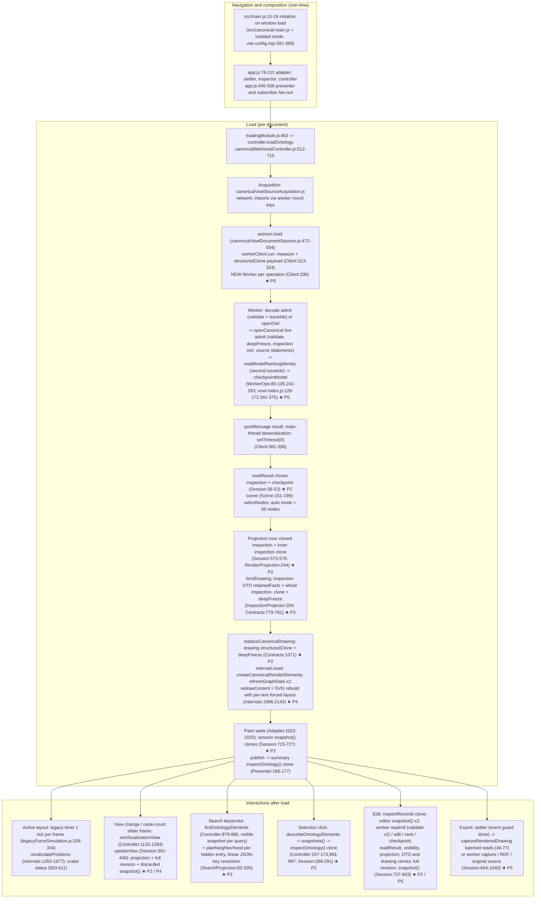

# WebVOWL remaining performance decisions — investigation and roadmap

Run `perf-20261020-62961414-f89186` · prepared 2026-10-20 (local) · planning and review only.

> **Provenance.**
> This review was written outside the repository, in `C:\Users\maksy\Documents\Claude-planning-reviews\2026-10-20\task-01\perf-20261020-62961414-f89186\`, as a report, a run manifest and a separate diagram file.
> The owner moved it into the repository on 2026-10-20, and it was then consolidated into this single document:
>
> - The run manifest is merged into this header.
> - The Mermaid diagram is inline in §3.2, and the separate `current-path.mmd` was removed. CI treats only `.md` files as documentation ([`util/selectCiChecks.mjs:9-14`](../../util/selectCiChecks.mjs#L9-L14)), so a diagram file would force full checks.
> - File citations are relative links. Line numbers refer to HEAD `62961414`; later commits may move them.
> - A few citation ranges were corrected during the conversion.
>
> The findings themselves are unchanged.
>
> Section 12, added after all three reviews were committed, reconciles this review with the [architecture assessment](20261020-architecture-assessment.md) and the [UI design review](20261020-ui-design-review.md) and fixes the implementation order.

| Item              | Value                                                                                                                                                                         |
| ----------------- | ----------------------------------------------------------------------------------------------------------------------------------------------------------------------------- |
| Repository        | `C:\Users\maksy\GitHub\webvowl`, origin `Hadden-Industries/webvowl`, upstream `VisualDataWeb/WebVOWL`                                                                         |
| Branch / HEAD     | `main` / `62961414530e141f8f79ec369afee2d68b9036a6` (tree `da151c34fd63360d99cafa579cefd1f812884ff5`)                                                                         |
| Working tree      | [`AGENTS.md`](../../AGENTS.md) modified (user-owned; SHA-256 `4ab54aa4e5895bb71f4885042db382fd5c7b111efecf3af5717d7486357308c3`); treated as authoritative and left untouched |
| Instructions read | Root `AGENTS.md` only (no nested `AGENTS.md`/`CLAUDE.md` is tracked)                                                                                                          |
| Lockfile          | `package-lock.json` SHA-256 `96884765e14a2e287fafce2987701ed423c6f25496b3668672852ccbf8087645`                                                                                |
| Runtime observed  | Node `v24.21.0` (version query only)                                                                                                                                          |

**Boundaries during the review.**

- Read-only inspection of repository source, history and documents, plus external primary sources.
- No repository or configuration writes. The owner moved the files in afterwards, and the later adaptation and consolidation touched only this review's own files.
- No builds, tests, benchmarks, generators, formatters, installs, worktrees, commits, publication or HISEW changes.
- No subagents, and no contact with the architecture or UI threads.
- One read-only exception: I listed the stale local `deploy/` output to obtain the size of a built worker bundle. Its identity against HEAD is unverified.

**Evidence labels.**
**\[SC]** source-confirmed by reading current source at HEAD.
**\[HM]** historically measured; the retained evidence and its scope are named.
**\[INF]** inferred from source or evidence, not measured.
**\[UNV]** unverified hypothesis.

No speed-up in this document is a measured result of this review.

Contents:

1. Executive recommendation
2. Repository state and document reconciliation
3. Current production paths, including the diagram
4. Audit of existing plan items
5. Ranked opportunities
6. Benchmark specification
7. Ordered implementation slices
8. Decision table
9. Skeptical second pass
10. Handoff notes
11. Evidence index
12. Cross-review reconciliation and implementation order

---

## 1. Executive recommendation

### 1.1 Answer in brief

The canonical performance/search programme closed what it targeted.
The implemented items are:

- scene reference and placement indexes, and indexed edit reconciliation;
- revision-owned search preparation and the bounded neighbourhood reveal;
- scalar per-tick layout events and transition-only controller publication;
- linear link and incidence setup;
- shared `Label` accessors and the `PlainLink` method pilot.

Each was qualified for its own fixtures and boundaries \[HM].

Four cost families that the programme never measured remain.
All four are source-confirmed mechanisms whose magnitude is unknown:

| ID  | Cost family                                                                                                                                   | Where it bites                                                                                                                                             |
| --- | --------------------------------------------------------------------------------------------------------------------------------------------- | ---------------------------------------------------------------------------------------------------------------------------------------------------------- |
| P2  | Main-thread **copy amplification** of the whole semantic inspection                                                                           | Selection clicks, focus, summaries, every drawing revision, every edit, every load. For OWL inputs the inspection carries every retained source statement. |
| P3  | A **per-keystroke search cue** that resolves references by linear scan with JSON serialization and materialises a full hidden-occurrence list | Each visible-but-hidden search result                                                                                                                      |
| P4  | **Forced synchronous layout** while drawing text                                                                                              | Every SVG mount and every drawing revision                                                                                                                 |
| P5  | **Worker pipeline latency**                                                                                                                   | Every load, edit and export                                                                                                                                |

P5 is three separate costs: a fresh ~1.19 MB worker per operation, structure validated twice per checkpoint readmission, and canonical identifier issuance repeated for node ranking.

The retained browser cohorts show the 145 KB benchmark preset loading 3.9–4.0× slower than the 131 KB FOAF preset.
Their drawing sizes are almost equal, which points at data-dependent worker work \[INF].

### 1.2 Best first investigation — P1, phase-attributed production measurement

**What.** Measure the production composition, not the development harness:

- a production preview build with the real `index.html` and CSS;
- headed Chrome on a quiescent machine under [ADR 0003](../adr/0003-quiescent-benchmark-environment.md).

Use these workloads:

- FOAF, benchmark and GoodRelations presets;
- the 2,000-class connected fixture from the [canonical qualification report](canonical-vowl-slice006-qualification.md);
- the owner's OWL input `20260912-full` (2,298,206 bytes, SHA-256 `85214ddc93194fccf5c0fc4bbbc8f34ab54e54f4abb352f0543411fd56b1c3f6`), in default `auto` (50-node) mode and in `all` mode.

Measure six operations: load, one node-count step, one filter toggle, a selection click, a search keystroke and one label edit.

For each workload, collect three things:

1. an untraced timing pass;
2. a separate traced pass recording Long Animation Frames attribution and worker User Timing;
3. deterministic counters for `structuredClone` calls and bytes, forced style/layout reads, renderer element constructions, and worker spawn-to-ready time.

The full specification is in §6.

**Why first.**
Every retained latency number comes from one configuration:

- the Vite development server ([`util/qualify-canonical-browser.mjs:127-136`](../../util/qualify-canonical-browser.mjs#L127-L136)) and headless Chrome ([`:163-173`](../../util/qualify-canonical-browser.mjs#L163-L173));
- a bare 800×600 container rather than the application page ([`packages/vowl/test/browser/performance-latency.js:48-61`](../../packages/vowl/test/browser/performance-latency.js#L48-L61));
- canonical JSON presets only ([`:17-25`](../../packages/vowl/test/browser/performance-latency.js#L17-L25));
- a boundary limited to `loadOntology` plus `findOntologyElements` ([`:90-114`](../../packages/vowl/test/browser/performance-latency.js#L90-L114)).

Production navigation, OWL inputs, large drawings and interaction paths have never been measured.
Those paths are clicks, the search cue, the node-count slider and end-to-end edits.
P2–P5 scale with different workload dimensions:

| Opportunity | Scales with                                         |
| ----------- | --------------------------------------------------- |
| P2          | Retained source statements                          |
| P3          | Semantic records × hidden results                   |
| P4          | Drawn text lines                                    |
| P5          | Worker bundle size, admission data and device speed |

One measurement session ranks them.
Choosing among them without it is guesswork.

**Bound.**
One session per workload class plus counters; no open-ended campaign.
The decision rule is in §6.10.

### 1.3 The five opportunities

| Rank | Opportunity                                               | User operation                                                                                     | Mechanism                                                                                                                                | Confidence of material gain                                          | Gate                                                               |
| ---: | --------------------------------------------------------- | -------------------------------------------------------------------------------------------------- | ---------------------------------------------------------------------------------------------------------------------------------------- | -------------------------------------------------------------------- | ------------------------------------------------------------------ |
|    1 | **P1** Phase-attributed measurement                       | All                                                                                                | Attribution, not optimisation                                                                                                            | n/a                                                                  | None (measurement only)                                            |
|    2 | **P2** Remove main-thread inspection copy amplification   | Click → details, focus, summary, each drawing revision, edit, load                                 | Pass the already-frozen inspection DTO by reference; stop discarded or duplicate copies; drop the drawing's `inspection` payload         | Medium overall; high for large OWL inputs; low for canonical presets | P1 clone census; owner contract decisions for P2b/P2c              |
|    3 | **P3** Make the search reveal cue O(1) per reference      | Search keystroke in large ontologies, especially default `auto` mode                               | Revision-owned key maps instead of linear `JSON.stringify` scans; a `canReveal`-only path without the hidden list                        | Medium                                                               | P1 or a Node work count                                            |
|    4 | **P4** Remove forced synchronous layout from text drawing | Load mount, node-count slider (one full revision per frame), filters, language, reveal/clear, edit | Memoise text metrics per text/style/font epoch; cache font size per style; separate reads from writes                                    | Medium-low → medium                                                  | P1 LoAF `forcedStyleAndLayoutDuration`                             |
|    5 | **P5** Reduce worker pipeline latency                     | Load, edit, export latency; constrained devices                                                    | Attribute first; then choose lazy parser chunks or a pre-warmed single-use worker, or deduplicate package validation and identifier work | Medium-low (high potential for preset load)                          | P1 worker User Timing; owner lifecycle and package scope decisions |

### 1.4 Not recommended now

| Option                                                            | Why not                                                                                                                                                                                                                                                                                                             |
| ----------------------------------------------------------------- | ------------------------------------------------------------------------------------------------------------------------------------------------------------------------------------------------------------------------------------------------------------------------------------------------------------------- |
| Simulation worker, offscreen culling, Canvas/WebGL backend        | No post-restoration evidence that force computation or paint dominates. Active layout after the legacy-solver restoration was never quiet-machine measured ([`rendering-performance-follow-up-results.md:95-98`](../rendering-performance-follow-up-results.md#L95-L98)). Gates in §8.                              |
| Broader constructor migration                                     | Declined because `Label` aliases `property.frozen/locked/pinned`, and because of mutable, fluent, override and callback identity in the `BaseElement` family ([`qualification-followup.md:73-85`](../designs/Performance-and-Search/qualification-followup.md#L73-L85)). No family-level evidence has changed that. |
| New geometry, attribute-write, degree or persistent search caches | No measured hotspot. Active layouts move on every frame ([`rendering-performance-follow-up-results.md:68`](../rendering-performance-follow-up-results.md#L68)).                                                                                                                                                     |
| Raising resource budgets                                          | Not a performance optimisation under the programme ([`implementation-plan.md:535-537`](../designs/Performance-and-Search/implementation-plan.md#L535-L537)).                                                                                                                                                        |

### 1.5 Decisions requested from the owner (batched)

1. **Approve P1 as measurement-only.**
   It needs a production build and preview and must follow ADR 0003.
   No configuration change is needed.
2. **Contract questions that gate parts of P2:**
   1. Should the drawing DTO stop carrying `inspection`?
      It is pinned only by [`canonicalVowlRenderProjection.test.js:193`](../../src/app/js/controller/canonicalVowlRenderProjection.test.js#L193).
      Text search found no reader under `src/webvowl/js`.
   2. Should session `load`/`edit`/`updateView` keep returning owned copies of `inspection`/`checkpoint`, or return them lazily?
      Tests read them, for example [`canonicalVowlDocumentSession.test.js:331`](../../src/app/js/controller/canonicalVowlDocumentSession.test.js#L331), [`566`](../../src/app/js/controller/canonicalVowlDocumentSession.test.js#L566) and [`669`](../../src/app/js/controller/canonicalVowlDocumentSession.test.js#L669).
   3. Should read-only inspector paths receive the frozen inspection DTO by reference, as search already does ([`ontologyInspector.js:394-445`](../../src/app/js/controller/ontologyInspector.js#L394-L445))?
3. **Worker lifecycle.**
   May an idle, pre-warmed, single-use worker exist?
   It would change the qualified observation that no worker target exists at idle ([`qualification-followup.md:18`](../designs/Performance-and-Search/qualification-followup.md#L18)).
4. **Package scope.**
   Are admission changes in the `vowl` package (deduplicated validation, reuse of ranking identifiers) in scope for this programme?

---

## 2. Repository state and document reconciliation

### 2.1 Chronology

| Date               | Commit                                               | Document / change                                                                                                                                                              | Status at HEAD                                                                                                                                      |
| ------------------ | ---------------------------------------------------- | ------------------------------------------------------------------------------------------------------------------------------------------------------------------------------ | --------------------------------------------------------------------------------------------------------------------------------------------------- |
| 2026-09-23         | `c6d3b871`                                           | P&S plan, dossier and catalogue published                                                                                                                                      | Superseded by the 5 Oct revision                                                                                                                    |
| 2026-10-05         | `74227959`, `d04d6a2c`                               | [P&S plan](../designs/Performance-and-Search/implementation-plan.md) retargeted to canonical VOWL, with transposition experiments                                              | Accepted for implementation on 10 Oct ([`implementation-qualification.md:4`](../designs/Performance-and-Search/implementation-qualification.md#L4)) |
| 2026-10-08         | `1189113f`                                           | Exact node-count selector                                                                                                                                                      | Supersedes P&S SLICE-005's degree proposal                                                                                                          |
| 2026-10-08         | `7281170d`                                           | Owner-approved desktop model-operation budget ([`canonicalVowlWorkerPolicy.js`](../../src/app/js/controller/canonicalVowlWorkerPolicy.js))                                     | Baseline                                                                                                                                            |
| 2026-10-09         | `eef8eeb0`                                           | Canonical benchmark preset restored ([`canonical-benchmark.md`](../canonical-benchmark.md))                                                                                    | Admitted; used as a latency fixture; "runtime and regression verification remain pending" ([`:35`](../canonical-benchmark.md#L35))                  |
| 2026-10-09         | `3f266167` → `b30a862b`                              | [Rendering regression plan](../plans/2026-10-09-rendering-performance-regression-plan.md) → shared `Label` accessors                                                           | SLICE-002 implemented; SLICE-003–005 superseded by the follow-up plan                                                                               |
| 2026-10-09         | `9a90ade5` → `94df175a` (#69)                        | [Rendering follow-up plan](../plans/2026-10-09-rendering-performance-follow-up-plan.md) → [legacy solver and per-tick removals](../rendering-performance-follow-up-results.md) | SLICE-001–005 implemented; 006–013 deferred at gates                                                                                                |
| 2026-10-10         | `040dac1c`, `64cec6b1`, `a91752fa`, merge `099e1cba` | Search preparation, neighbourhood reveal, scene indexes, PlainLink pilot                                                                                                       | Implemented                                                                                                                                         |
| 2026-10-10         | `dff179c7`, `b69aa662`, merge `a8e69702`             | [Qualification follow-up](../designs/Performance-and-Search/qualification-followup.md): paired latency, heap retainers, constructor decision                                   | Retained evidence below                                                                                                                             |
| 2026-10-11 → 10-19 | `ddd0d528`, `2cb8e23f`, `c9c3f398`, …                | DRY constants, search UI state, tooling                                                                                                                                        | Small drift in measured paths (§2.4)                                                                                                                |

ADR 0003 remains in force.
The follow-up added `--settle-ms` and `--wait-for-idle-ms` without weakening the 10%-busy / 500 ms guard ([`qualification-followup.md:35-38`](../designs/Performance-and-Search/qualification-followup.md#L35-L38)).

The [materialization-cache plan](../plans/validated-ontology-materialization-cache-implementation-plan.md) is a 5 October draft about availability under CORS and mixed-content restrictions.
It has no source implementation; a text search for "materiali\[sz]ation" under `src`/`packages/vowl/src` finds only unrelated files.
It is not a performance lever unless P1 shows acquisition is material.

### 2.2 What the retained evidence closes, within scope

| Claim                                                                                                                                                        | Evidence                                                                                                                                   | Scope limit                                                                                                                                                                                            |
| ------------------------------------------------------------------------------------------------------------------------------------------------------------ | ------------------------------------------------------------------------------------------------------------------------------------------ | ------------------------------------------------------------------------------------------------------------------------------------------------------------------------------------------------------ |
| Scene arrange (10k occurrences): 2,398.92 → 10.38 ms. Reconcile: 195.18 → 48.11 ms. Search (100k synthetic records): 279.53 → 9.82 ms; preparation 74.63 ms. | [`qualification-followup.md:43-50`](../designs/Performance-and-Search/qualification-followup.md#L43-L50); `paired-attempt-05.json`         | Isolated Node boundaries. The 100k set is synthetic inspector records, not an admitted ontology size.                                                                                                  |
| Browser load-to-two-frames, FOAF: 589.3 → 577.3 ms (p95 1,105.3 → 690.5 ms). Benchmark: 2,382.4 → 2,278.8 ms. First query 2.7 → 0.2 ms and 4.6 → 0.4 ms.     | `latency-summary.json` (Chrome 155.0.8059.40 headless; FOAF `54e853e3…`, benchmark `5bb50f71…`, lockfile `8c6852f8…`, harness `38ef410e…`) | Development server, headless, bare container, canonical JSON only. Nearest-rank p95 at n=10 per version equals the maximum sample.                                                                     |
| No retained owners after retirement: 0 of 90 weakly observed owners live; 7 positive controls absent from the retirement snapshot                            | `browser-attempt-03/`; [`qualification-followup.md:7-24`](../designs/Performance-and-Search/qualification-followup.md#L7-L24)              | Ten cycles of a **3-class** functional-syntax ontology ([`performance-search.js:84-92`](../../packages/vowl/test/browser/performance-search.js#L84-L92)). Lifetime only, not transient volume or peak. |
| PlainLink retained heap −35.8% at 100k live links                                                                                                            | [`qualification-followup.md:73-77`](../designs/Performance-and-Search/qualification-followup.md#L73-L77)                                   | Isolated equal-live-object Node result                                                                                                                                                                 |
| Legacy solver equivalence                                                                                                                                    | [`rendering-performance-follow-up-results.md:29-50`](../rendering-performance-follow-up-results.md#L29-L50)                                | Behaviour, not timing                                                                                                                                                                                  |

### 2.3 What remains open

- Production navigation and the production composition.
- OWL inputs, where the inspection retains source statements.
- Large drawings: the owner's 664-node / 775-label view and the 2,000-class fixtures beyond their single sampled runs.
- Interaction paths: selection details, the search cue, slider revisions, end-to-end edits.
- Transient allocation volume and retained duplication.
- Cancellation latency.
- Constrained devices.
- Active-layout frame cost after the legacy-solver restoration.

### 2.4 Source drift after qualification \[SC]

These changes landed after the measured commit:

- `publish` now computes changed fields with `lodash/isEqual` ([`canonicalWebVowlController.js:146`](../../src/app/js/controller/canonicalWebVowlController.js#L146)).
- The reveal-plan cache signature is now `structuredClone` + `isEqual` ([`:773-778`](../../src/app/js/controller/canonicalWebVowlController.js#L773-L778)).
- Search fact keys changed ([`ontologyInspector.js:345-391`](../../src/app/js/controller/ontologyInspector.js#L345-L391)).
- Constants moved for DRY.

The retained measurements therefore apply to HEAD by inference only.

---

## 3. Current production paths (HEAD)

### 3.1 Entry and composition

- [`src/main.js:15-19`](../../src/main.js#L15-L19) creates the application once and calls `initialize()` on `window` `load`.
- [`src/canonical-main.js`](../../src/canonical-main.js) is the isolated candidate entry; [`vite.config.mjs:391-399`](../../vite.config.mjs#L391-L399) swaps it in for `--mode canonical`.
- [`src/app/js/canonicalApplication.js:19-39`](../../src/app/js/canonicalApplication.js#L19-L39) composes the canonical controller with source acquisition and confirmation UI.
- [`src/app/js/app.js:76-111`](../../src/app/js/app.js#L76-L111) builds the D3 adapter, settler, inspector and artifact service.
- [`app.js:445-506`](../../src/app/js/app.js#L445-L506) wires the presenter and subscriber fan-out.
- [`app.js:569`](../../src/app/js/app.js#L569) triggers the location load.

### 3.2 Diagram

★ marks the opportunity IDs in §5.
Node labels give plain-text locations; the operation tables in §3.3 link each one.

### 3.3 Operation tables

**Load** — acquisition → worker admission → session → scene/projection → renderer mount → paint.

|   # | Step                    | Owner (file:line)                                                                                                                                                                                                                                                                                                                                | Work                                                                                                                                                                                                                                                                                                                                                                                   | Cost class               | Label |
| --: | ----------------------- | ------------------------------------------------------------------------------------------------------------------------------------------------------------------------------------------------------------------------------------------------------------------------------------------------------------------------------------------------ | -------------------------------------------------------------------------------------------------------------------------------------------------------------------------------------------------------------------------------------------------------------------------------------------------------------------------------------------------------------------------------------- | ------------------------ | ----- |
|   1 | Controller load         | [`canonicalWebVowlController.js:512-715`](../../src/app/js/controller/canonicalWebVowlController.js#L512-L715)                                                                                                                                                                                                                                   | `structuredClone(source)` ([525](../../src/app/js/controller/canonicalWebVowlController.js#L525)), loading publish, acquisition, import retry loop                                                                                                                                                                                                                                     | per load                 | SC    |
|   2 | Acquisition             | [`canonicalVowlSourceAcquisition.js`](../../src/app/js/controller/canonicalVowlSourceAcquisition.js) (byte copy [79](../../src/app/js/controller/canonicalVowlSourceAcquisition.js#L79); import context [107-206](../../src/app/js/controller/canonicalVowlSourceAcquisition.js#L107-L206))                                                      | network fetch; per-import fetch through worker round trips                                                                                                                                                                                                                                                                                                                             | per load, per import     | SC    |
|   3 | Worker request          | [`canonicalVowlDocumentSession.js:499-504`](../../src/app/js/controller/canonicalVowlDocumentSession.js#L499-L504) → [`canonicalVowlWorkerClient.js:236-472`](../../src/app/js/controller/canonicalVowlWorkerClient.js#L236-L472)                                                                                                                | `copyBytes` plus `structuredClone(payload)` ([322-324](../../src/app/js/controller/canonicalVowlWorkerClient.js#L322-L324)); **new `Worker` per operation** ([336](../../src/app/js/controller/canonicalVowlWorkerClient.js#L336)); terminate ([361](../../src/app/js/controller/canonicalVowlWorkerClient.js#L361)) ★P5                                                               | per load                 | SC    |
|   4 | Worker admission        | [`canonicalVowlWorkerOperations.js:80-105`](../../src/app/js/controller/canonicalVowlWorkerOperations.js#L80-L105), [`242-263`](../../src/app/js/controller/canonicalVowlWorkerOperations.js#L242-L263)                                                                                                                                          | details in the next block ★P5                                                                                                                                                                                                                                                                                                                                                          | per load (worker thread) | SC    |
|   5 | Result delivery         | [`canonicalVowlWorkerClient.js:381-396`](../../src/app/js/controller/canonicalVowlWorkerClient.js#L381-L396)                                                                                                                                                                                                                                     | structured deserialization on the main thread; `setTimeout(0)` before processing                                                                                                                                                                                                                                                                                                       | per load                 | SC    |
|   6 | `readResult`            | [`canonicalVowlDocumentSession.js:36-53`](../../src/app/js/controller/canonicalVowlDocumentSession.js#L36-L53)                                                                                                                                                                                                                                   | clones the inspection and the checkpoint; node-selector indexes ★P2                                                                                                                                                                                                                                                                                                                    | per load                 | SC    |
|   7 | Scene                   | [`canonicalVowlScene.js:151-199`](../../src/app/js/controller/canonicalVowlScene.js#L151-L199)                                                                                                                                                                                                                                                   | `structuredClone(occurrences)` ([163](../../src/app/js/controller/canonicalVowlScene.js#L163)); registry maps; placements; visibility closure                                                                                                                                                                                                                                          | per load                 | SC    |
|   8 | Visibility              | [`canonicalVowlDocumentSession.js:537-559`](../../src/app/js/controller/canonicalVowlDocumentSession.js#L537-L559); [`canonicalVowlViewControls.js:84-209`](../../src/app/js/controller/canonicalVowlViewControls.js#L84-L209)                                                                                                                   | prepare visibility and rank nodes (heap); `auto` shows 50 nodes ([145-150](../../src/app/js/controller/canonicalVowlViewControls.js#L145-L150)); OWL loads default to `auto` ([session 533-536](../../src/app/js/controller/canonicalVowlDocumentSession.js#L533-L536))                                                                                                                | per load                 | SC    |
|   9 | Projection and bindings | [session 567-594](../../src/app/js/controller/canonicalVowlDocumentSession.js#L567-L594); [`canonicalVowlRenderProjection.js:34-246`](../../src/app/js/controller/canonicalVowlRenderProjection.js#L34-L246)                                                                                                                                     | projection over a cloned inspection ([session 573-576](../../src/app/js/controller/canonicalVowlDocumentSession.js#L573-L576)) **plus an inner inspection clone** ([projection 244](../../src/app/js/controller/canonicalVowlRenderProjection.js#L244)); semantic references and bindings ([session 66-112](../../src/app/js/controller/canonicalVowlDocumentSession.js#L66-L112)) ★P2 | per load                 | SC    |
|  10 | Inspection DTO          | [`canonicalVowlInspectionProjector.js:204`](../../src/app/js/controller/canonicalVowlInspectionProjector.js#L204); [`renderedGraphRuntimeContracts.js:712-818`](../../src/app/js/controller/renderedGraphRuntimeContracts.js#L712-L818)                                                                                                          | `retainedFacts` = the **whole inspection**, cloned and deep-frozen ([779-781](../../src/app/js/controller/renderedGraphRuntimeContracts.js#L779-L781)) ★P2                                                                                                                                                                                                                             | per load                 | SC    |
|  11 | Previous drawing        | [session 611-646](../../src/app/js/controller/canonicalVowlDocumentSession.js#L611-L646)                                                                                                                                                                                                                                                         | eager recovery projection of the previous document                                                                                                                                                                                                                                                                                                                                     | per replacement load     | SC    |
|  12 | Runtime mount           | [`d3RenderedGraphAdapter.js:961-1047`](../../src/webvowl/js/runtime/d3RenderedGraphAdapter.js#L961-L1047); [`renderedGraphRuntimeContracts.js:1034-1080`](../../src/app/js/controller/renderedGraphRuntimeContracts.js#L1034-L1080); [`renderedGraphInternals.js:2271-2348`](../../src/webvowl/js/runtime/renderedGraphInternals.js#L2271-L2348) | details in the next block ★P2 ★P4                                                                                                                                                                                                                                                                                                                                                      | per load                 | SC    |
|  13 | Accept and publish      | [session 705-727](../../src/app/js/controller/canonicalVowlDocumentSession.js#L705-L727); [controller 640-686](../../src/app/js/controller/canonicalWebVowlController.js#L640-L686); [`controllerStatePresenter.js:166-177`](../../src/app/js/ui/controllerStatePresenter.js#L166-L177)                                                          | `snapshot()` clones inspection and checkpoint ([session 276-285](../../src/app/js/controller/canonicalVowlDocumentSession.js#L276-L285)); publish; summary → `inspectOntology()` clone plus visible snapshot ★P2                                                                                                                                                                       | per load                 | SC    |

Worker admission (step 4) runs, in order:

- **Decode admission:** field, graph, meaning, projection and artifact validation; `issueIds`; JCS byte comparison ([`packages/vowl/src/index.js:126-172`](../../packages/vowl/src/index.js#L126-L172), [`195-246`](../../packages/vowl/src/index.js#L195-L246)).
- **Live admission:** `openCanonical` → live `admit`, with `validateStructure`, `deepFreeze`, and an inspection that carries `sourceStatements`, `documents`, `dependencies` and `supports` for OWL inputs ([`liveModel.js:91-106`](../../packages/vowl/src/liveModel.js#L91-L106), [`144-187`](../../packages/vowl/src/liveModel.js#L144-L187), [`232-327`](../../packages/vowl/src/liveModel.js#L232-L327)).
- **Ranking identity:** `readModelRankingIdentity` runs a **second `issueIds` with refinement** ([`index.js:341-364`](../../packages/vowl/src/index.js#L341-L364)).
- **Checkpoint:** `checkpointModel` ([`liveModel.js:468-477`](../../packages/vowl/src/liveModel.js#L468-L477)).

Runtime mount (step 12) runs, in order:

- **Drawing request:** `structuredClone(drawing)` plus `deepFreezePlainData` ([contracts 1071](../../src/app/js/controller/renderedGraphRuntimeContracts.js#L1071)). The drawing includes the cloned inspection.
- **Element construction:** `createCanonicalRenderElements` builds new element objects ([`canonicalRenderElements.js:27-177`](../../src/webvowl/js/parsing/canonicalRenderElements.js#L27-L177)).
- **Data refresh:** `refreshGraphData` runs twice ([internals 2314](../../src/webvowl/js/runtime/renderedGraphInternals.js#L2314) and [2555](../../src/webvowl/js/runtime/renderedGraphInternals.js#L2555)).
- **SVG redraw:** `redrawContent` empties and rebuilds the SVG ([2004-2143](../../src/webvowl/js/runtime/renderedGraphInternals.js#L2004-L2143)), forcing layout per text line.
- **First paint:** `recalculatePositions`; then the adapter waits for paint ([adapter 1022-1025](../../src/webvowl/js/runtime/d3RenderedGraphAdapter.js#L1022-L1025)).

Canonical drawings present immediately rather than through the hidden pre-layout ([internals 2326-2344](../../src/webvowl/js/runtime/renderedGraphInternals.js#L2326-L2344)).

**Drawing revision** — filter toggle, node-count slider frame, language change, reveal or clear.

|   # | Step             | Owner                                                                                                                                                                              | Work                                                                                                                                                                                                                                                          | Class                 | Label |
| --: | ---------------- | ---------------------------------------------------------------------------------------------------------------------------------------------------------------------------------- | ------------------------------------------------------------------------------------------------------------------------------------------------------------------------------------------------------------------------------------------------------------- | --------------------- | ----- |
|   1 | Request          | [controller 1133-1210](../../src/app/js/controller/canonicalWebVowlController.js#L1133-L1210)                                                                                      | `selectNodes`; `previousScene = scene.snapshot()` (clone)                                                                                                                                                                                                     | per revision          | SC    |
|   2 | `updateView`     | [session 391-449](../../src/app/js/controller/canonicalVowlDocumentSession.js#L391-L449)                                                                                           | details in the next block ★P2                                                                                                                                                                                                                                 | per revision          | SC    |
|   3 | Runtime revision | [adapter 1049-1084](../../src/webvowl/js/runtime/d3RenderedGraphAdapter.js#L1049-L1084); [internals 2350-2405](../../src/webvowl/js/runtime/renderedGraphInternals.js#L2350-L2405) | drawing clone plus deep-freeze; **all elements re-materialised**; full SVG rebuild with forced layouts ★P2 ★P4                                                                                                                                                | per revision          | SC    |
|   4 | Completion       | [controller 1221-1282](../../src/app/js/controller/canonicalWebVowlController.js#L1221-L1282)                                                                                      | `applyVisualizationView`; `synchronizeDrawing` again; `webvowl.node-count-interaction` measure ([1235-1242](../../src/app/js/controller/canonicalWebVowlController.js#L1235-L1242)); two publishes → `getVisualizationFocus()` clones when focus is non-empty | per revision          | SC    |
|   5 | Slider cadence   | [`nodesShownControl.js:22-31`](../../src/app/js/ui/nodesShownControl.js#L22-L31), [`111-116`](../../src/app/js/ui/nodesShownControl.js#L111-L116)                                  | at most one revision per animation frame while dragging                                                                                                                                                                                                       | per frame during drag | SC    |

`updateView` (step 2) runs, in order:

- **Drawing sync:** `synchronizeDrawing` → `readCanonicalDrawingState` (`arrangedElements`, with an unused legacy `hasParallelLinks` scan per label, [internals 655-662](../../src/webvowl/js/runtime/renderedGraphInternals.js#L655-L662)) → `scene.arrange` (clone).
- **Scene preparation:** `prepareView` (clone) and `preview` (clone).
- **Projection:** rebuilt, including its inner inspection clone.
- **Bindings:** rebuilt.
- **Inspection presentation:** reused for visibility-only changes; that is SLICE-011, [session 416-424](../../src/app/js/controller/canonicalVowlDocumentSession.js#L416-L424).
- **Commit:** calls `applyCanonicalDrawingRevision` synchronously.
- **Return value:** `{...snapshot(), projection}` ([448](../../src/app/js/controller/canonicalVowlDocumentSession.js#L448)) clones inspection and checkpoint. **The controller discards it** ([controller 1192](../../src/app/js/controller/canonicalWebVowlController.js#L1192)).

**Active layout**

| Step        | Owner                                                                                                                                                                                                                                                             | Work                                                                               | Class                  | Label |
| ----------- | ----------------------------------------------------------------------------------------------------------------------------------------------------------------------------------------------------------------------------------------------------------------- | ---------------------------------------------------------------------------------- | ---------------------- | ----- |
| Timer       | [`legacyForceSimulation.js:328-334`](../../src/webvowl/js/runtime/legacyForceSimulation.js#L328-L334); cooling at [78](../../src/webvowl/js/runtime/legacyForceSimulation.js#L78)                                                                                 | one legacy tick per D3 timer callback (animation frame); alpha ×0.99 down to 0.005 | per frame              | SC    |
| Positioning | [internals 1355-1677](../../src/webvowl/js/runtime/renderedGraphInternals.js#L1355-L1677)                                                                                                                                                                         | transforms, paths and cardinalities with finite guards; solitary-label recentering | per frame × occurrence | SC    |
| Status      | [internals 2304-2311](../../src/webvowl/js/runtime/renderedGraphInternals.js#L2304-L2311), [603-611](../../src/webvowl/js/runtime/renderedGraphInternals.js#L603-L611); [controller 439-449](../../src/app/js/controller/canonicalWebVowlController.js#L439-L449) | scalar status; controller publishes only on transitions                            | per frame, O(1)        | SC    |

**Search → results → reveal/focus**

| Step            | Owner                                                                                                                                                                                                                                                                                                                                                                                                                                          | Work                                                                                                                                                                                                                                                                                                                                                                                                                                                                                                                                                                                                                                                                                                                                  | Class             | Label |
| --------------- | ---------------------------------------------------------------------------------------------------------------------------------------------------------------------------------------------------------------------------------------------------------------------------------------------------------------------------------------------------------------------------------------------------------------------------------------------- | ------------------------------------------------------------------------------------------------------------------------------------------------------------------------------------------------------------------------------------------------------------------------------------------------------------------------------------------------------------------------------------------------------------------------------------------------------------------------------------------------------------------------------------------------------------------------------------------------------------------------------------------------------------------------------------------------------------------------------------- | ----------------- | ----- |
| Keystroke query | [`searchMenu.js:623`](../../src/app/js/menu/searchMenu.js#L623), [`35-80`](../../src/app/js/menu/searchMenu.js#L35-L80) → [controller 979-990](../../src/app/js/controller/canonicalWebVowlController.js#L979-L990)                                                                                                                                                                                                                            | `readVisibleRenderedGraphSnapshot()` ([adapter 1360-1387](../../src/webvowl/js/runtime/d3RenderedGraphAdapter.js#L1360-L1387), O(visible)); prepared search ([session 292-304](../../src/app/js/controller/canonicalVowlDocumentSession.js#L292-L304); [inspector 394-445](../../src/app/js/controller/ontologyInspector.js#L394-L445), [533+](../../src/app/js/controller/ontologyInspector.js#L533)) with per-label `toLowerCase` per query ([225-239](../../src/app/js/controller/ontologyInspector.js#L225-L239)), relation-group loop ([569-585](../../src/app/js/controller/ontologyInspector.js#L569-L585)), `localeCompare` sort ([612-626](../../src/app/js/controller/ontologyInspector.js#L612-L626)); no limit for the UI | per query         | SC    |
| Reveal cue      | [`searchMenu.js:22`](../../src/app/js/menu/searchMenu.js#L22) (`maxEntries = 6`), [527-531](../../src/app/js/menu/searchMenu.js#L527-L531) → [controller 859-869](../../src/app/js/controller/canonicalWebVowlController.js#L859-L869) → [session 305-317](../../src/app/js/controller/canonicalVowlDocumentSession.js#L305-L317) → [`canonicalSearchProjection.js:83-205`](../../src/app/js/controller/canonicalSearchProjection.js#L83-L205) | per displayed entry with hidden members: **linear `resolveOntologyElementReference`** per requested reference ([110-113](../../src/app/js/controller/canonicalSearchProjection.js#L110-L113) → [`webVowlControllerContracts.js:408-430`](../../src/app/js/controller/webVowlControllerContracts.js#L408-L430), two `JSON.stringify` and one object rest per candidate); bounded BFS; **full hidden list** ([201-203](../../src/app/js/controller/canonicalSearchProjection.js#L201-L203)) ★P3                                                                                                                                                                                                                                         | per query × entry | SC    |
| Reveal          | [controller 870-951](../../src/app/js/controller/canonicalWebVowlController.js#L870-L951) → [session 318-331](../../src/app/js/controller/canonicalVowlDocumentSession.js#L318-L331)                                                                                                                                                                                                                                                           | full drawing revision; focus application; drawing sync                                                                                                                                                                                                                                                                                                                                                                                                                                                                                                                                                                                                                                                                                | per reveal        | SC    |
| Focus           | [controller 1162-1167](../../src/app/js/controller/canonicalWebVowlController.js#L1162-L1167), [1211-1217](../../src/app/js/controller/canonicalWebVowlController.js#L1211-L1217)                                                                                                                                                                                                                                                              | `snapshots()` twice → two `inspectOntology()` clones ★P2                                                                                                                                                                                                                                                                                                                                                                                                                                                                                                                                                                                                                                                                              | per focus         | SC    |

**Selection**

| Step            | Owner                                                                                                                                                                                                                                                                                                                                                                                                                                              | Work                                                                                                                      | Class     | Label |
| --------------- | -------------------------------------------------------------------------------------------------------------------------------------------------------------------------------------------------------------------------------------------------------------------------------------------------------------------------------------------------------------------------------------------------------------------------------------------------- | ------------------------------------------------------------------------------------------------------------------------- | --------- | ----- |
| Click → details | [controller 408-410](../../src/app/js/controller/canonicalWebVowlController.js#L408-L410) → [presenter 125-144](../../src/app/js/ui/controllerStatePresenter.js#L125-L144) → [controller 991-997](../../src/app/js/controller/canonicalWebVowlController.js#L991-L997) → [167-173](../../src/app/js/controller/canonicalWebVowlController.js#L167-L173) → [session 289-291](../../src/app/js/controller/canonicalVowlDocumentSession.js#L289-L291) | **full clone of the projected inspection, including `retainedFacts`** (the whole inspection), plus a visible snapshot ★P2 | per click | SC    |

**Edit → reconciliation → publication** (label rename with a selection present)

| Step                  | Owner                                                                                                                                                                                                                                                                                                                                                  | Work                                                                                                                                                                                                                                                                                                                                                                                                                                                               | Class    | Label |
| --------------------- | ------------------------------------------------------------------------------------------------------------------------------------------------------------------------------------------------------------------------------------------------------------------------------------------------------------------------------------------------------ | ------------------------------------------------------------------------------------------------------------------------------------------------------------------------------------------------------------------------------------------------------------------------------------------------------------------------------------------------------------------------------------------------------------------------------------------------------------------ | -------- | ----- |
| Command               | [controller 249-319](../../src/app/js/controller/canonicalWebVowlController.js#L249-L319)                                                                                                                                                                                                                                                              | `inspectRecords()` clone ([253-257](../../src/app/js/controller/canonicalWebVowlController.js#L253-L257)); semantic references                                                                                                                                                                                                                                                                                                                                     | per edit | SC    |
| Editor                | [`canonicalVowlEditorCommands.js:1084-1260`](../../src/app/js/controller/canonicalVowlEditorCommands.js#L1084-L1260)                                                                                                                                                                                                                                   | `session.snapshot()` **twice** ([1085](../../src/app/js/controller/canonicalVowlEditorCommands.js#L1085), [1242](../../src/app/js/controller/canonicalVowlEditorCommands.js#L1242)), each cloning inspection, checkpoint and scene; drawing sync                                                                                                                                                                                                                   | per edit | SC    |
| Worker                | [session 758-770](../../src/app/js/controller/canonicalVowlDocumentSession.js#L758-L770); [client 313-324](../../src/app/js/controller/canonicalVowlWorkerClient.js#L313-L324); [worker ops 132-148](../../src/app/js/controller/canonicalVowlWorkerOperations.js#L132-L148); [`liveModel.js:492-622`](../../packages/vowl/src/liveModel.js#L492-L622) | checkpoint walk, clone and `postMessage` serialization; new worker; readmit with **`validateStructure` twice** ([549](../../packages/vowl/src/liveModel.js#L549) and inside `admit` at [93](../../packages/vowl/src/liveModel.js#L93)); `editModel` admit; inspect; ranking (second `issueIds`); checkpoint ★P5                                                                                                                                                    | per edit | SC    |
| Reconcile and publish | [session 785-937](../../src/app/js/controller/canonicalVowlDocumentSession.js#L785-L937)                                                                                                                                                                                                                                                               | `readResult` clones; visibility clone ([840-843](../../src/app/js/controller/canonicalVowlDocumentSession.js#L840-L843)); scene `prepareEdit`; projection clone plus inner clone ([884-888](../../src/app/js/controller/canonicalVowlDocumentSession.js#L884-L888)); DTO `retainedFacts` clone and freeze; drawing clone and freeze; full revision; `snapshot()` clones ([932-937](../../src/app/js/controller/canonicalVowlDocumentSession.js#L932-L937)) ★P2 ★P4 | per edit | SC    |
| Accept                | [controller 195-248](../../src/app/js/controller/canonicalWebVowlController.js#L195-L248)                                                                                                                                                                                                                                                              | `inspectRecords()` clone; new selector re-ranks; publish → presenter describe and summary clones                                                                                                                                                                                                                                                                                                                                                                   | per edit | SC    |

**Export → settlement → capture**

| Path                     | Owner                                                                                                                                                                                                                                                                                                                                                          | Work                                                                                                    | Label |
| ------------------------ | -------------------------------------------------------------------------------------------------------------------------------------------------------------------------------------------------------------------------------------------------------------------------------------------------------------------------------------------------------------- | ------------------------------------------------------------------------------------------------------- | ----- |
| Canonical JSON           | [session 944-1040](../../src/app/js/controller/canonicalVowlDocumentSession.js#L944-L1040)                                                                                                                                                                                                                                                                     | drawing sync; **worker spawn**, readmit, `captureModel`, encode; artifact hashing                       | SC    |
| SVG/LaTeX                | [`canonicalVowlDrawingExport.js`](../../src/app/js/controller/canonicalVowlDrawingExport.js), [`graphLayoutSettler.js`](../../src/app/js/controller/graphLayoutSettler.js), [`captureRenderedDrawing.js:46-77`](../../src/webvowl/js/runtime/captureRenderedDrawing.js#L46-L77), [`149-168`](../../src/webvowl/js/runtime/captureRenderedDrawing.js#L149-L168) | settlement (event guard already implemented); fonts and paint waits; batched layout reads, so no thrash | SC    |
| Turtle / original source | [session 179-238](../../src/app/js/controller/canonicalVowlDocumentSession.js#L179-L238)                                                                                                                                                                                                                                                                       | worker spawn plus readmit                                                                               | SC    |

### 3.4 Cross-cutting census (static, from source)

These counts are a reading of the source, to be confirmed by S0 counters.
"Inspection-sized" means the worker inspection, or the projected DTO that embeds it as `retainedFacts`.

| Operation        |                                                                                                    Inspection-sized deep copies | Recursive deep-freeze walks |           Checkpoint copies | Scene clones | Renderer      |
| ---------------- | ------------------------------------------------------------------------------------------------------------------------------: | --------------------------: | --------------------------: | -----------: | ------------- |
| Load             | ≥6 (`readResult`, projection argument, projection inner, drawing request, `retainedFacts`, `snapshot()`), plus 1 in the summary |                           2 |    2 (plus deserialization) |           ≥3 | full mount    |
| Drawing revision |                                        3 (projection inner, drawing request, discarded `snapshot()`), plus up to 2 focus clones |                           1 |                           1 |           ≈6 | full revision |
| Edit             |                                                                                                     ≈10–13 (see the edit table) |                           2 | ≈5, including serialization |           ≈6 | full revision |
| Selection click  |                                                                                                         1 (whole projected DTO) |                           0 |                           0 |            0 | —             |

**Retained duplication \[SC].**
The accepted document holds `inspection` ([session 706-714](../../src/app/js/controller/canonicalVowlDocumentSession.js#L706-L714)).
The projected DTO holds a second deep copy of the same inspection as `retainedFacts` ([contracts 781](../../src/app/js/controller/renderedGraphRuntimeContracts.js#L781)).
The checkpoint additionally holds the structural model, supports and, for OWL, the source archive.

**Event fan-out \[SC]** is bounded:

- `viewport-changed` publishes once per zoom/pan event; the state is small.
- The presenter gates on changed fields ([`controllerStatePresenter.js:101-177`](../../src/app/js/ui/controllerStatePresenter.js#L101-L177)).

---

## 4. Audit of existing plan items

| Plan item                                                    | Classification                                                                                                                                    | Evidence                                                                                                                                                                                                                  |
| ------------------------------------------------------------ | ------------------------------------------------------------------------------------------------------------------------------------------------- | ------------------------------------------------------------------------------------------------------------------------------------------------------------------------------------------------------------------------- |
| P&S SLICE-001 link/incidence indexes                         | **Implemented** (by follow-up SLICE-004)                                                                                                          | [`renderedGraphInternals.js:2911-2939`](../../src/webvowl/js/runtime/renderedGraphInternals.js#L2911-L2939); [`rendering-performance-follow-up-results.md:65`](../rendering-performance-follow-up-results.md#L65)         |
| P&S SLICE-002 scene reference/placement index                | **Implemented**                                                                                                                                   | `040dac1c`; [`canonicalVowlScene.js:172-175`](../../src/app/js/controller/canonicalVowlScene.js#L172-L175), [`226-264`](../../src/app/js/controller/canonicalVowlScene.js#L226-L264); \[HM] arrange                       |
| P&S SLICE-003 edit reconciliation index                      | **Implemented**                                                                                                                                   | [`canonicalVowlScene.js:428-436`](../../src/app/js/controller/canonicalVowlScene.js#L428-L436); \[HM] reconcile                                                                                                           |
| P&S SLICE-004 visibility closure                             | **Implemented** (retained as already efficient)                                                                                                   | [`canonicalVowlScene.js:19-37`](../../src/app/js/controller/canonicalVowlScene.js#L19-L37)                                                                                                                                |
| P&S SLICE-005 degree preparation reuse                       | **Superseded** by the exact node-count selector                                                                                                   | [`canonicalVowlViewControls.js:84-209`](../../src/app/js/controller/canonicalVowlViewControls.js#L84-L209); [`implementation-qualification.md:14`](../designs/Performance-and-Search/implementation-qualification.md#L14) |
| P&S SLICE-006 bounded neighbourhood reveal                   | **Implemented**; per-keystroke cue cost **unresolved** (new P3)                                                                                   | [`canonicalSearchProjection.js`](../../src/app/js/controller/canonicalSearchProjection.js); [`searchMenu.js:527-531`](../../src/app/js/menu/searchMenu.js#L527-L531)                                                      |
| P&S SLICE-007 search preparation reuse                       | **Implemented**; other read paths still clone (P2)                                                                                                | [session 292-304](../../src/app/js/controller/canonicalVowlDocumentSession.js#L292-L304); \[HM]                                                                                                                           |
| P&S SLICE-008 PlainLink pilot                                | **Implemented**                                                                                                                                   | [`PlainLink.js`](../../src/webvowl/js/elements/links/PlainLink.js); \[HM]                                                                                                                                                 |
| P&S SLICE-009 broader constructors                           | **Unresolved / declined**; re-entry criteria in §8                                                                                                | [`qualification-followup.md:73-85`](../designs/Performance-and-Search/qualification-followup.md#L73-L85)                                                                                                                  |
| P&S SLICE-010 retire disposable state                        | Lifetime **implemented**; transient copies and retained duplication **still applicable** (P2)                                                     | \[HM] heap; §3.4                                                                                                                                                                                                          |
| P&S SLICE-011 presentation reuse                             | **Implemented narrowly**; projection and drawing still rebuilt per revision (**still applicable** through P4 and the incremental-revision option) | [session 416-424](../../src/app/js/controller/canonicalVowlDocumentSession.js#L416-L424)                                                                                                                                  |
| P&S GATE-004 / 005 / 006                                     | Not exercised / not selected                                                                                                                      | [`implementation-qualification.md:57-58`](../designs/Performance-and-Search/implementation-qualification.md#L57-L58)                                                                                                      |
| Regression plan SLICE-001/002                                | **Implemented**                                                                                                                                   | `b30a862b`, `5b182e34`                                                                                                                                                                                                    |
| Regression plan SLICE-003/004/005                            | **Superseded** by follow-up 007/009/011                                                                                                           | [follow-up plan §1](../plans/2026-10-09-rendering-performance-follow-up-plan.md)                                                                                                                                          |
| Follow-up SLICE-000–005                                      | **Implemented**                                                                                                                                   | [results doc table](../rendering-performance-follow-up-results.md)                                                                                                                                                        |
| Follow-up SLICE-006/007 geometry and write caching           | **Still applicable, gated**                                                                                                                       | [results doc](../rendering-performance-follow-up-results.md) 006/007                                                                                                                                                      |
| Follow-up SLICE-008 paint scheduling                         | **Superseded / not selected**                                                                                                                     | [results doc](../rendering-performance-follow-up-results.md) 008                                                                                                                                                          |
| Follow-up SLICE-009/010 numeric records, constructor sharing | **Still applicable, gated**                                                                                                                       | [results doc](../rendering-performance-follow-up-results.md)                                                                                                                                                              |
| Follow-up SLICE-011/012/013 worker, culling, Canvas/WebGL    | **Unresolved, gated** (§8)                                                                                                                        | [results doc](../rendering-performance-follow-up-results.md)                                                                                                                                                              |
| This review's hidden pre-layout hypothesis                   | **Falsified**                                                                                                                                     | [`renderedGraphInternals.js:2326-2344`](../../src/webvowl/js/runtime/renderedGraphInternals.js#L2326-L2344)                                                                                                               |

---

## 5. Ranked opportunities

### 5.1 Ranked table

| Rank | ID  | Affected operation                          | Evidence                                                           | Expected mechanism                                                           | Effort                              | Regression risk                                                                                | Confidence               | Cheapest discriminating experiment                                                                                                |
| ---: | --- | ------------------------------------------- | ------------------------------------------------------------------ | ---------------------------------------------------------------------------- | ----------------------------------- | ---------------------------------------------------------------------------------------------- | ------------------------ | --------------------------------------------------------------------------------------------------------------------------------- |
|    1 | P1  | All                                         | \[HM] gaps                                                         | Attribution                                                                  | S (trace) to M (marks and counters) | None for production; instrumentation stays in the harness or is cleared after use              | n/a                      | One traced and one untraced session per workload                                                                                  |
|    2 | P2  | Click, focus, summary, revision, edit, load | \[SC] census; \[INF] magnitude                                     | Fewer O(document) deep copies and freeze walks; lower peak memory and GC     | S per sub-slice, M in total         | Low (P2a) to medium (P2b–d): session and test contracts, isolation from injected fakes         | Medium (high for OWL)    | Harness counters for `structuredClone` calls and bytes per operation on the owner's OWL input, plus one traced click              |
|    3 | P3  | Search keystroke                            | \[SC]; \[HM] gap                                                   | O(1) reference resolution; no hidden-list materialisation for the cue        | S                                   | Low-medium: ambiguity, roleKind, refusal reasons, WebMCP parity                                | Medium                   | Node timing and counting of `plan()` with a real admitted inspection                                                              |
|    4 | P4  | Mount and every revision                    | \[SC] pattern; \[UNV] magnitude                                    | Fewer forced style/layout flushes per redraw                                 | S-M                                 | Medium: exact truncation and widths, font loading, CSS changes                                 | Medium-low → medium      | LoAF `forcedStyleAndLayoutDuration` and DevTools forced-reflow attribution for one revision on the owner's input in `all` mode    |
|    5 | P5  | Load, edit, export latency                  | \[SC] mechanisms; \[HM] FOAF/benchmark gap; \[UNV] bundle identity | Less spawn, compile, validation and ID-issuance work                         | M-L                                 | High: lifecycle evidence, cancellation, package admission contracts, checkpoint trust boundary | Medium-low               | Worker User Timing (existing `webvowl.node-ranking-identity`, `webvowl.owl-*`) plus spawn-to-ready marks on FOAF versus benchmark |
|    6 | P6  | Cold navigation                             | \[UNV]                                                             | Start `initialize` earlier than `window.load`; bundle evaluation             | S                                   | Low                                                                                            | Low                      | Production navigation trace (load-event gap)                                                                                      |
|    7 | P7  | Remote OWL loads with imports               | \[UNV]                                                             | Overlap import fetches (owlapi loader concurrency unknown)                   | ?                                   | Medium                                                                                         | Low                      | Trace import request overlap on a multi-import ontology                                                                           |
|    8 | P8  | Revisions (slider)                          | \[INF]                                                             | Keyed D3 join and element reuse instead of `remove()` and re-materialisation | L                                   | High                                                                                           | Low until P2/P4 are done | Only if P2/P4 leave revisions dominated by element construction and DOM creation                                                  |
|    9 | P9  | Active layout frames                        | \[HM] limit                                                        | Select among the deferred 006/007/009/011/012/013                            | —                                   | —                                                                                              | —                        | Post-restoration A/A-calibrated frame intervals on the owner's graph                                                              |

### 5.2 Dossiers

#### P2 — main-thread inspection copy amplification

- **Benefits.**
  - Selection click → details panel.
  - Search focus and the summary after load, edit or language change.
  - Every drawing revision: filters, node-count slider frames, reveal/clear, language.
  - Load and edit.
- **Why reachable \[SC].**
  - Click: [presenter 125-144](../../src/app/js/ui/controllerStatePresenter.js#L125-L144) → [controller 991-997](../../src/app/js/controller/canonicalWebVowlController.js#L991-L997) → `snapshots()` [167-173](../../src/app/js/controller/canonicalWebVowlController.js#L167-L173) → `session.inspectOntology()` [289-291](../../src/app/js/controller/canonicalVowlDocumentSession.js#L289-L291) (`structuredClone` of the whole projected DTO, whose `retainedFacts` is the whole inspection, [`canonicalVowlInspectionProjector.js:204`](../../src/app/js/controller/canonicalVowlInspectionProjector.js#L204)).
  - Revision: [controller 1192](../../src/app/js/controller/canonicalWebVowlController.js#L1192) discards `updateView`'s return value, which was built by `snapshot()` ([session 276-285](../../src/app/js/controller/canonicalVowlDocumentSession.js#L276-L285), [448](../../src/app/js/controller/canonicalVowlDocumentSession.js#L448)).
  - Drawing payload: [render projection 244](../../src/app/js/controller/canonicalVowlRenderProjection.js#L244) adds a clone, then [contracts 1071](../../src/app/js/controller/renderedGraphRuntimeContracts.js#L1071) clones it again and deep-freezes it. The renderer never reads `inspection`; text search under `src/webvowl/js` finds only an unrelated test.
- **Materiality evidence.**
  - \[SC]: OWL inspections include `sourceStatements`, `documents`, `dependencies` and `supports` ([`liveModel.js:232-327`](../../packages/vowl/src/liveModel.js#L232-L327)).
  - \[INF]: cost grows with retained source statements, so it is largest for the owner's 2.3 MB OWL input and small for canonical presets.
  - No measurement covers these paths.
- **Already optimised.**
  - Search reads the session-owned snapshot without cloning (SLICE-007).
  - Visibility-only updates reuse the presentation DTO (SLICE-011).
  - Some copies were removed (SLICE-010).
- **Contracts that could regress.**
  - Session return values: tests read `result.inspection`/`checkpoint`.
  - The pinned drawing field ([`canonicalVowlRenderProjection.test.js:193`](../../src/app/js/controller/canonicalVowlRenderProjection.test.js#L193)).
  - Owned-copy isolation from injected collaborators (worker-client fakes, the `prepareProjection` seam).
  - Immutability of public results.
  - [ADR 0010](../adr/0010-rendered-graph-is-a-projection-not-the-store.md) projection principles.
- **Lower-risk sub-item.**
  The projected DTO is frozen at every level by construction \[SC]:
  - records ([`renderedGraphRuntimeContracts.js:680-685`](../../src/app/js/controller/renderedGraphRuntimeContracts.js#L680-L685));
  - nested collections ([216-251](../../src/app/js/controller/renderedGraphRuntimeContracts.js#L216-L251), [373-382](../../src/app/js/controller/renderedGraphRuntimeContracts.js#L373-L382));
  - `relationGroups` and `canonicalDisplay` ([453-465](../../src/app/js/controller/renderedGraphRuntimeContracts.js#L453-L465));
  - `retainedFacts` ([781](../../src/app/js/controller/renderedGraphRuntimeContracts.js#L781)).
    Passing it by reference therefore cannot let consumers mutate it.
- **Falsifier.**
  On the owner's input, the summed main-thread clone and freeze time per click is under 10 ms and under 5% of load, revision and edit time.
- **Sub-items:**
  - **P2a** read-only inspector paths;
  - **P2b** discarded or lazy session snapshots;
  - **P2c** drop the drawing `inspection`;
  - **P2d** move the owned-copy duty to the producer boundary (worker client) instead of `readResult` and `prepareProjection` clones; drop the pre-`postMessage` clone, since serialization is synchronous (HTML message port steps 5 and 7.4);
  - **P2e** de-duplicate retained `retainedFacts`;
  - **P2f** skip the legacy `hasParallelLinks` scan in canonical mode ([internals 655-662](../../src/webvowl/js/runtime/renderedGraphInternals.js#L655-L662)).

#### P3 — search reveal cue

- **Benefits.**
  Typing in search on large ontologies, especially the default `auto` mode.
  `auto` shows 50 nodes ([view controls 145-150](../../src/app/js/controller/canonicalVowlViewControls.js#L145-L150)), and OWL loads default to it ([session 533-536](../../src/app/js/controller/canonicalVowlDocumentSession.js#L533-L536)), so most matches are hidden and each displayed entry triggers a plan.
- **Why reachable.**
  [`searchMenu.js:623`](../../src/app/js/menu/searchMenu.js#L623) → [505-560](../../src/app/js/menu/searchMenu.js#L505-L560) → [527-531](../../src/app/js/menu/searchMenu.js#L527-L531) → [controller 859-869](../../src/app/js/controller/canonicalWebVowlController.js#L859-L869) → [session 305-317](../../src/app/js/controller/canonicalVowlDocumentSession.js#L305-L317) → `plan` [83-205](../../src/app/js/controller/canonicalSearchProjection.js#L83-L205).
- **Evidence.**
  - \[SC]: per requested reference, an O(R) scan with two `JSON.stringify` and one object rest per candidate ([`webVowlControllerContracts.js:408-430`](../../src/app/js/controller/webVowlControllerContracts.js#L408-L430)), plus an O(occurrences) hidden array per plan.
  - \[HM] gap: the qualification timed only `findOntologyElements` ([`performance-latency.js:98-114`](../../packages/vowl/test/browser/performance-latency.js#L98-L114)).
- **Already optimised.**
  Revision-owned projection and caps (SLICE-006); prepared search (SLICE-007).
- **Contracts.**
  - `ELEMENT_AMBIGUOUS` for coarse references matching several roles.
  - Exact `roleKind`.
  - Refusal reasons and counts.
  - The exact hidden list for the real reveal.
  - WebMCP returns only `canReveal`, `reason` and `counts` ([controller 859-869](../../src/app/js/controller/canonicalWebVowlController.js#L859-L869)).
- **Falsifier.**
  Total `plan()` time per keystroke is under 5 ms on the owner's input in `auto` mode and on the 2,000-class fixture.

#### P4 — forced synchronous layout in text drawing

- **Benefits.**
  - Load mount.
  - Each drawing revision, including every slider frame.
  - Label pinning ([`BaseProperty.js:636-645`](../../src/webvowl/js/elements/properties/BaseProperty.js#L636-L645)).
- **Why reachable.**
  - Nodes: [internals 2060-2072](../../src/webvowl/js/runtime/renderedGraphInternals.js#L2060-L2072) → [`RoundNode.js:307-321`](../../src/webvowl/js/elements/nodes/RoundNode.js#L307-L321) → [`CenteringTextElement.js:63-86`](../../src/shared/js/util/CenteringTextElement.js#L63-L86).
    `truncate` → `measureTextWidth` appends a probe `div` to `body` and reads `offsetWidth` ([`textTools.js:5-21`](../../src/shared/js/util/textTools.js#L5-L21), [`44-59`](../../src/shared/js/util/textTools.js#L44-L59)).
    After each tspan write, `getComputedStyle` ([89-91](../../src/shared/js/util/CenteringTextElement.js#L89-L91), in `_repositionTextLine`) and `getBBox` ([112](../../src/shared/js/util/CenteringTextElement.js#L112), in `_repositionTextBlock` [104-114](../../src/shared/js/util/CenteringTextElement.js#L104-L114)) both run.
  - Labels: [`BaseProperty.js:290-292`](../../src/webvowl/js/elements/properties/BaseProperty.js#L290-L292) → `getMyWidth` measures twice ([781-793](../../src/webvowl/js/elements/properties/BaseProperty.js#L781-L793)) before drawing.
- **Evidence.**
  - \[SC]: reads and writes interleave per text line. web.dev names this forced synchronous layout and recommends batching reads.
  - \[UNV] magnitude: earlier traces covered the active tick, not mount or revision ([regression plan §2](../plans/2026-10-09-rendering-performance-regression-plan.md)). The probe is `position:absolute; visibility:hidden` ([`vowl.css:340-345`](../../src/webvowl/css/vowl.css#L340-L345)), which may keep each flush cheap.
  - Likely inherited from legacy WebVOWL \[UNV].
- **Already optimised.**
  Link and incidence setup (follow-up 004); per-tick work (001/002/005).
- **Contracts.**
  - Truncation strings.
  - `dynamicLabelWidth`/`maxLabelWidth` geometry.
  - Capture `widthPx` ([`captureRenderedDrawing.js:43`](../../src/webvowl/js/runtime/captureRenderedDrawing.js#L43)).
  - Export geometry.
  - Font loading.
  - Language and compact notation.
  - Inline editing.
  - Injectable documents in tests ([`textTools.test.js`](../../src/shared/js/util/textTools.test.js)).
- **Falsifier.**
  Forced style/layout attributable to these call sites is under 15% of revision time on the owner's input in `all` mode and on the 2,000-class fixture.

#### P5 — worker pipeline latency

- **Benefits.**
  Load, edit, canonical/Turtle/original-source export; constrained devices especially.
- **Why reachable \[SC].**
  - A new worker per `run` ([client 336](../../src/app/js/controller/canonicalVowlWorkerClient.js#L336)).
  - Edits readmit the checkpoint ([worker ops 132-148](../../src/app/js/controller/canonicalVowlWorkerOperations.js#L132-L148) → [`liveModel.js:492-622`](../../packages/vowl/src/liveModel.js#L492-L622), with `validateStructure` at [549](../../packages/vowl/src/liveModel.js#L549) and again in `admit` at [93](../../packages/vowl/src/liveModel.js#L93)).
  - Ranking re-issues identifiers on every load and edit ([`index.js:341-364`](../../packages/vowl/src/index.js#L341-L364); worker ops [98](../../src/app/js/controller/canonicalVowlWorkerOperations.js#L98), [127](../../src/app/js/controller/canonicalVowlWorkerOperations.js#L127), [143](../../src/app/js/controller/canonicalVowlWorkerOperations.js#L143), [259](../../src/app/js/controller/canonicalVowlWorkerOperations.js#L259)).
  - Decode already issued identifiers during admission ([`index.js:148`](../../packages/vowl/src/index.js#L148)).
- **Evidence.**
  - \[HM]: per-cohort load medians of 558.0–647.1 ms (FOAF) against 2,225.1–2,553.7 ms (benchmark), with near-equal drawn sizes (134 versus 143 placements).
  - \[INF]: data-dependent worker work dominates the gap.
  - \[UNV]: a stale local build has a ~1.19 MB worker bundle.
- **Already optimised.**
  - Refinement hash batches, bounded scratch, checkpoint accounting and next-task result delivery ([`implementation-plan.md:83`](../designs/Performance-and-Search/implementation-plan.md#L83)).
  - Result processing deferred by `setTimeout(0)`.
  - The owner-approved budget.
- **Contracts.**
  - Single-job worker with termination-based cancellation ([`canonicalVowlWorker.js:6-7`](../../src/app/js/controller/canonicalVowlWorker.js#L6-L7)).
  - Whole-job deadline.
  - Budget charges.
  - The checkpoint as untrusted input.
  - Canonical bytes and identifiers, and corpus conformance.
  - The "no worker at idle" observation.
- **Falsifier.**
  Spawn-to-ready is under 5%, and ranking plus readmission validation is under 15%, of load and edit time on FOAF, benchmark and the owner's input.

#### Lower-ranked and closed

| ID  | Item                                                                                                                                                             | Status and reason                              | Next step                                        |
| --- | ---------------------------------------------------------------------------------------------------------------------------------------------------------------- | ---------------------------------------------- | ------------------------------------------------ |
| P6  | `window.load` gating ([`main.js:17`](../../src/main.js#L17)) and bundle evaluation; prior local `index.js` about 596 KB plus vendor about 274 KB \[UNV identity] | \[UNV]                                         | Production navigation trace                      |
| P7  | Import acquisition overlap                                                                                                                                       | \[UNV]                                         | Trace import requests on a multi-import ontology |
| P8  | Keyed incremental revision                                                                                                                                       | \[INF]                                         | Design study only after P2/P4 (§8)               |
| P9  | Active-layout options                                                                                                                                            | Deferred to measured post-restoration evidence | Retain existing gates                            |

Closed or rejected:

- **Hidden pre-layout:** falsified.
- **Search ranking preparation:** done. Small residuals (per-query lowercasing, `localeCompare` sort, visible snapshot per query) are not ranked.
- **Scene lookups, per-tick snapshots, export settlement events, link/incidence:** done.
- **Degree caches:** superseded.

---

## 6. Benchmark specification

All thresholds here are **proposals**, not measured results.
No benchmark was run in this review.

### 6.1 Preserved guards

- [ADR 0003](../adr/0003-quiescent-benchmark-environment.md) stays unchanged:
  - `assertQuiescentMachine` ([`util/benchmarkEnvironment.mjs`](../../util/benchmarkEnvironment.mjs)) with 10% busy over 500 ms;
  - foreground only;
  - no concurrent build, test, scan or benchmark;
  - every threshold breach corroborated by an isolated repeat, a scaling check or an arithmetic check;
  - invalid samples retained along with the reason.
- Use the existing `--settle-ms` and `--wait-for-idle-ms` options; never raise the threshold.
- Keep untraced timing runs separate from traced attribution runs.
- Take DOM inspection and screenshots outside measured windows.

### 6.2 Baseline identity

Record for every run:

- HEAD and tree hash, plus hashes of any dirty inputs;
- `package-lock.json` hash;
- production bundle hashes and **the worker asset hash actually referenced by `deploy/js/index.js`.** `deploy/assets` holds stale hashed workers because `emptyOutDir: false` ([`vite.config.mjs:322`](../../vite.config.mjs#L322));
- browser version, headed or headless;
- OS, power plan, refresh rate, DPR and viewport;
- fixture SHA-256;
- harness hash;
- CPU-busy preflight samples.

The baseline is HEAD `62961414` or the implementer's protected parent.
Candidates differ only by the slice under test.

### 6.3 Workloads

**Admitted** (real ontologies):

| ID  | Fixture                                                 | Notes                                                                                                   |
| --- | ------------------------------------------------------- | ------------------------------------------------------------------------------------------------------- |
| W1  | FOAF preset                                             | `54e853e3…`                                                                                             |
| W2  | Benchmark preset                                        | `5bb50f71…`                                                                                             |
| W3  | GoodRelations preset                                    | 288,395 B; 566 occurrences                                                                              |
| W4  | Connected and disconnected 2,000-class fixtures         | Bind hashes from [`canonical-vowl-slice006-qualification.md`](canonical-vowl-slice006-qualification.md) |
| W5  | Owner's OWL `20260912-full`                             | Kept private and outside the repository; `auto` and `all` modes                                         |
| W6  | A rights-reviewed remote OWL with several `owl:imports` | To be selected; for P7                                                                                  |

**Synthetic**, always labelled as synthetic:

- the 100k-record inspector set (this is **not** an admitted ontology size);
- 1k/10k scene occurrences;
- graph-density families: chain, hub, dense parallel links, self-loops;
- label-length families that exercise truncation loops;
- fact-heavy families with many annotations.

### 6.4 Operation boundaries

| ID  | Operation                        | Start                                            | End                                                          | Attribution                                                                                                                                                                                                                                                                                                                                                                  |
| --- | -------------------------------- | ------------------------------------------------ | ------------------------------------------------------------ | ---------------------------------------------------------------------------------------------------------------------------------------------------------------------------------------------------------------------------------------------------------------------------------------------------------------------------------------------------------------------------- |
| B1  | Navigation (cold and warm cache) | navigation start                                 | first ontology paint after `initialize`                      | Navigation and Resource Timing, LoAF, the load-event gap                                                                                                                                                                                                                                                                                                                     |
| B2  | Load                             | `controller.loadOntology` call                   | first paint (two rAF), cross-checked with LoAF `renderStart` | worker spawn → first message; worker phases (existing `webvowl.owl-loading`, `webvowl.owl-assessment`, `webvowl.owl-retention`, `webvowl.owl-checkpoint`, `webvowl.node-ranking-identity`, plus new decode/openCanonical/inspect marks); deserialization; `readResult`; scene; projection; bind; inspection DTO; request validation; materialisation; `redrawContent`; paint |
| B3  | Revision                         | `setVisualizationView` call                      | after completion plus a paint                                | existing `webvowl.node-count-interaction`; scripted slider drag of N steps at rAF cadence                                                                                                                                                                                                                                                                                    |
| B4  | Click → details                  | pointer event                                    | next paint                                                   | Event Timing duration, LoAF scripts                                                                                                                                                                                                                                                                                                                                          |
| B5  | Keystroke → listbox              | input event                                      | next paint                                                   | Event Timing; `plan()` count and time                                                                                                                                                                                                                                                                                                                                        |
| B6  | Edit                             | `editOntologyRecord` call                        | accepted revision drawn                                      | worker phases plus main-thread phases; ten repeated edits                                                                                                                                                                                                                                                                                                                    |
| B7  | Export                           | `exportVisualization` call                       | artifact published                                           | settlement wait, capture, serialization, hashing                                                                                                                                                                                                                                                                                                                             |
| B8  | Active layout                    | reheat stimulus                                  | 5-second window                                              | untraced frame intervals; separate traced attribution; active and idle portions reported separately                                                                                                                                                                                                                                                                          |
| B9  | Lifecycle                        | —                                                | —                                                            | ten load/search/edit/export/dispose cycles at W1 and W5 sizes: retained heap at equal live size, allocation sampling for transient volume, worker count at idle                                                                                                                                                                                                              |
| B10 | Cancellation                     | replacement request at fixed points of a W5 load | stale work stopped                                           | time to stop; no stale publication                                                                                                                                                                                                                                                                                                                                           |

**Constrained devices:** CPU throttling at 4× and 6× (labelled as emulation), plus a real mid-range device if available, identity recorded.

### 6.5 Environment controls

- Dedicated browser profile; extensions disabled; headed for paint-sensitive metrics.
- Fixed viewport and DPR; fonts loaded (`document.fonts.ready`) before B3–B8.
- Laptop on AC power with a fixed power plan.
- No other tabs active.

### 6.6 Warmup, ordering, samples, statistics

- One discarded warmup per fixture per cohort.
- ABBA cohorts, matching the retained script's method.
- n ≥ 20 per version per fixture for p95, because at n = 10 nearest-rank p95 is the maximum.
- Report per-run and per-cohort values, medians and p95.
- Frames within a run are correlated, so report run-level statistics.
- Run an A/A calibration before interpreting a candidate.
- Treat a result as **inconclusive** when the A/A spread is comparable to the target.

### 6.7 Deterministic counters (no timing needed)

Per operation, count:

- `structuredClone` calls and serialized bytes (harness wrapper or test spy, never production code);
- deep-freeze walks;
- `measureTextWidth`, `getComputedStyle` and `getBBox` calls per redraw;
- renderer element constructions;
- `plan()` resolutions and the size of the `JSON.stringify` work;
- worker spawns and spawn-to-ready time.

These counters are complexity gates; timing establishes benefit ([`implementation-plan.md:551`](../designs/Performance-and-Search/implementation-plan.md#L551)).

### 6.8 Correctness oracles

Results must be identical between baseline and candidate:

- ordered search answers, including totals, truncation and focusability;
- neighbourhood plans, including reasons and counts;
- scene snapshots;
- occurrence IDs and placements;
- an SVG geometry hash at fixed simulation state;
- canonical export bytes;
- error codes;
- the session public results.

### 6.9 Retained evidence

Keep everything outside the repository under the HISEW evidence root:

- raw samples, including rejected preflights;
- traces;
- counters;
- harness and analysis scripts;
- fixture manifests;
- environment records;
- a summary receipt bound to source hashes, in the style of `latency-summary.json`.

### 6.10 Proposed thresholds and decision rule

| Scope          | Proposal                                                                                                                                |
| -------------- | --------------------------------------------------------------------------------------------------------------------------------------- |
| Targeted phase | ≥25% median reduction (existing QA-002)                                                                                                 |
| Small corpus   | No corroborated regression greater than max(10%, 25 ms) (existing)                                                                      |
| B4 click       | p95 ≤200 ms on W5 `all`                                                                                                                 |
| B5 keystroke   | p95 ≤100 ms on W5 `auto`                                                                                                                |
| B3 revision    | No LoAF over 200 ms per slider step on W4 connected; median revision ≤ ½ of baseline on W5 `all`                                        |
| Copies         | Zero full-inspection clones on read-only inspector paths; at most one inspection-sized main-thread copy per load beyond deserialization |
| B9 lifecycle   | No increase in retained heap after ten cycles at equal live size                                                                        |

The B4 threshold borrows INP's "good" value. INP is a field p75 metric, so applying it to lab p95 is an adaptation.

**Decision rule after S0:**

- Select a slice only if its phase is at least 15% of the operation on at least one admitted workload, or its counters prove O(document) waste on a per-interaction path.
- Rank selected slices by measured share divided by effort and risk.

### 6.11 What this programme cannot establish

- Field Core Web Vitals or a universal capacity.
- Exact heap peaks, from sampled tools.
- Safari behaviour, unless measured.
- Behaviour on ontologies outside the admitted budgets.

---

## 7. Ordered implementation slices

Every slice is test-first (the repository's TDD rule) and keeps the existing guards.
Each ends with a sweep for siblings of the same defect class and, where mechanical, a ratchet test.
Each stops if its falsifier holds.

### S0 — Measurement and counters (P1)

- **Modules:** harness only (an extended [`util/qualify-canonical-browser.mjs`](../../util/qualify-canonical-browser.mjs) against a production preview); optional low-cost User Timing marks at the B2 boundaries, cleared after use.
- **Contract checks:** none, since production behaviour does not change.
- **Accept:** a complete evidence set for W1–W5, counters for B2–B6, and a ranked list.
- **Stop:** guard rejections persist; record them and do not weaken anything.
- **Effort:** S–M.

### S1 — P3 search cue

- **Modules:**
  - [`canonicalSearchProjection.js`](../../src/app/js/controller/canonicalSearchProjection.js): revision-owned full-key and coarse-key maps, and a `canReveal` path without the hidden list;
  - possibly [`webVowlControllerContracts.js`](../../src/app/js/controller/webVowlControllerContracts.js): an indexed resolver with identical semantics;
  - [`canonicalVowlDocumentSession.js:305-317`](../../src/app/js/controller/canonicalVowlDocumentSession.js#L305-L317).
- **Tests first:** ambiguity, roleKind, refusal precedence, counts and exact hidden lists, compared against the current implementation on hand-built fixtures; WebMCP parity tests.
- **Accept:** identical plans with O(1) resolution per reference by count; B5 meets its proposal.
- **Stop:** any change in ambiguity semantics.
- **Effort:** S.

### S2 — P2a read-only inspector paths

- **Modules:**
  - [`canonicalWebVowlController.js:167-173`](../../src/app/js/controller/canonicalWebVowlController.js#L167-L173): pass the frozen DTO;
  - [`canonicalVowlDocumentSession.js:289-291`](../../src/app/js/controller/canonicalVowlDocumentSession.js#L289-L291): keep `inspectOntology()` cloning for external API callers if required, and add an internal by-reference reader.
- **Tests first:**
  - assert the DTO is deeply frozen and that inspector outputs are unchanged and owned;
  - a counter asserting no clone on click, focus or summary.
- **Accept:** identical describe, summary, focus and arrangement results; zero clones; B4 improves.
- **Stop:** a consumer is found that mutates its copy.
- **Effort:** S.

### S3 — P2b session snapshot returns (requires decision 1.5-2b)

- **Modules:** [session 391-449](../../src/app/js/controller/canonicalVowlDocumentSession.js#L391-L449) (`updateView`), [715-727](../../src/app/js/controller/canonicalVowlDocumentSession.js#L715-L727) (load), [932-937](../../src/app/js/controller/canonicalVowlDocumentSession.js#L932-L937) (edit), plus the reveal/clear callers.
- **Design note:** lazy getters must not be read through object spread. `{...snapshot()}` evaluates getters, so build the result object once.
- **Tests:** existing session tests pass unweakened.
- **Accept:** no discarded clones per revision by count.
- **Stop:** contract rejection.
- **Effort:** S–M.

### S4 — P2c drawing without `inspection` (requires decision 1.5-2a)

- **Modules:**
  - [`canonicalVowlRenderProjection.js:240-245`](../../src/app/js/controller/canonicalVowlRenderProjection.js#L240-L245);
  - its test at [line 193](../../src/app/js/controller/canonicalVowlRenderProjection.test.js#L193), changed deliberately with the owner's decision;
  - [`renderedGraphRuntimeContracts.js:1071`](../../src/app/js/controller/renderedGraphRuntimeContracts.js#L1071).
- **Contract checks:** renderer seam conformance, details and facts dialogs, capture and export unchanged.
- **Accept:** two fewer inspection-sized copies and one fewer freeze walk per drawing.
- **Effort:** S.

### S5 — P2d/P2e ownership at the producer boundary

- **Modules:**
  - [`canonicalVowlWorkerClient.js:322-324`](../../src/app/js/controller/canonicalVowlWorkerClient.js#L322-L324): a shallow payload for checkpoint operations (the limit mutation needs only a shallow copy);
  - a documented "fresh deserialization is owned" result contract;
  - session `readResult` and `prepareProjection`, which rely on that contract instead of cloning;
  - `retainedFacts` referencing one frozen inspection.
- **Tests:** isolation tests with injected fake worker clients, which must clone or freeze at their own boundary ([ADR 0011](../adr/0011-a-test-double-must-behave-like-its-subject.md): a test double must behave like its subject).
- **Accept:** fewer copies, retained heap reduced at equal live size, identical outputs.
- **Stop:** a resource-accounting change (`measureCheckpointInput` must remain).
- **Effort:** M.

### S6 — P4 text metrics (gated by S0)

- **Modules:**
  - [`src/shared/js/util/textTools.js`](../../src/shared/js/util/textTools.js): a per-document `WeakMap` cache keyed by (style class, text), invalidated on `document.fonts` `loadingdone` and on stylesheet changes;
  - [`CenteringTextElement.js`](../../src/shared/js/util/CenteringTextElement.js): font size per style class;
  - [`BaseProperty.js`](../../src/webvowl/js/elements/properties/BaseProperty.js) and [`RectangularNode.js`](../../src/webvowl/js/elements/nodes/RectangularNode.js), which consume the cache.
- **Tests first:** identical truncation strings and widths against the uncached path, including before and after font load, language change, compact notation and inline editing; identical SVG and capture geometry.
- **Accept:** forced-layout share drops by at least 50% on W5 `all`; geometry is unchanged.
- **Stop:** any geometry difference that cannot be explained.
- **Effort:** S–M.

### S7 — P5 worker experiments (gated by S0 and decisions 3 and 4)

Pick the cheapest option that fits the attributed phase:

- lazy parser chunks inside the worker;
- a pre-warmed single-use worker;
- package-level deduplication behind corpus conformance.

Keep at least one full checkpoint validation as the trust boundary, and keep termination-based cancellation.
Stop on any canonical-byte or corpus change.
Effort: M–L.

### S8 — P8 design study

Pursue only if S2–S6 leave revisions dominated by element construction or DOM work.
The deliverable is a design proposal for keyed reuse that preserves atomic install and recovery ([internals 2350-2405](../../src/webvowl/js/runtime/renderedGraphInternals.js#L2350-L2405)), not an implementation.

**Global replanning triggers:**

- canonical contracts or identities change;
- a hotspot disappears;
- an oracle cannot discriminate;
- a configuration, dependency or package change becomes necessary (stop and request exact approval under [`AGENTS.md`](../../AGENTS.md));
- the measured share falls below noise.

---

## 8. Decision table

| Option                                                                                                     | Evidence that would select it                                                                                                            | Evidence that would reject it                    | Status now               |
| ---------------------------------------------------------------------------------------------------------- | ---------------------------------------------------------------------------------------------------------------------------------------- | ------------------------------------------------ | ------------------------ |
| **Pre-warmed single-use admission worker**                                                                 | Spawn-to-ready ≥15% of edit or load, or ≥100 ms at 4× throttle; idle memory acceptable; owner accepts an idle worker                     | <5%; lifecycle change refused                    | Not selected             |
| **Lazy parser chunks in the worker**                                                                       | Compiling or evaluating unused parser code dominates spawn for edit and capture                                                          | Spawn is cheap, or code caching amortises it     | Not selected             |
| **Persistent model-holding worker**                                                                        | Readmission dominates edit latency **and** a new cancellation, recovery and lifetime design is accepted                                  | Default                                          | Rejected for now         |
| **Package deduplication** (double `validateStructure`, second `issueIds`)                                  | A worker phase ≥25% of the operation, with a corpus oracle and the trust boundary kept                                                   | Otherwise                                        | Not selected             |
| **Simulation worker**                                                                                      | After restoration, force ≥50% of frame time with frames >33 ms on the owner's graph, paint not dominant, and a bounded protocol designed | Paint or style dominant; force <30%              | Deferred (follow-up 011) |
| **Offscreen culling**                                                                                      | Offscreen style, paint or writes ≥30% at typical zoom, plus a complete visibility, picking and export design                             | Fit-to-graph shows most elements (likely \[INF]) | Deferred (012)           |
| **Canvas/WebGL renderer**                                                                                  | SVG style, layout or paint ≥50% of frame time after P4 and write caching, plus an accessibility, interaction and export parity design    | Otherwise                                        | Deferred (013)           |
| **Text-metric cache**                                                                                      | Forced layout ≥15% of revision                                                                                                           | <15%                                             | Candidate (S6)           |
| **Geometry and attribute-write cache**                                                                     | Unchanged-write hit rate ≥30% with a net gain                                                                                            | Active layouts                                   | Deferred (006/007)       |
| **Render-projection reuse across revisions**                                                               | Projection build ≥15% of revision                                                                                                        | Otherwise                                        | Not selected             |
| **Constructor sharing** (new family)                                                                       | Equal-live graph heap ≥20% for that family, plus receiver and callback proof including the label/property alias                          | Default                                          | Declined (P&S 009)       |
| **Yielding between post-worker preparation phases** (never inside the synchronous publication transaction) | A single post-worker task >200 ms on W5, or cancellation latency is material                                                             | Otherwise                                        | Not selected             |
| **Keyed incremental revision**                                                                             | Revisions remain dominated by element construction or DOM after S2–S6                                                                    | Otherwise                                        | Design study only        |

---

## 9. Skeptical second pass

|   # | Challenge                                                                               | Check performed                                                                                                                                                                                                                                                                                                                                                                  | Result                                                                                                                                                                                                                                           | Revision                                                                                             |
| --: | --------------------------------------------------------------------------------------- | -------------------------------------------------------------------------------------------------------------------------------------------------------------------------------------------------------------------------------------------------------------------------------------------------------------------------------------------------------------------------------- | ------------------------------------------------------------------------------------------------------------------------------------------------------------------------------------------------------------------------------------------------ | ---------------------------------------------------------------------------------------------------- |
|   1 | Does a hidden pre-layout dominate load?                                                 | Read `graph.load`                                                                                                                                                                                                                                                                                                                                                                | Canonical drawings present immediately ([internals 2326-2344](../../src/webvowl/js/runtime/renderedGraphInternals.js#L2326-L2344))                                                                                                               | Hypothesis dropped                                                                                   |
|   2 | Is search still the hotspot?                                                            | Retained follow-up numbers; read search code                                                                                                                                                                                                                                                                                                                                     | Ranking is ~10 ms at 100k synthetic records \[HM]; the residual is the UI cue path                                                                                                                                                               | P3 retargeted to `plan()`, not ranking                                                               |
|   3 | Copies may be cheap: `structuredClone` is native and presets carry no source statements | Read [`liveModel.js:232-327`](../../packages/vowl/src/liveModel.js#L232-L327) and the [projector at 204](../../src/app/js/controller/canonicalVowlInspectionProjector.js#L204)                                                                                                                                                                                                   | OWL inspections carry source statements; the projected DTO embeds the whole inspection                                                                                                                                                           | P2 made workload-conditional; S0 must include W5                                                     |
|   4 | Copies provide isolation; removing them could expose mutation                           | Read the DTO constructors (contracts [216-251](../../src/app/js/controller/renderedGraphRuntimeContracts.js#L216-L251), [432-500](../../src/app/js/controller/renderedGraphRuntimeContracts.js#L432-L500), [680-685](../../src/app/js/controller/renderedGraphRuntimeContracts.js#L680-L685), [779-781](../../src/app/js/controller/renderedGraphRuntimeContracts.js#L779-L781)) | The projected DTO is frozen at every level by construction                                                                                                                                                                                       | P2a risk lowered; P2d must move the owned-copy duty to the producer boundary rather than deleting it |
|   5 | Lazy session snapshots may silently become eager                                        | Read call sites `{...this.snapshot(), …}`                                                                                                                                                                                                                                                                                                                                        | Object spread evaluates getters                                                                                                                                                                                                                  | Design note added to S3                                                                              |
|   6 | The forced-layout pattern may be cheap                                                  | Read [`vowl.css:340-345`](../../src/webvowl/css/vowl.css#L340-L345); default `auto` shows 50 nodes                                                                                                                                                                                                                                                                               | The probe is absolutely positioned and hidden; small drawings are unaffected                                                                                                                                                                     | P4 gated on LoAF for large `all` drawings                                                            |
|   7 | Text caching could break widths when fonts load late                                    | Export waits for `document.fonts.ready` ([`app.js:109`](../../src/app/js/app.js#L109)); tests inject documents                                                                                                                                                                                                                                                                   | A real risk                                                                                                                                                                                                                                      | Per-document cache with a font epoch and stylesheet invalidation (S6)                                |
|   8 | Is the FOAF/benchmark gap really worker work?                                           | Per-cohort medians from `latency-summary.json`                                                                                                                                                                                                                                                                                                                                   | Consistent 3.9–4.0× across four cohorts with near-equal drawing size. Not attributed: benchmark has ~4× records and more label lines. The development server serves the same modules to both fixtures, so module loading cannot explain the gap. | Kept as \[INF]; S0 decides                                                                           |
|   9 | A pre-warmed worker contradicts qualified lifetime evidence                             | [`qualification-followup.md:18`](../designs/Performance-and-Search/qualification-followup.md#L18)                                                                                                                                                                                                                                                                                | No worker target at idle was observed and relied on                                                                                                                                                                                              | Lazy chunks preferred; the persistent worker is rejected for now                                     |
|  10 | Is incremental revision a top-five item?                                                | Risk and dependency review                                                                                                                                                                                                                                                                                                                                                       | High risk; depends on P2 and P4                                                                                                                                                                                                                  | Demoted to P8 (design study)                                                                         |
|  11 | Does the drawing carrying `inspection` violate ADR 0010?                                | Read the [ADR decision text](../adr/0010-rendered-graph-is-a-projection-not-the-store.md)                                                                                                                                                                                                                                                                                        | It does not make the renderer the store; it sits in tension with minimal projection                                                                                                                                                              | Wording softened; handed to the architecture thread                                                  |
|  12 | Are earlier evidence gaps being reopened?                                               | Compare against the follow-up                                                                                                                                                                                                                                                                                                                                                    | Latency and heap retirement are closed for their fixtures and boundaries                                                                                                                                                                         | Recorded as closed-within-scope (§2.2)                                                               |
|  13 | Does the production preview serve the measured worker?                                  | Listed `deploy/assets`                                                                                                                                                                                                                                                                                                                                                           | 14 stale hashed workers                                                                                                                                                                                                                          | §6.2 requires binding the referenced worker hash                                                     |
|  14 | Are the p95 values in the retained receipts meaningful?                                 | Retained script method                                                                                                                                                                                                                                                                                                                                                           | Nearest-rank at n = 10 equals the maximum                                                                                                                                                                                                        | §6.6 requires n ≥ 20                                                                                 |

---

## 10. Handoff notes

### For the architecture thread

None of these questions is a prerequisite for S0–S2.

1. **Drawing DTO.**
   It carries a full copy of the semantic inspection the renderer never reads ([render projection 244](../../src/app/js/controller/canonicalVowlRenderProjection.js#L244); [contracts 1071](../../src/app/js/controller/renderedGraphRuntimeContracts.js#L1071)), which is in tension with [ADR 0010](../adr/0010-rendered-graph-is-a-projection-not-the-store.md)'s minimal projection.
   Should the DTO be restricted to drawing rows, bindings, camera and display?
2. **Session results.**
   Should `load`/`edit`/`updateView` return owned snapshots or identity plus projection, with explicit snapshot reads?
3. **Ownership model.**
   Adopt deep-frozen immutable DTOs passed by reference with owned outputs, as search preparation already does, in place of a clone per consumer?
   Where should the owned-copy duty sit at the worker boundary?
4. **Worker lifecycle.**
   The single-job worker with termination-based cancellation is a stated design ([`canonicalVowlWorker.js:6-7`](../../src/app/js/controller/canonicalVowlWorker.js#L6-L7)).
   Pre-warming or persistence needs acceptance.
5. **Package admission.**
   Repeated validation and identifier issuance across decode, live admission, ranking and readmission belong to the `vowl` package's contracts.
6. **Revision strategy.**
   Full rebuild versus keyed reuse, preserving atomic install and recovery ([internals 2350-2405](../../src/webvowl/js/runtime/renderedGraphInternals.js#L2350-L2405)).

### For the UI thread

None of these questions blocks performance work.

1. **Search cue.**
   The reveal cue is computed eagerly for up to 6 entries per keystroke ([`searchMenu.js:527-531`](../../src/app/js/menu/searchMenu.js#L527-L531)).
   Could the cue be lazy, or request `canReveal` only?
   S1 makes eager computation cheap anyway.
2. **Node-count slider.**
   It applies a full revision per animation frame while dragging ([`nodesShownControl.js:22-31`](../../src/app/js/ui/nodesShownControl.js#L22-L31), [`111-116`](../../src/app/js/ui/nodesShownControl.js#L111-L116)).
   Live feedback versus apply-on-release is a UX choice.
3. **Selection details.**
   They are rendered synchronously on every selection change ([presenter 125-144](../../src/app/js/ui/controllerStatePresenter.js#L125-L144)).
   Deferring them until after paint would trade details latency for click responsiveness.
4. **Initialization.**
   It waits for `window.load` ([`main.js:17`](../../src/main.js#L17)).

### Interface assumptions

- The controller and session APIs remain the integration seam.
- WebMCP envelopes and human/agent parity ([ADR 0012](../adr/0012-human-and-agent-visualization-action-parity.md)) are preserved.
- No slice here changes UI behaviour or configuration.

---

## 11. Evidence index

### Retained evidence (read-only listings, plus one summary receipt read)

These paths are on the owner's machine, outside the repository.

- `C:/Users/maksy/.hi/w/e/operator/2d1a0a2427314cfbbb3c4a25a2341881/` — implementation qualification (HISEW `b51c2afe-dae9-44e6-aeee-8b2222441f6d`).
- `C:/Users/maksy/.hi/w/e/operator/c72016ed20e14414a99653b05d9e5943/` — follow-up (HISEW `1f8737ce-7c82-4b24-873b-141f3d5f7f46`):
  - `latency-summary.json`;
  - `latency-attempt-04-{1-baseline,2-candidate,3-candidate,4-baseline}/`;
  - `paired-attempt-05.json`;
  - `browser-attempt-03/`;
  - `heap-analysis-final.json`.
- `C:/Users/maksy/.hi/w/e/operator-reports/performance-search-canonical-transposition-20261005/` — transposition experiments (`experiment.mjs`, `results.json`).

### External primary sources (accessed 2026-10-20)

- web.dev, Interaction to Next Paint — good ≤200 ms, poor >500 ms, field p75: <https://web.dev/articles/inp>
- Chrome for Developers, Long Animation Frames API — frames >50 ms; `scripts[].forcedStyleAndLayoutDuration`; Chrome 123: <https://developer.chrome.com/docs/web-platform/long-animation-frames>
- web.dev, avoid large complex layouts and layout thrashing — forced synchronous layout; batch reads before writes: <https://web.dev/articles/avoid-large-complex-layouts-and-layout-thrashing>
- WHATWG HTML, message port post message steps — serialization synchronous in step 5; deserialization in the receiver's task, step 7.4: <https://html.spec.whatwg.org/multipage/web-messaging.html>
- D3, joining data — keyed joins reuse matched elements: <https://d3js.org/d3-selection/joining>

### Limitations of this review

- Nothing was timed or executed beyond read-only listings, hash computations and version queries.
- Reachability claims come from reading and text search; an absent text hit is not proof of absence.
- The worker bundle size comes from a stale local artefact.
- The 2,000-class fixture identities were not re-read.
- The "legacy-inherited" status of the text-measurement code was not compared against the upstream source.

---

## 12. Cross-review reconciliation and implementation order

### 12.1 Implementation order across the three reviews

The text of this subsection is identical in all three reviews; only its number differs.
It was added on 2026-10-20, after the [architecture assessment](20261020-architecture-assessment.md), the [performance review](20261020-performance-review.md) and the [UI design review](20261020-ui-design-review.md) were committed together in `838dd6e9`.
It orders, assigns and cross-references their recommendations, and it changes none of their findings.
The sessions that produced the three reviews were consulted, and they record no ordering intent beyond what the documents state.

One implementation plan is written from each review, and the plans are applied in this order:

| Order | Plan written from            | Slices, in order                                                      | Starts when                                                                      |
| ----: | ---------------------------- | --------------------------------------------------------------------- | -------------------------------------------------------------------------------- |
|     1 | Architecture assessment, §11 | PR-A → PR-B → PR-C → PR-D → PR-E                                      | Now: its owner decisions were settled on 2026-10-20 (architecture §15 and §18.6) |
|     2 | Performance review, §7       | S0 → S1 → S2 → SF (conditional) → S3 → S4 → S5 → S6 → S7 → S8         | Plan 1 is complete                                                               |
|     3 | UI design review, §9         | A1 → A2 → A3 → A4 (optional) → B1 → B2 → B3 → B4 → B5 → B6 (optional) | Plan 2 is complete                                                               |

A plan is complete when every slice has either merged or been closed by its own gate: not selected, stopped by its falsifier, or deferred by an owner decision.
Optional and gated slices therefore never hold up the next plan.
Reviving a closed slice later needs a new plan after plan 3.

**Why the order is stable.**
Every dependency points to an earlier plan:

- **Plan 1 needs nothing from plans 2 and 3.**
  PR-A and PR-B are the oracles the later plans test against: the declared runtime contract R and the honest runtime double.
  PR-C gives supersession and cancellation one owner, which the worker experiments (S7) and the UI's selection clearing rely on.
  PR-D publishes `temporaryPresentation` and removes the search menu's private copy of it before S1 and the UI's slices A2 and A3 change the same modules.
  PR-E leaves one renderer input mode for S6, S8, B5 and B6.
- **Plan 2 needs only plan 1.**
  No performance slice changes UI behaviour or configuration (performance §10, interface assumptions), and its questions to the UI do not block it.
  Running it before plan 3 means a selection no longer deep-copies the whole inspection (S2) by the time the UI makes every selection open a preview, and S0's harness already exists when the UI needs to measure its anchoring and motion.
- **Plan 3 needs both.**
  It extends contract R with the anchor fact and the decoration (UI AH-1 and AH-3), reads the published `temporaryPresentation`, and builds the preview on the copy-free describe path.

**One transfer removes the only backward dependency.**
Architecture PR-F, the semantic read model (contract S), moves into plan 2 as the conditional slice SF, directly after S2.
The architecture assessment gates PR-F on the performance work (its §11 ordering rationale and §14.5), so leaving it in plan 1 would make plan 1 wait for plan 2.

**Rules for every plan.**

- **Re-anchor first.**
  All three reviews cite HEAD `62961414`, and no source changed between it and `838dd6e9`.
  Each plan's first step re-verifies its review's citations and counts against the HEAD the previous plan left, and records any drift.
  Contract changes made by an earlier plan in this order are the expected starting point, not a replanning trigger.
  This narrows the performance review's trigger "canonical contracts or identities change" (performance §7) to changes not listed in this subsection.
- **Do not reopen an earlier plan's accepted decision.**
  Raise a new owner decision instead.
- **Keep each review's own rules.**
  Slices are test-first; any configuration change needs exact approval under [`AGENTS.md`](../../AGENTS.md); performance acceptance uses the quiescent environment of [ADR 0003](../adr/0003-quiescent-benchmark-environment.md).

### 12.2 Position and prerequisites

This review's plan runs second, once the architecture plan is complete.
What it inherits from that plan:

- S1 changes [`webVowlControllerContracts.js`](../../src/app/js/controller/webVowlControllerContracts.js) after PR-D adds the `temporaryPresentation` field there, and its cue no longer has to work around the search menu's private copy of the neighbourhood state, which PR-D removes.
- S2 changes `snapshots()` inside the controller that PR-C restructures, so [`canonicalWebVowlController.js:167-173`](../../src/app/js/controller/canonicalWebVowlController.js#L167-L173) must be re-anchored before S2 starts.
- S4 changes the drawing-request validation in [`renderedGraphRuntimeContracts.js`](../../src/app/js/controller/renderedGraphRuntimeContracts.js) after PR-E removes that file's legacy validators.
- S6 and S8 work on the canonical-only renderer that PR-E leaves.
- S7 keeps termination-based cancellation under PR-C's lifecycle owner.

S0 does not need to run before the architecture plan.
That plan confirms PR-C and PR-D are performance-neutral with the existing scripts (architecture §13).
S0 then records the post-plan-1 baseline; §6.2 already records HEAD and tree for every run.

### 12.3 Slice SF, transferred from the architecture assessment

SF is architecture PR-F, the revision-scoped semantic read model (architecture contract S, sections 10 and 11), placed directly after S2.

- **Decide after S0 and S2.**
  Adopt SF if the owner accepts the architecture assessment's ownership argument, one invalidation owner instead of seven (architecture §14.5).
  Also adopt it if S0 and S2 show that the per-call record-index rebuild in `describeOntologyElements` ([`ontologyInspector.js:696-709`](../../src/app/js/controller/ontologyInspector.js#L696-L709)) still matters on the click-to-details path (B4).
  Otherwise close it as not selected.
- **Tests:** contract S's differential oracle (invariant S3) on the shipped corpus, plus retirement on edit, on load, and on a language or prefix change.
- **Ownership:** invariant S2's "owned copies" may be met by deep-frozen results passed by reference, if decision 1.5-2c accepts that model for S2.
- **Why it sits here:** the UI plan describes the selection on every selection change (UI PH-3), and SF is the single place to prepare that work once per revision.

### 12.4 What the UI plan relies on

- S0's harness, workloads and boundaries stay usable after this plan.
  The UI plan uses them to measure its anchoring and motion (UI PH-1 and PH-2) and to re-measure B4 (click → details) once a selection opens a preview.
  W5 (`20260912-full`) is the nearest admitted workload to the UI's Hadden Industries suggestions (UI PH-4).
- S2, and SF if adopted, leave describe, summary and focus free of whole-inspection copies, so the UI's frame-coalesced describe (UI PH-3) has a bounded cost.
- No slice changes UI behaviour (section 10), so the UI plan starts from today's presentation code apart from PR-D's search-menu change.

### 12.5 Answers to this review's questions for the UI

The UI design review answers the questions in section 10, "For the UI thread", as follows:

| #   | Question                                      | Answer                                                                                                                                                                    | Owner                                      |
| --- | --------------------------------------------- | ------------------------------------------------------------------------------------------------------------------------------------------------------------------------- | ------------------------------------------ |
| 1   | Search cue: lazy, or `canReveal` only?        | Not adopted: the UI review covers the ontology chooser and the details experience, not search. S1 makes the eager cue cheap                                               | Unassigned UI option                       |
| 2   | Node-count slider: live, or apply on release? | Outside the UI review's scope                                                                                                                                             | Unassigned owner decision                  |
| 3   | Selection details: defer until after paint?   | Adopted. The preview renders in the next animation frame after a selection, coalesced so that the latest selection wins (UI §7.4), and full details render only on demand | UI plan, slice B3                          |
| 4   | Initialisation waits for `window.load`        | This is opportunity P6, which has no slice. S0's navigation boundary (B1) decides whether it is planned                                                                   | A new plan after plan 3, if B1 shows a gap |

### 12.6 Owner decisions before and during this plan

- Decision 1.5-1 before S0.
- Decision 1.5-2c (the third contract question in §1.5) before S2 and SF.
- The SF adoption decision after S2 (§12.3).
- Decision 1.5-2b before S3, and decision 1.5-2a before S4.
- Decisions 3 and 4 before S7.
